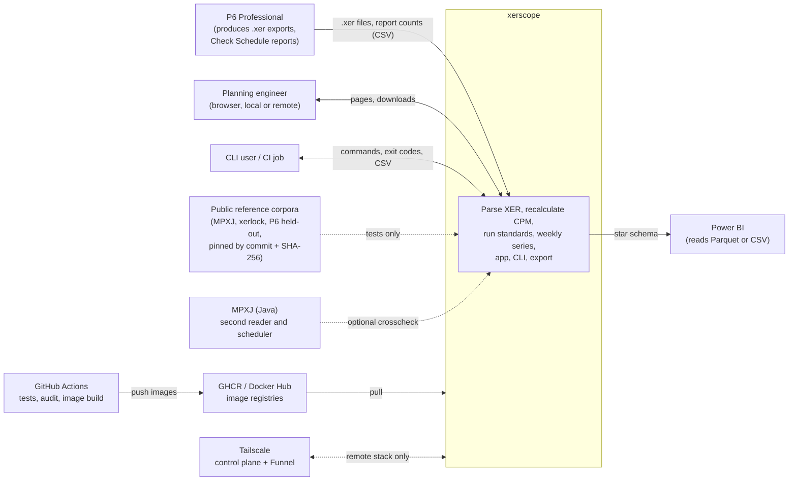
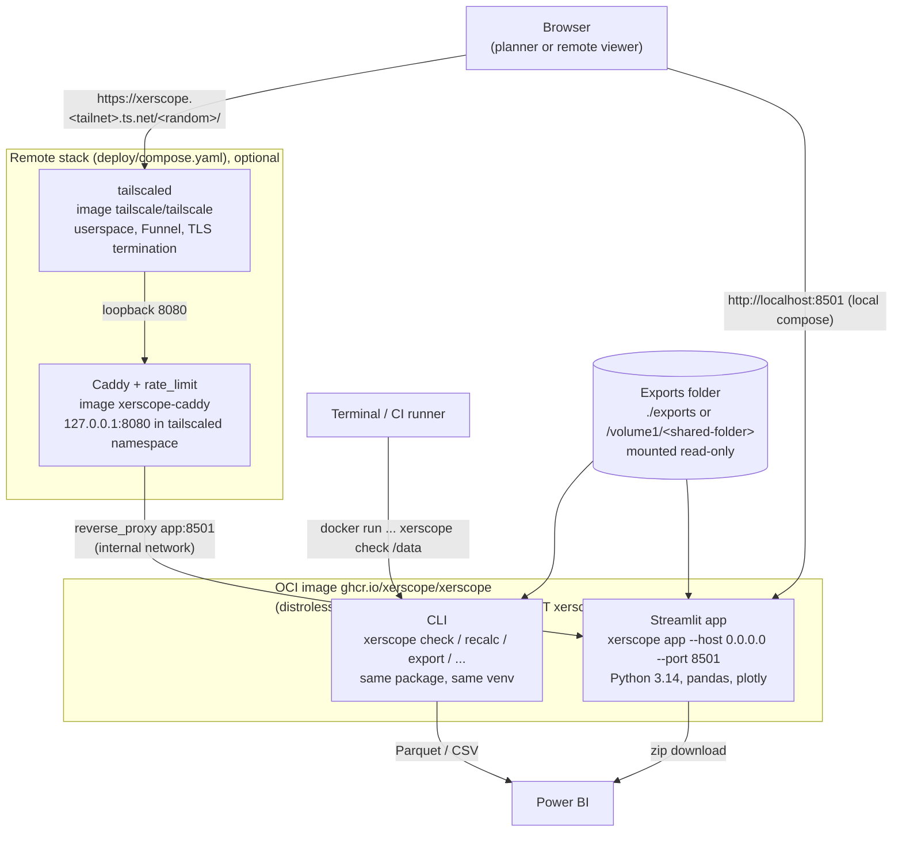

# 3. Context and scope

## 3.1 Business context

xerscope sits between the P6 export a planner produces every week and the people who need to
read it: the planner, a reviewer who compares with P6's own Check Schedule report, and a BI
analyst. It never writes back to P6 and never talks to a P6 database: its only input is the XER
file (plus optional TOML standards and a P6 Activities CSV for `pv-compare`).

| Partner | Direction | Data exchanged | Code |
|---|---|---|---|
| Planning engineer (app user) | in / out | Folder or upload of `.xer`; baseline choice; standards; reads pages; downloads CSV, zip, Power BI tables, anonymised XER | `app/state.py`, `app/views/*` |
| CLI user / CI | in / out | `xerscope check FILE --standard P6 --expect report.csv`, exit codes, CSV outputs | `cli.py` |
| Power BI (or any BI tool) | out | `dim_snapshot`, `fact_activity`, `fact_relationship`, `fact_assignment` as Parquet or CSV | `export.py` |
| P6 Professional (via exports) | in | The `.xer` file: tables `PROJECT`, `TASK`, `TASKPRED`, `TASKRSRC`, `CALENDAR`, `PROJWBS`, `SCHEDOPTIONS`, ... ; a P6 Check Schedule summary typed into a CSV; a P6 Activities view CSV | `xer/parser.py`, `cli._expect_differs`, `app/diagnostic.read_p6_export` |
| Oracle documentation, DCMA / DECM texts | reference | Cited by URL in `standards/*.toml` and `populations.STEP_SOURCES`; not fetched at run time | `standards/p6.toml`, `analysis/populations.py` |
| Public reference corpora (MPXJ, xerlock, P6-Viewer, cpp-cpm-engine, ...) | in (tests only) | Pinned by commit and SHA-256, downloaded by `tests/reference/fetch*.py`, never vendored | `tests/reference/sources.py` |
| MPXJ (Java) | in (optional) | A second XER reader and scheduler, through JPype; needs a JDK | `verify/mpxj_reader.py`, `verify/mpxj_cpm.py` |
| GitHub Actions / GHCR / Docker Hub | out | Built images `xerscope` and `xerscope-caddy`, tags `latest`, `vX.Y.Z`, `sha-<short>` | `.github/workflows/image.yml` |
| Tailscale (control plane, Funnel) | out (remote stack only) | tailscaled's own traffic; the public HTTPS name `xerscope.<tailnet>.ts.net` | `deploy/compose.yaml`, `deploy/tailscale-serve.json` |
| Remote viewer's browser | in / out | HTTPS through Funnel, basic auth, secret path prefix | `deploy/Caddyfile` |

## 3.2 C4 Level 1: system context

Solid arrows are run-time data flows; dotted arrows exist only in tests, the optional crosscheck or
the optional remote deployment.

## 3.3 Technical context

| Interface | Protocol / format | Where it is bound | Evidence |
|---|---|---|---|
| Web app | HTTP + WebSocket (Streamlit) on `localhost:8501` by default; `0.0.0.0` only by explicit `--host` | `cli._args_app`, `app/.streamlit/config.toml` (`address = "localhost"`) | README "Schedules stay on your machine" |
| Health endpoint | `GET /_stcore/health` | Container `HEALTHCHECK`, CI container job | `Dockerfile`, `tests.yml` |
| File input | Local path, folder or upload bytes (`load_snapshot(bytes, name=)`) | `xer/__init__.py` | Uploads stay in session memory, never written to disk |
| Standards input | TOML file (`load_standard`), upload (`loads_standard`), folder (`XERSCOPE_STANDARDS`) | `analysis/standards.py` | Validated on load against the rule registry |
| Export | Parquet (pyarrow) or CSV (`utf-8-sig`, `DATETIME_FMT`), optionally zipped | `export.py` | |
| Remote access | HTTPS 443 terminated by tailscaled → `127.0.0.1:8080` Caddy (basic auth, rate limit) → `app:8501` on an internal Docker network | `deploy/tailscale-serve.json`, `deploy/Caddyfile`, `deploy/compose.yaml` | No host port published |
| MPXJ | JPype JVM in-process; jar from `XERSCOPE_MPXJ_CPM_JAR` | `verify/mpxj_reader.py` `start_jvm` | Skipped without Java |

## 3.4 C4 Level 2: containers

"Container" here is the C4 term (a separately runnable unit), not only a Docker container.

| Container | Technology | Responsibility | Evidence |
|---|---|---|---|
| Streamlit app | Python 3.14, Streamlit ≥ 1.66, pandas, plotly | Sidebar loader, eleven pages, per-session caches, downloads | `app/streamlit_app.py`, `app/state.py` |
| CLI | Python `argparse`, `xerscope.cli:main` | Ten commands; `app` launches Streamlit as a subprocess from the app folder so `.streamlit/config.toml` applies | `cli.py` `COMMANDS`, `_cmd_app` |
| OCI image | Multi-stage: `ghcr.io/astral-sh/uv` build stage, `gcr.io/distroless/cc-debian13:nonroot` runtime, both pinned by digest | Ships the venv and interpreter at identical paths; `EXPOSE 8501`; `XERSCOPE_DATA=/data` | `Dockerfile` |
| Caddy | `caddy:2.11.8` + `github.com/mholt/caddy-ratelimit` built with `xcaddy` | 404 outside `/<prefix>/`, rate limit before `basic_auth`, security headers, redacted logs, proxy to `app:8501` | `deploy/caddy/Dockerfile`, `deploy/Caddyfile` |
| tailscaled | `tailscale/tailscale:v1.104.4`, `TS_USERSPACE=true` | Node identity in a named volume; Funnel on 443 proxying to `127.0.0.1:8080`; no TUN, no route, no DNS change | `deploy/compose.yaml`, `deploy/tailscale-serve.json` |

The exports folder is the only persistent input; the app writes nothing to disk (uploads stay in
`st.session_state`, tmpfs mounts hold Streamlit's own files).
