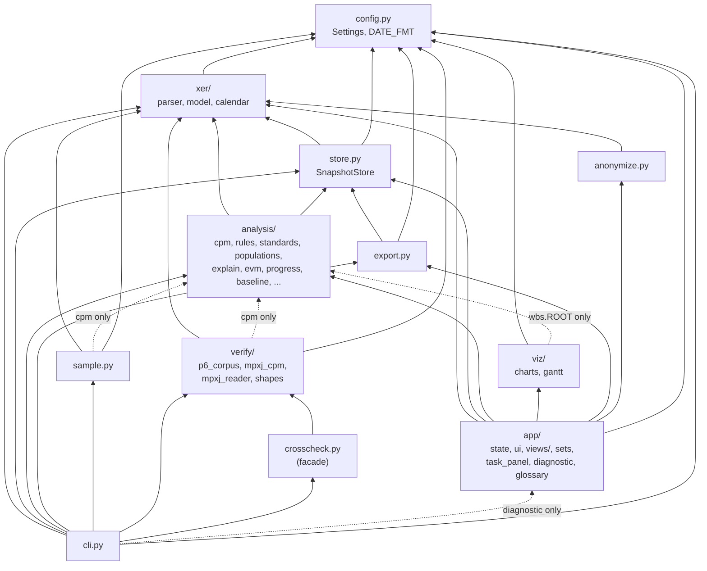

# 5. Building block view

Level 1 (the system) and Level 2 (containers) are in [03-context-and-scope.md](03-context-and-scope.md).
This section is **C4 Level 3**: the components inside the Python package `xerscope`. The authoritative
layer rule is `LAYERS` in `tests/test_architecture.py`, reproduced here verbatim:

```python
LAYERS = {  # layer -> exactly what it imports from the other layers
    "xer": {"config"},
    "store": {"xer", "config"},
    "export": {"store", "config"},
    "anonymize": {"xer"},
    "analysis": {"xer", "store"},
    "viz": {"config", "analysis.wbs.ROOT"},
    "verify": {"xer", "analysis.cpm", "config"},
    "crosscheck": {"verify"},
    "sample": {"xer", "analysis.cpm", "config"},
    "app": {"xer", "store", "analysis", "viz", "export", "anonymize", "config"},
    "cli": {"xer", "store", "analysis", "export", "sample", "verify", "crosscheck", "app.diagnostic", "config"},
}
```

The test also asserts that `app` is imported by nothing but `cli`. "Exactly" means a layer must use
every listed import and no other; the sets are an equality, not an upper bound.

## 5.1 Layer dependency diagram



Arrows point at what is imported. Dotted arrows are the narrow exceptions the test names.

## 5.2 Components

Sizes are `wc -l` at the time of writing. "Imports" lists only the cross-layer imports.

### `config.py` (17 lines)

- **Responsibility:** the few tunable defaults no standard owns.
- **Public:** `Settings(default_hours_per_day=8.0, critical_float_days=0.0, near_critical_float_days=10.0,
  table_filter_min_rows=10)`, `DEFAULT_SETTINGS`, `DATE_FMT`, `DATETIME_FMT`.
- **Imports:** none.

### `xer/` (parser 147, model 1,317, calendar 377, `__init__` 62)

- **Responsibility:** the file format (`parser.py`), what P6 means (`model.py`), working time
  (`calendar.py`).
- **Public:** `parse_bytes`, `parse_text`, `read_xer`, `decode_xer`, `RawXer`, `XerError`;
  `build_snapshot`, `read_header`, `Snapshot`, `FileHeader`, `FileBaseline`, `percent_complete`,
  `forecast_dates`, `baseline_copies`, `leveled`, constants `TASK_COLS`, `LABOR_COLS`,
  `REL_COLS_MODEL`, `ASSIGNMENT_COLS_MODEL`, `HARD_CONSTRAINTS`, `HEADER_TABLES`;
  `WorkCalendar`, `TimeAxis`, `parse_clndr_data`, `hours_to_days`; facade `load_snapshot`,
  `load_header`, `xer_files`.
- **Imports:** `config` only.
- **Note:** `Snapshot.activities` excludes WBS summary rows; `Snapshot.by_code` is the cached
  `task_code` index; `Snapshot.file_baseline` reads `sum_base_proj_id`.

### `store.py` (227)

- **Responsibility:** the weekly series, one snapshot per data date, as long-format frames.
- **Public:** `SnapshotStore` (`from_folder`, `from_paths`, `first`, `latest`, `labels`, `previous`,
  `selection`, cached `history`, `relationship_history`, `assignment_history`, `summary`),
  `DuplicateDataDate`, `HISTORY_COLS`, `REL_COLS`, `ASSIGNMENT_COLS`.
- **Imports:** `xer`, `config`.

### `analysis/` (see `docs/architecture.md` §5 for input → output of each module)

| Module | Lines | Responsibility | Main public names |
|---|---|---|---|
| `cpm.py` | 1,664 | P6-style CPM: forward, backward, floats, LOE, longest path, assignments | `schedule`, `Schedule`, `Options`, `CycleError`, `compare_with_stored`, `compare_assignments`, `critical_path_test`, `CptResult`, `FIELDS`, `FLOAT_TYPE` |
| `rules.py` | 689 | `@rule` registry, `AnalysisContext`, `RuleOutput`, `Rule`; parameterised rules for custom standards; shared helpers | `RULES`, `rule`, `AnalysisContext`, `RuleOutput`, `Rule`, `EXEMPT`, `ALLOWED`, rules `missing_logic`, `dangling`, `lag`, `relationship_type`, `constraints`, `float` (`total_float`), `duration`, `invalid_dates`, `no_resource`, `late_vs_baseline`, `bei`; helpers `link_funnel`, `share_of_type`, `late_output`, `bei_from_baseline`, `critical_path_output` |
| `standards.py` | 214 | TOML → `Standard(metrics)`, validated on load | `Metric`, `Standard`, `parse_target`, `parse_standard`, `load_standard`, `loads_standard`, `builtin_standards`, `discover_standards`, `template_text`, `UNITS`, `BUILTIN_DIR` |
| `populations.py` | 300 | The one vocabulary of exclusions and population building blocks | `EXCLUSIONS`, `Exclusion`, `Funnel`, `Step`, `STEP_SOURCES`, `activity_funnel`, `without`, `has_predecessor_in_project`, `has_successor_in_project`, `constrained_by`, `lag_flagged`, `forecast_before`, `actual_after`, `flagged_activities`, `flagged_relationships`, `predecessors_ahead` |
| `checks.py` | 243 | Run a standard: `CheckResult` per metric, score, history | `CheckResult`, `run_metric`, `run_standard`, `StandardScore`, `standard_score`, `results_frame`, `compare_counts`, `health_history`, `health_wide`, `fmt_value`, `uses_baseline` |
| `explain.py` | 249 | Read-only account of a `CheckResult` from the rule docstring and parameters | `Explanation`, `explain`, `noun`, `NOTES` |
| `audit.py` | 203 | Counted / checked / excluded sets, re-run with page settings, TOML block, calculation sheets | `AuditSets`, `split`, `sets_long`, `by_check`, `with_settings`, `choices`, `is_list`, `sheet`, `toml_block` |
| `baseline.py` | 212 | Baseline frame from a BL snapshot, planned dates or the file's Project Baseline | `Baseline` (`from_snapshot`, `planned`), `baseline_in_file`, `renumbered`, `relinked`, `COLS`, `EV_COLS`, `EV_BASES` |
| `evm.py` | 725 | PV curve, EV/AC/SPI per update, forecast, BEI series, PV comparison with a P6 export | `pv_curve`, `schedule_pct`, `planned_value_cost`, `earned`, `ev_point`, `EvPoint`, `evm_series`, `forecast_curve`, `bei_series`, `pv_p6_comparison`, `PvComparison`, `ev_technique` |
| `progress.py` | 274 | Milestone trend (MTA), PPC, progress delta | `milestone_trend`, `milestone_slips`, `committed`, `ppc_series`, `progress_delta`, `rollup_delta` |
| `changelog.py` | 359 | Two snapshots → one row per change | `changelog`, `summary`, `category_totals`, `weekly_change_counts`, `weekly_change_matrix`, `CATEGORIES` |
| `integrity.py` | 353 | INT-01..08: recalculation comparison and the P6 scheduling-log warnings | `int_01_recalculated`, `int_02_out_of_sequence_progress`, `int_03_assignments_recalculated`, `int_04_relationship_loops`, `int_05_...`, `int_06_...`, `int_07_unsatisfied_constraints`, `int_08_unsatisfied_relationships` |
| `wbs.py` | 124 | WBS tree and roll-up | `tree`, `rollup`, `subtree_ids`, `ROOT` |
| `p6/check_schedule.py` | 441 | P6 Check Schedule, 17 checks on 18 lines | `p6_01_logic` … `p6_17_dangling_finish`, `P6_HARD_CONSTRAINTS`, `SOFT_CONSTRAINTS`, `LARGE_HOURS` |
| `dcma/fourteen_point.py` | 493 | DCMA 14-Point | `dcma_01_logic` … `dcma_14_bei`, `DCMA_HIGH_DAYS`, `DCMA_SLIP_DAYS` |
| `decm/schedule_metrics.py` | 469 | DCMA DECM v8.0 Guideline 6 | `decm_06a204b_dangling_logic` … `decm_06a506c_riding_status_date`, `HIGH_FLOAT_DAYS`, `STATUS_PERIOD_DAYS` |

- **Imports:** `xer`, `store`. Never `viz`, `app` or `verify`.
- `analysis/__init__.py` imports `dcma`, `decm`, `integrity`, `p6` for their side effect: the
  `@rule` decorator registers each function in `RULES`.

### Standards data and sheets (not Python)

- `standards/p6.toml`, `dcma.toml`, `decm.toml`, `integrity.toml`, `custom-template.toml`: each
  `[[metric]]` has `id`, `name`, `rule`, `target`, optional `params`, `unit`, `group`, `source`.
- `sheets/P6/P6-01.md` … `P6-17.md`: one calculation sheet per P6 check, read by `audit.sheet`
  for the Audit page; `tests/test_sheets.py` keeps each on the TOML's target and parameters.

### `export.py` (70)

- **Responsibility:** Power BI star schema.
- **Public:** `export_tables` (`dim_snapshot`, `fact_activity`, `fact_relationship`,
  `fact_assignment`), `write_tables`, `zip_tables`, `zip_frames`, `Fmt`.
- **Imports:** `store`, `config`.

### `anonymize.py` (527)

- **Responsibility:** anonymised copies of XER files and of every table handed out.
- **Public:** `Anonymizer` (`from_raws`, `table`, `frame`, `zip_xers`, `zip_frames`, `leaks`,
  `report`), `Report`, `LeakError`, `CodeClash`, `csv_bytes`, `KEEP`, `CODES`, `LABELS`, `MONEY`.
- **Imports:** `xer` only.

### `viz/` (charts 526, gantt 218, plus `gantt.js`, `gantt.css`)

- **Responsibility:** figures and the Gantt component data; draws frames, computes no result.
- **Public:** `build_scurve`, `build_index_trend`, `build_mta`, `build_ppc`, `build_metric_trend`,
  `build_finish_trend`, `build_activity_dates`, `build_activity_float`, `STATUS`, `SERIES`,
  `NEUTRAL`, `ACCENT`; `gantt_rows`, `gantt_data`, `gantt_assets`, `categorise`, `PALETTE`.
- **Imports:** `config`, and `analysis.wbs.ROOT` only.

### `verify/` and `crosscheck.py`

- **Responsibility:** independent checks, strongest source first (`p6_corpus.p6_heldout_score`,
  `mpxj_cpm.mpxj_schedule` / `cpm_crosscheck` with `P6_SETTLED` / `UNRESOLVED`,
  `mpxj_reader.compare_file` / `compare_paths`, `shapes.difference_report`).
- **Imports:** `xer`, `analysis.cpm`, `config`. `crosscheck.py` re-exports `verify` for the CLI
  and tests. Nothing in `app` depends on it.

### `sample.py` (795)

- **Responsibility:** the demo series generator with planted findings (`generate(out_dir, weeks, seed)`).
- **Imports:** `xer`, `analysis.cpm`, `config`.

### `app/` (state 1,238, ui 555, diagnostic 679, task_panel 252, sets 109, glossary 121, views 2,092)

| Module | Responsibility | Main public names |
|---|---|---|
| `streamlit_app.py` | Declares the pages with `st.navigation`; runs `ui.apply_style()`, `sidebar_loader()`, `ui.glossary()` | — |
| `state.py` | Sidebar, Files and baseline window, per-session caches, baseline resolution, standards list, download helpers | `sidebar_loader`, `require_store`, `snapshot_picker`, `compare_picker`, `baseline_for`, `standards`, `memo`, `metric_result`, `standard_results`, `data_identity`, `page_header`, `context_banner`, `baseline_warnings`, `anonymizer`, `anonymous_exports`, `costs_shown`, `MEMO_SIZE` |
| `ui.py` | Shared look: `COLUMNS` label dictionary, `table` with filters, `kpis`, `score_cards`, `status_style`, `GANTT` component | `apply_style`, `table`, `kpis`, `column_config`, `filter_rows`, `md_text`, `fmt_date` |
| `sets.py` | Counted / checked / excluded tables and the funnel display, shared by Health and Audit | `show_sets`, `show_funnel`, `funnel_table` |
| `task_panel.py` | One activity's card, resources, logic and history | `task_from_row_id`, `card_sections`, `show_card`, `show_history` |
| `diagnostic.py` | Debug tables and the P6 export comparison (`pv-compare` reads the same frames) | `options_table`, `projects_table`, `recalculation_table`, `assignments_table`, `diagnostic_frames`, `read_p6_export`, `compare_p6_export` |
| `glossary.py` | Acronyms and their expansions | `GLOSSARY`, `acronyms`, `spelled_out` |
| `views/*.py` | One file per page: overview, gantt, activity, health, audit, changelog, earned_value, milestones, ppc, export, debug | page scripts (no public API) |

- **Imports:** `xer`, `store`, `analysis`, `viz`, `export`, `anonymize`, `config`.
- `app/.streamlit/config.toml` (themes, `address = "localhost"`, `disableDataExport = true`),
  `app/static/` (two OFL fonts), `app/style.css`.

### `cli.py` (624)

- **Responsibility:** the entry point `xerscope` (`[project.scripts]`); ten subcommands in `COMMANDS`.
- **Public:** `main(argv)`; `FAIL_ON`.
- **Imports:** every layer, including `app.diagnostic` (for `pv-compare`) and `verify` / `crosscheck`.
