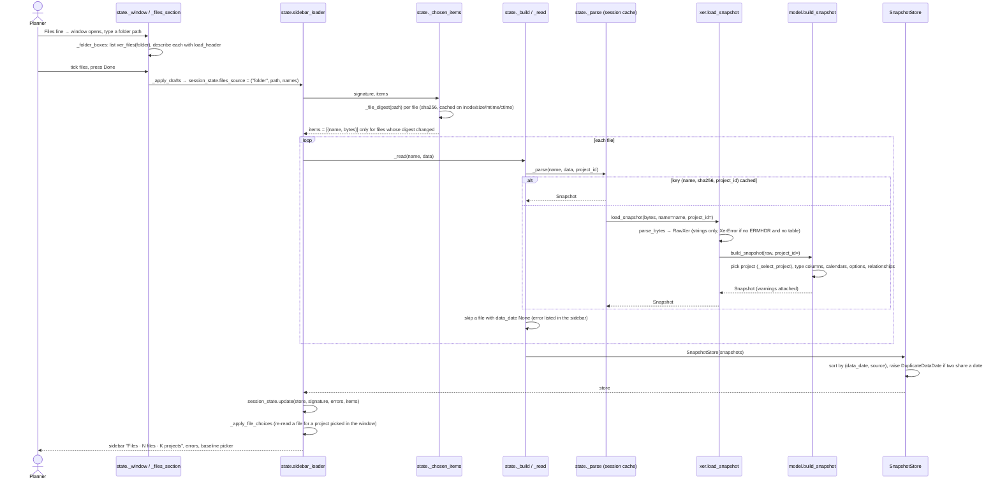
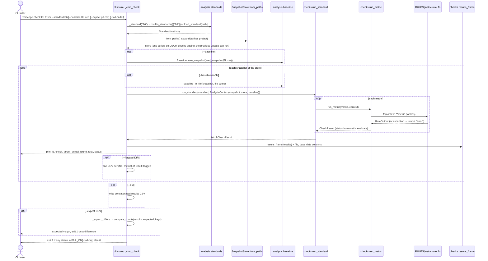
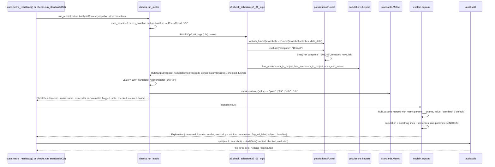
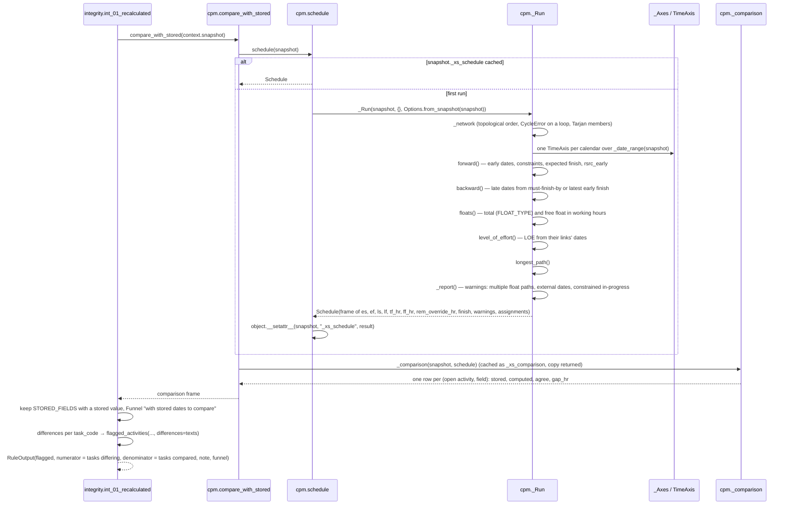
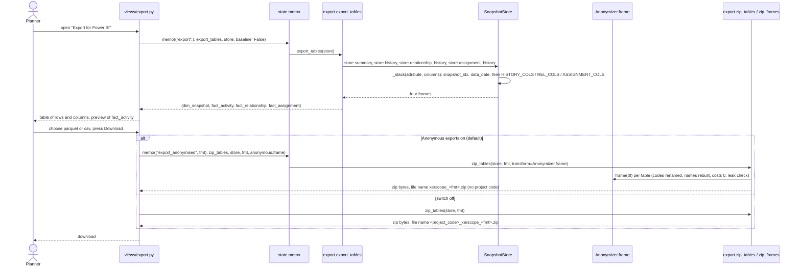

# 6. Runtime view

Five scenarios, each drawn from the code path named in the diagram. Participant names are real
modules, classes and functions.

## 6.1 Loading a folder of `.xer` into `SnapshotStore` in the app

Path: `app/state.py` (`sidebar_loader`, `_window`, `_chosen_items`, `_build`, `_read`, `_parse`),
`xer/__init__.py` (`load_snapshot`), `xer/parser.py`, `xer/model.py`, `store.py`. Nothing is read
before the user presses Done in the Files and baseline window.

Notes: `_parse` clears its dictionary past 64 entries; the key includes `project_id`, so a file
read for another of its projects is a second entry. A `DuplicateDataDate` is shown as an error with
"Untick the others."; the store stays `None`.

## 6.2 `xerscope check FILE --standard P6`

Path: `cli.main` → `_cmd_check` → `_standard` → `SnapshotStore.from_paths` → `run_standard` →
`results_frame`; optional `--expect` through `compare_counts`.

## 6.3 One rule: populations → rule → metric → explain

Example: metric `P6-01` (`rule = "p6_01_logic"`, `target = "< 5%"`). In the app the entry point is
`state.metric_result`, which wraps `run_metric` in `memo`; in the CLI it is `run_standard`.

A rule that raises gives `CheckResult(status="error", note="<ExceptionName>: <text>")`; the other
metrics still run (`checks.py` docstring). A rule whose denominator is 0 gives `"n/a"` with the
note "nothing to check" unless the rule set its own.

## 6.4 CPM recalculation and the INT-01 comparison

Path: `integrity.int_01_recalculated` → `cpm.compare_with_stored` → `cpm.schedule` → `_Run`.
The plain recalculation is cached on the snapshot object (`_xs_schedule`, `_xs_comparison`).

A `CycleError` in `schedule` is caught by INT-01 and returned as `RuleOutput(note="cannot schedule: …")`;
INT-04 reports the loop members. `critical_path_test` (DCMA-12, DECM 06A401a) runs `schedule`
again with `extra_hours` on the first open critical task and `base` = the plain schedule.

## 6.5 Power BI export

Path (app): `views/export.py` → `state.memo` → `export.export_tables` → `export.zip_tables`, through
`Anonymizer.frame` when "Anonymous exports" is on. Path (CLI): `_cmd_export` → `export.write_tables`.

The CLI path (`xerscope export FOLDER --out DIR --format parquet|csv`) writes one file per table with
`write_tables` and prints the paths; it does not anonymise (not determined from code whether that is
intended or an omission: the CLI has no `--anonymous` flag).
