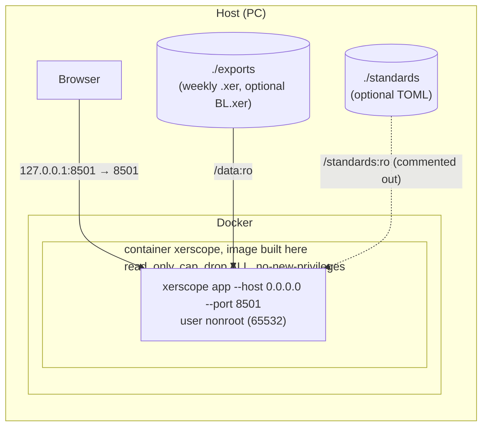
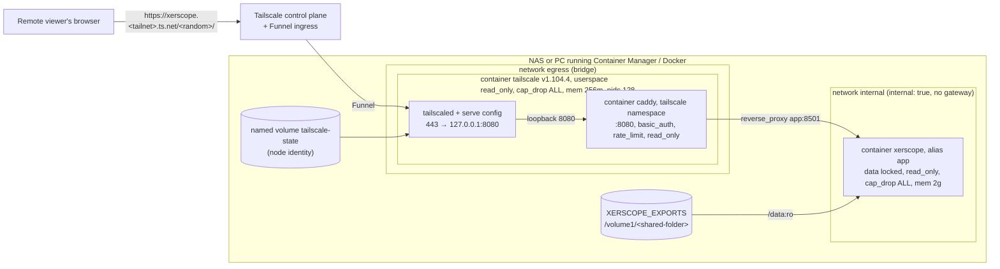
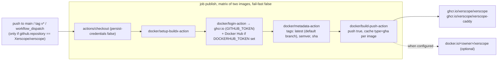

# 7. Deployment view

Three deployments exist in the repository: a developer or planner's machine (`uv run xerscope app`),
the local Docker stack (`compose.yaml`), and the remote stack behind Tailscale Funnel
(`deploy/compose.yaml`). The image both Docker stacks run is built by `.github/workflows/image.yml`.
Operator steps are in [../deploy.md](../deploy.md); this section describes the structure.

## 7.1 Local: `compose.yaml`

| Property | Value | Evidence |
|---|---|---|
| Published port | `127.0.0.1:8501:8501` only (loopback) | `compose.yaml`; `tests/test_docker.py::test_compose_publishes_on_loopback_only` |
| Volumes | `./exports:/data:ro`; `./standards:/standards:ro` commented | `compose.yaml` |
| Environment | `XERSCOPE_DATA=/data`; `XERSCOPE_BASELINE`, `XERSCOPE_STANDARDS` commented | `compose.yaml` |
| Filesystem | `read_only: true`; tmpfs `/tmp` (mode 1777) and `/home/nonroot` (mode 700), both `uid=65532,gid=65532` | `compose.yaml` |
| Capabilities | `cap_drop: [ALL]`, `security_opt: no-new-privileges:true` | `compose.yaml` |
| Restart | `unless-stopped` | `compose.yaml` |
| Health | `HEALTHCHECK` on `/_stcore/health` every 30 s, Python one-liner (no curl in distroless) | `Dockerfile` |
| Memory / PID limits | none in the local file | `compose.yaml` |

## 7.2 Remote: `deploy/compose.yaml` (Tailscale Funnel + Caddy)

| Concern | How the files handle it | Evidence |
|---|---|---|
| **Nothing published** | No `ports:` anywhere; tailscaled is on `egress` and `internal`, Caddy shares tailscaled's namespace, the app is on `internal` only (no gateway: it cannot reach the internet) | `deploy/compose.yaml` `networks`; `tests/test_docker.py::test_funnel_stack_publishes_nothing_on_the_host` |
| **TLS** | Terminated by tailscaled (Funnel); Caddy has `auto_https off`, `admin off`, `default_bind 127.0.0.1` | `deploy/tailscale-serve.json`, `deploy/Caddyfile` |
| **Authentication** | `basic_auth {$XERSCOPE_USER} {$XERSCOPE_PASSWORD_HASH}` (bcrypt cost 10) inside `handle_path /{$XERSCOPE_PATH}/*`; `respond 404` for every other path, before authentication | `deploy/Caddyfile`, `docs/deploy.md` §3 |
| **Rate limit** | `rate_limit` zone `per_visitor`, key `{client_ip}`, `ipv6_prefix 64`, 120 events per minute, runs before `basic_auth` | `deploy/Caddyfile`; CI job `deploy` checks a 429 |
| **Headers** | `Referrer-Policy no-referrer`, `X-Content-Type-Options nosniff`, `Content-Security-Policy "frame-ancestors 'self'"`, `Strict-Transport-Security`, `Permissions-Policy`; `header -Server`; downloads `Cache-Control no-store` | `deploy/Caddyfile` |
| **Logs without secrets** | Access and error logs replace the prefix with `<prefix>` in request line, Referer and Location; delete `Sec-Websocket-Protocol` (Streamlit XSRF token) and `Content-Disposition` (file name carries the project code) | `deploy/Caddyfile` global and site `log` blocks; `tests/test_docker.py::test_caddy_error_log_redacts_the_secret_prefix` |
| **Secrets** | Only `${VAR}` interpolation in the compose file; `.env` holds `TS_AUTHKEY` (first start only, `TS_AUTH_ONCE`), `XERSCOPE_USER`, `XERSCOPE_PASSWORD_HASH`, `XERSCOPE_PATH`, `XERSCOPE_EXPORTS`, optional `XERSCOPE_UID/GID`, `XERSCOPE_IMAGE`, `XERSCOPE_CADDY_IMAGE`, `XERSCOPE_MEM_LIMIT` | `deploy/.env.example`; `tests/test_docker.py` asserts no key or hash literal in the compose file |
| **Read-only, non-root** | All three containers `read_only: true`, `cap_drop: [ALL]`, `no-new-privileges`; Caddy adds back `NET_BIND_SERVICE` because its binary carries that file capability | `deploy/compose.yaml`; `tests/test_docker.py::test_sidecars_hardened` |
| **Resource bounds** | `mem_limit` and `pids_limit` on each container; every tmpfs has a `size=`; no CPU quota on purpose (Docker refuses one on a kernel without CFS bandwidth control) | `deploy/compose.yaml` comments; `tests/test_docker.py::test_funnel_stack_bounds_what_it_takes_from_the_nas` |
| **Visitor restrictions** | `XERSCOPE_DATA_LOCKED=true` (no path field, no XER upload), `STREAMLIT_SERVER_MAX_UPLOAD_SIZE=1` (a TOML only), `STREAMLIT_CLIENT_SHOW_ERROR_DETAILS=none` | `deploy/compose.yaml`; `app/state.py` `_data_locked` |
| **Upstream name** | Caddy proxies to `app:8501` (network alias), not to `xerscope`, which in the shared namespace resolves to the tailscale container | `tests/test_docker.py::test_caddy_upstream_is_not_shadowed_by_the_tailscale_hostname` |

## 7.3 Image build pipeline (`.github/workflows/image.yml`)

| Matrix entry | Context | Dockerfile | Stages |
|---|---|---|---|
| `xerscope` | `.` | `Dockerfile` | `ghcr.io/astral-sh/uv:0.13.6-trixie-slim@sha256:…` builds a uv-managed CPython 3.14 and the locked venv (`uv sync --locked --no-dev`, twice: dependencies first, then the project); pip removed from the managed CPython; `gcr.io/distroless/cc-debian13:nonroot@sha256:…` runtime |
| `xerscope-caddy` | `deploy/caddy` | `deploy/caddy/Dockerfile` | `caddy:2.11.8-builder` runs `xcaddy build --with github.com/mholt/caddy-ratelimit@<pseudo-version>`; `caddy:2.11.8` runtime; build fails if `http.handlers.rate_limit` is not listed |

Permissions: `contents: read`, `packages: write`. The `tests.yml` `container` job builds the same
Dockerfile with `load: true`, starts it with the demo data, checks `/_stcore/health` and runs Trivy;
the `deploy` job builds the Caddy image, validates the Caddyfile, starts tailscaled and Caddy from
`deploy/compose.yaml`, and checks 404 / 401 / 502 / 429 and the redacted log.

## 7.4 Supply-chain controls

| Control | Where | What it covers |
|---|---|---|
| GitHub Actions pinned to a 40-hex commit SHA, tag in a comment | every `uses:` in `tests.yml`, `image.yml`, `attribution.yml`; `tests/test_docker.py::test_ci_cannot_pass_by_skipping_its_evidence` asserts the pattern | A moved tag cannot change the action that runs |
| Base images pinned by digest (`@sha256:`) | `Dockerfile` (both `FROM` lines) | A moved tag cannot change the base image |
| Images pinned by tag only | `deploy/compose.yaml` (`tailscale/tailscale:v1.104.4`), `deploy/caddy/Dockerfile` (`caddy:2.11.8-builder`, `caddy:2.11.8`) | Listed as debt in `docs/backlog.md`; see section 11 |
| Dependabot weekly: uv (pyproject + lock), github-actions, docker (`Dockerfile`), docker-compose (`deploy/`), docker (`deploy/caddy`, group `caddy`) | `.github/dependabot.yml` | Tag and digest proposed together; the `caddy-ratelimit` pseudo-version is bumped by hand |
| Go module checksum database | `deploy/caddy/Dockerfile` comment: `xcaddy` verifies the module against sum.golang.org | A rewritten commit fails the build |
| `uv.lock` + version floors; `uv sync --locked` in CI and image | `pyproject.toml`, `Dockerfile`, workflows | Reproducible installs; floors protect installs that ignore the lock |
| `pip-audit` against OSV and PyPI advisories, on `uv export --locked --all-extras --all-groups` | `tests.yml` job `audit` | Known CVEs in every locked dependency, dev tools included |
| `bandit -r src -ll` | `tests.yml` job `audit` | Medium and high severity findings in the source |
| Trivy on the app image, the Caddy image and the Tailscale image, `HIGH,CRITICAL`, `ignore-unfixed`, `exit-code 1` | `tests.yml` jobs `container` and `deploy` | OS packages and Python wheels; Caddy exceptions dated in `deploy/caddy.trivyignore.yaml` (one entry at the time of writing, expiring 2026-12-02) |
| Weekly scheduled run (Monday 05:17 UTC) | `tests.yml` `schedule` | Newly published CVEs caught without a push |
| `XERSCOPE_REQUIRE=reference,p6-corpus[,mpxj]` | `tests.yml`, `tests/conftest.py` `missing` | A job cannot go green by skipping its evidence |
| No tracked data file | `tests.yml` `lint`: `! git ls-files \| grep -iE '\.(xer\|parquet\|xlsx?\|csv)$'` | The repository stays free of schedules |
| `persist-credentials: false` on every checkout; `permissions: contents: read` by default | all workflows | Least privilege |
| Build context limited to `src/` | `.dockerignore` (`*` then `!src/`); `tests/test_docker.py::test_build_context_holds_only_the_package` | No test data or secret in the image |
| Image labels carry the commit (`org.opencontainers.image.revision`) | `docker/metadata-action` labels; `docs/deploy.md` §2 | A running image can be traced to its commit |

Not present (recorded in `docs/backlog.md` and section 11): SBOM attestation, provenance
attestation and image signing in `image.yml`.

## 7.5 Developer machine

`uv sync --locked` then `uv run xerscope app --data <folder>`: Streamlit listens on `localhost:8501`
(`app/.streamlit/config.toml` `address = "localhost"`), the CLI runs Streamlit from the app folder
so the packaged config applies. The optional `crosscheck` extra needs a JDK 21 or 25 on `PATH`.
Windows is supported (CI runs `windows-latest` on the Monday matrix and for the MPXJ crosscheck).
