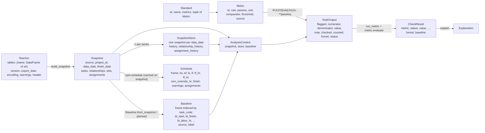
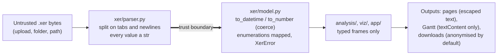

# 8. Cross-cutting concepts

Concepts that apply across building blocks. Each points at the code that implements it;
[../formulas.md](../formulas.md) holds the formulas themselves.

## 8.1 Domain model

**Snapshot contract.** `xer/model.py` declares the minimum columns of each frame: `TASK_COLS` plus
`LABOR_COLS` for `tasks`, `REL_COLS_MODEL` for `relationships`, `ASSIGNMENT_COLS_MODEL` for
`assignments`; `_check_snapshot_columns` raises `XerError` when one is missing. The store's
`HISTORY_COLS`, `REL_COLS` and `ASSIGNMENT_COLS` must be subsets (`tests/test_store.py`). Frames may
carry more columns: the lists are a floor, not a filter.

**Identity.** `task_code` (Activity ID) identifies an activity across weeks; `task_id` resolves
relationships inside one file only and is dropped from the history. A predecessor in another project
of the same file is named `[ext]{task_id}` in `pred_code` so it cannot collide with a local ID.

**Units.** Hours in `*_hr` / `*_hr_cnt`; working days of the activity's own calendar in `_d`
columns (`hours_to_days(hours, day_hr_cnt)`); percentages 0–100; the standards express their
thresholds in whichever unit their text uses (`Metric.unit ∈ UNITS = {"%", "ratio", "count",
"days", "pass/fail"}`).

**Status words.** Boolean columns on `activities`: `is_complete`, `is_started`, `is_milestone`,
`is_start_milestone`, `is_loe`, `is_critical`, `on_longest_path`, `has_hard_constraint`,
`has_external_pred`, `has_external_succ`, `is_wbs_summary` (`docs/formulas.md` §1.2).

**Populations.** `EXCLUSIONS` is the single vocabulary (`complete`, `complete_before_data_date`,
`started`, `loe`, `milestones`, `no_duration`); a `Funnel` records each step with its label, its
source key (`STEP_SOURCES`) and the rows it removed.

## 8.2 Time model

- `WorkCalendar` (frozen dataclass): working intervals per weekday plus dated exceptions, parsed
  from the `CALENDAR.clndr_data` tree; without a blob, the work week is inferred from
  `week_hr_cnt / day_hr_cnt` (`from_data=False`). `WorkCalendar.standard()` is Monday–Friday on
  `Settings.default_hours_per_day`.
- `TimeAxis`: a calendar laid on an absolute minute axis with cumulative work (`cum`), built with
  numpy `searchsorted`. `work(ts)` is monotone and continuous; `at(w, finish)` is its inverse with
  P6's two conventions (a start is the beginning of a period, a finish the end of one). The axis
  grows on demand (`_grow`) and work values stay anchored on the first origin, so a value computed
  before the axis grew stays valid.
- `Snapshot.work_hours`, `working_days`, `project_working_days`, `activity_working_days` route
  every date difference through the right calendar. "I'll use calendar days, it's close enough" is a
  listed red flag (`CONTRIBUTING.md`).
- Lags: `lag_hr` as stored; `lag_d` converted on the predecessor's calendar; in the CPM the lag runs
  on the calendar `SCHEDOPTIONS.sched_calendar_on_relationship_lag` names (successor when blank).
- Known limit: `TimeAxis.at` rounds half minutes to even, so sub-minute durations can land on either
  side (`docs/backlog.md`, CPM section).

## 8.3 Error handling and warnings

| Situation | Mechanism | Where it surfaces |
|---|---|---|
| Not an XER (no `ERMHDR`, no table); a required column missing | `XerError(ValueError)` | CLI exits with the message; the app lists it under the sidebar and skips the file (`state._build`) |
| Two files share a data date | `DuplicateDataDate(ValueError)` | `cli.main` → `SystemExit`; app error "Untick the others." |
| Relationship loop | `CycleError(ValueError)` with `members` | INT-01 returns a note; INT-04 lists the members; `critical_path_test` returns `CptResult` via `_cycle_failure` |
| A rule raises anything | caught in `run_metric` → `CheckResult(status="error", note="<Type>: <text>")` | the other checks still run; the page shows the error under the check |
| A standard file is malformed | `ValueError` from `parse_standard` / `Rule.validate` | refused before any check runs; `discover_standards` collects errors by file |
| Data read with a caveat | `warnings: list[str]` on `RawXer`, `Snapshot`, `SnapshotStore`, `Schedule` | sidebar warnings, Debug page, CLI `recalc` prints `warning:` lines |
| A field cannot be typed | `pd.to_datetime(..., errors="coerce")`, `pd.to_numeric(..., errors="coerce")` → NaN / NaT | counted as missing by the rules; not yet counted in warnings (`docs/backlog.md`, Parser) |
| An anonymised output still holds an original text | `LeakError` / `CodeClash` | the download is refused (`extract.refused`), never handed out |
| No Java / no reference files | `conftest.missing` → skip, or fail when `XERSCOPE_REQUIRE` names it | test report |

Python's `logging` module is not used in `src/xerscope` (no `getLogger` call); diagnostics are
return values (`warnings` lists, `note` strings) and `print` in the CLI. Streamlit's own server log
is the only process log.

## 8.4 Caching and session state

| Cache | Key | Scope and eviction | Code |
|---|---|---|---|
| Parsed snapshots | `(name, sha256(bytes), project_id)` | `st.session_state["_parsed"]`; cleared past 64 entries | `state._parse` |
| File headers for the folder picker | `(path, size, mtime_ns)` | session | `state._header` |
| Folder file digests | `(inode, size, mtime_ns, ctime_ns)` | session | `state._file_digest` |
| Analyses | `data_identity(baseline, ev_basis) + key` where `data_identity` = files signature, projects read, baseline identity, EV basis | `st.session_state["_memo"]`, LRU of `MEMO_SIZE = 128`; `keep=False` computes without storing | `state.memo` |
| One check result | `("metric", repr(metric), snapshot.source, data_date)`, `ev_basis=False` | through `memo`; Health, Audit and the BEI series share it | `state.metric_result`, `standard_results_held` |
| Plain CPM schedule and its comparison | attribute on the `Snapshot` object (`_xs_schedule`, `_xs_comparison`) | lives as long as the snapshot; shared by INT-01, INT-03, the critical path test, Debug | `cpm.schedule`, `cpm.compare_with_stored` |
| Store frames | `functools.cached_property` | per `SnapshotStore` instance | `store.py` |
| Calendar axis | `WorkCalendar._axis` | per calendar object, grown on demand | `xer/calendar.py` |
| Built downloads | `data_identity` tag; offered again only for the same identity | session (`hold` / `held` / `fetch`) | `state.py` |

No `st.cache_data` / `st.cache_resource` process-wide cache is used for file content, so one
session's schedules are never visible to another and vanish with the session.

## 8.5 Security model

- **Trust boundary at the parser.** The parser knows the format only; nothing in a file is
  evaluated, imported or rendered as HTML. `SECURITY.md`: "a crafted `.xer` must not do more than
  fail to load".
- **No `eval`, no shell, no network from file content.** `gantt.js` holds no network call and sets
  text with `textContent` (checked by a test, `docs/architecture.md` §6). The task card escapes
  text (`task_panel.card_html`); `ui.md_text` escapes Markdown specials. `task_from_row_id` accepts an
  `a:` prefix and at most `MAX_ID = 200` characters.
- **Nothing written to disk by the app.** Uploads stay in session memory; the container runs
  `read_only` with tmpfs for Streamlit's own files.
- **Network.** `localhost` by default; `0.0.0.0` only inside a container whose port is published on
  loopback or not at all. The remote stack adds Funnel, Caddy basic auth, a secret prefix, a rate
  limit and security headers (section 7).
- **Secrets never logged.** `TS_AUTHKEY`, the password hash and `XERSCOPE_PATH` are environment
  variables; Caddy's logs redact the prefix and drop the XSRF token; `tests/test_docker.py` pins
  these. Streamlit's `disableDataExport = true` removes table-level CSV export and clipboard copy.
- **Anonymisation by default.** `anon_exports` toggle on; codes are HMAC-SHA256 under a per-session
  key; every output field is checked against the originals' text (`Anonymizer.leaks`).
- **Supply chain.** Section 7.4.

## 8.6 Configuration

| Source | Items | Read by |
|---|---|---|
| `config.Settings` | `default_hours_per_day`, `critical_float_days`, `near_critical_float_days`, `table_filter_min_rows` | `build_snapshot`, `viz/gantt.categorise`, `ui.table` |
| `XERSCOPE_DATA` | folder preloaded in the app (`--data`), `/data` in the image | `cli._cmd_app`, `state._files_section` |
| `XERSCOPE_BASELINE` | baseline file path (`--baseline`) | `cli._cmd_app`, `state._baseline_options` |
| `XERSCOPE_STANDARDS` | folder of extra TOML standards (`--standards`) | `cli._cmd_app`, `state.standards` |
| `XERSCOPE_DATA_LOCKED` | `1`/`true`/`yes`: no path field, no XER upload | `state._data_locked` |
| `XERSCOPE_MPXJ_CPM_JAR` | path of the MPXJ scheduler jar | `verify/mpxj_reader.py`, `cli`, `tests/conftest.py` |
| `XERSCOPE_REQUIRE` | `reference,p6-corpus,mpxj`: skip becomes fail | `tests/conftest.py` |
| `XERSCOPE_UPDATE_GOLDEN` | rewrite `tests/golden/standards.json` (the run fails by design) | `tests/test_characterization.py` |
| `STREAMLIT_*` | `SERVER_FILE_WATCHER_TYPE=none` (image), `SERVER_MAX_UPLOAD_SIZE`, `CLIENT_SHOW_ERROR_DETAILS` (remote) | Streamlit |
| `app/.streamlit/config.toml` | themes, `address = "localhost"`, XSRF on, `enableStaticServing`, `toolbarMode = "viewer"`, `disableDataExport` | Streamlit, applied because `xerscope app` runs from the app folder |
| Standards TOML | targets, units, parameters, sources | `analysis/standards.py` |
| Deployment `.env` | section 7.2 | Compose interpolation |

## 8.7 User interface concepts

Pages compose analyses and figures and compute nothing (`CONTRIBUTING.md` table; some computation
remains in views, listed in `docs/backlog.md` Structure). One column-label dictionary (`ui.COLUMNS`)
maps internal names to P6 labels (`task_code` → "Activity ID"). Status colours (red / amber / green)
are reserved for status; charts and Gantt derive their colours from `viz/charts.py`. Every page opens
with a context banner (`state.page_header`) naming the projects read, the update shown, the baseline
source, the EV basis and the file count. Every check shows its explanation (`explain.py`) and, on
the Audit page, its funnel and sets.

## 8.8 Internationalisation

None. The UI, the docs and the glossary are English; dates are ISO 8601; the sample project name
deliberately carries an en dash and an accent to exercise cp1252 decoding (`sample.PROJECT_NAME`).
No locale or translation mechanism exists in the code.

## 8.9 Testing strategy

| Layer of evidence | Tool | What it pins |
|---|---|---|
| Hand-built schedules | `tests/xerkit.py` (tiny XERs built in code, numeric ids, full calendars) | One behaviour per test with the expected count written by hand |
| Rule tests | `tests/test_rules.py`, `test_p6_check_schedule.py`, `test_calendar_and_standards.py`, `test_explain.py`, `tests/rulekit.py` | Each check where P6 and DCMA differ; one quoted sentence of the help per test |
| Characterisation | `tests/test_characterization.py` + `tests/golden/standards.json` | Every metric of every built-in standard on the demo and reference files; a refactor changes no number |
| Real P6 exports | `tests/test_cpm.py`, `tests/test_reference.py`, `tests/reference/sources.py` (pinned commit + SHA-256) | Dates, floats, longest path and assignments to the minute; third-party stated results |
| Held-out P6 corpus | `tests/test_p6_heldout.py` (`FLOORS` per set, never lowered), `verify/p6_corpus.py` | Share of values identical to P6 23.12.1; one witness activity per engine rule |
| Second engine | `tests/test_crosscheck_mpxj.py`, `verify/mpxj_cpm.py` (`P6_SETTLED`, `UNRESOLVED`) | Random networks, hand cases, demo, P6 files |
| Property tests | `tests/test_cpm_properties.py` (seeded random networks) | Relationships hold on early and late dates; no negative float unconstrained; delaying never advances the finish |
| App | `tests/test_app.py`, `test_app_cache.py`, `test_app_parity.py` (Streamlit `AppTest`) | Every page renders headless; downloads anonymised by default; cache identity |
| Architecture | `tests/test_architecture.py` | Layer imports equal `LAYERS` |
| Deployment | `tests/test_docker.py` | Loopback only, non-root, no published port, no secret in the files |
| Local only | `tests/test_p6_witness.py` | Anonymised real schedules against P6 reports, never committed, skipped in CI |

The verification gate (`CONTRIBUTING.md`): `uv sync --locked`, fetch the reference files, `pytest -rs`,
`ruff check`, `bandit -r src -ll`, then the targeted suites for what changed.
