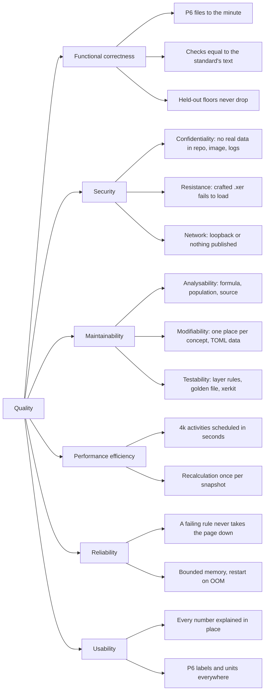

# 10. Quality requirements

The quality goals of section 1 are refined here into a quality tree (ISO/IEC 25010 vocabulary) and
concrete scenarios. Each scenario names the test or mechanism that holds it; where a figure is
measured rather than asserted, the source of the measurement is given.

## 10.1 Quality tree

## 10.2 Scenarios

### Functional correctness

| ID | Scenario | Response measure | Held by |
|---|---|---|---|
| FC-1 | A P6-scheduled export (every early/late date and float stored) is recalculated | Every stored early/late date, total and free float identical to the minute; assignments' remaining dates identical | `tests/test_cpm.py` on the pinned P6 exports (`tests/reference/sources.py`) |
| FC-2 | The engine runs on the held-out corpus scheduled by P6 Professional 23.12.1 | Share of identical values per set ≥ `FLOORS[set]` (30 sets; several at 1.00, lowest 0.72 at the time of writing); no `error` rows | `tests/test_p6_heldout.py`, `verify/p6_corpus.py` |
| FC-3 | A planner runs `xerscope check FILE --standard P6 --expect report.csv` with counts typed from P6's Check Schedule summary | `compare_counts` reports zero differences; exit code 0 | `cli._expect_differs`; `tests/test_p6_checksched.py` (synthetic project checked by P6 Professional 26.8, every line asserted) |
| FC-4 | A check is parameterised differently by two standards (P6-06 in hours vs DCMA-06 in working days) | Both counts match their source's reading on the same hand-built schedule | `tests/test_rules.py`, `tests/test_p6_check_schedule.py` (one quoted sentence of the help per test) |
| FC-5 | A refactor touches `analysis/` | No number changes in `tests/golden/standards.json` across demo, demo-planned, demo-first-as-baseline and reference sections | `tests/test_characterization.py` |
| FC-6 | A seeded random network with every link type, lags and leads is scheduled | Every relationship holds on early and late dates; unstarted tasks last their remaining duration; unconstrained single-calendar network has no negative float | `tests/test_cpm_properties.py` (60 seeds) |
| FC-7 | The same file is read by xerscope and by MPXJ | Table-level agreement on the reference files and the demo; CPM differences either in `P6_SETTLED` or named in `UNRESOLVED` | `tests/test_reference.py`, `tests/test_crosscheck_mpxj.py` (CI job `crosscheck`, Java 21 and 25) |
| FC-8 | Anonymised copies of the demo series and P6 exports are analysed | Same dates, floats and check results as the originals | `tests/test_anonymize.py` |

### Security

| ID | Scenario | Response measure | Held by |
|---|---|---|---|
| S-1 | A crafted file with no `ERMHDR` and no table is loaded | `XerError`, nothing executed; the app lists the error and skips the file | `xer/parser.py` `parse_text`; `state._build` |
| S-2 | A file holds a tab or line break inside a text value, a row with extra fields, undecodable bytes | Rows padded or truncated with a warning; lossy decode warned; no exception escapes the parser | `tests/test_parser.py`; known gap: fields can shift without warning (`docs/backlog.md`) |
| S-3 | An activity name holds HTML or Markdown | Rendered as text: `textContent` in the Gantt, `md_text` escaping in tables, escaped card HTML | `viz/gantt.js`, `ui.md_text`, `task_panel.card_html`; test on `gantt.js` holding no network call |
| S-4 | A download is prepared with "Anonymous exports" on | No original code, name, user, file name or free text in any field; otherwise the download is refused | `Anonymizer.leaks`, `LeakError`; `tests/test_app.py`, `tests/test_anonymize.py` |
| S-5 | Someone greps the repository for a schedule | No `.xer`, `.parquet`, `.csv`, `.xlsx` tracked | CI `lint` step in `tests.yml` |
| S-6 | The local stack is started | Port 8501 bound to `127.0.0.1` only; `read_only`, `cap_drop ALL` | `tests/test_docker.py::test_compose_publishes_on_loopback_only` |
| S-7 | The remote stack is started on a NAS | No host port; app on an internal network with no gateway; secrets only from `.env`; prefix absent from Caddy's logs; 404 outside the prefix before auth, 401 inside, 429 over 120 requests/min | `tests/test_docker.py`; CI job `deploy` |
| S-8 | A dependency or action publishes a CVE | Monday run of `pip-audit` (OSV + PyPI), Trivy on three images, Dependabot PRs | `tests.yml` jobs `audit`, `container`, `deploy`; `.github/dependabot.yml` |

### Maintainability

| ID | Scenario | Response measure | Held by |
|---|---|---|---|
| M-1 | A reviewer wants to know why an activity is counted by P6-01 | The Audit page shows the funnel step by step with the Oracle text each step follows, the counted / checked / excluded sets, the effective parameters and the calculation sheet | `populations.Funnel`, `audit.split`, `audit.sheet`, `sheets/P6/P6-01.md` |
| M-2 | A company wants its own standard | A TOML file composed of parameterised rules, validated on load, listed by `xerscope standards --rules`; no Python | `standards/custom-template.toml`, `analysis/standards.py`, `Rule.validate` |
| M-3 | A developer adds an import from `viz/` to `analysis/evm.py` | `tests/test_architecture.py` fails naming the layer | `LAYERS` |
| M-4 | A developer changes the CPM for one shape | The P6 files, the held-out floors and the MPXJ crosscheck all run; a lowered floor fails; the settling source is recorded in `docs/cpm.md` | `CONTRIBUTING.md` "Changing the CPM engine" |
| M-5 | A new behaviour is needed and no source settles it | Written down as an open question (`UNRESOLVED`, `docs/cpm.md` "Conventions no reference file settles", `docs/backlog.md`), not guessed | `CONTRIBUTING.md` rule 2 |

### Performance efficiency

| ID | Scenario | Response measure | Held by |
|---|---|---|---|
| P-1 | A 4,217-activity, 7,586-link, 2,278-assignment P6 export is recalculated | About 2 s (measured, `docs/cpm.md` "Performance"); the target "< 3 s" is a reading of that figure, not a test assertion | not asserted by a test (not determined from code) |
| P-2 | INT-01, INT-03, the critical path test and the Debug page run on one snapshot | One plain recalculation; the critical path test adds one more run | `cpm.schedule` cache on the snapshot |
| P-3 | A 15,000-activity Gantt is scrolled | Only the rows in view are in the page; WBS rows open and close without a rerun | `viz/gantt.js`, `docs/architecture.md` §6 |
| P-4 | A folder is re-read after one file changed | Only the changed file's bytes are read and parsed again (digest cached on inode, size, mtime, ctime) | `state._chosen_items`, `_file_digest` |
| P-5 | A 43 MB synthetic export (97,121 activities) is loaded | About 0.95 GB at parsing peak, 0.75 GB per further file held (measured, `docs/deploy.md` §7); the remote cap `XERSCOPE_MEM_LIMIT` defaults to 2g | measured, not asserted |

### Reliability

| ID | Scenario | Response measure | Held by |
|---|---|---|---|
| R-1 | One rule raises on a file | That check shows status `error` with the exception text; every other check runs | `checks.run_metric` |
| R-2 | A file has a relationship loop | INT-01 notes "cannot schedule", INT-04 lists the loop members, the critical path test returns a failed `CptResult`; no page crashes | `cpm.CycleError`, `integrity.int_04_relationship_loops` |
| R-3 | The remote app exceeds its memory cap | The kernel kills that container alone; Docker restarts it (`restart: unless-stopped`) | `deploy/compose.yaml` |
| R-4 | Two files share a data date | `DuplicateDataDate` names them; the user keeps one | `store.SnapshotStore.__init__` |

### Usability

| ID | Scenario | Response measure | Held by |
|---|---|---|---|
| U-1 | A planner reads a failed check | Formula with the actual numbers, verdict against the target, population, parameters and source under the check | `explain.explain`, Health page |
| U-2 | A planner opens any page | A context banner names the projects read, the update shown, the baseline source, the EV basis and the file count | `state.page_header`, `context_banner` |
| U-3 | A planner switches the browser theme | Charts and Gantt follow without a rerun; status colours stay red / amber / green | `app/.streamlit/config.toml`, `viz/charts.py`, `viz/gantt.css` |
