# Fiche formules

English: [Formula sheet](formula-sheet.md)

Cette fiche liste tous les chiffres que calcule xerscope : pour chacun, sa formule, la population
sur laquelle il est calculé, son unité et son calendrier, sa cible et sa source. C'est la vue
compacte des calculs. La référence longue, les sources des standards et le moteur de calcul ont
leurs propres documents, listés dans [Documents associés](#documents-associés) de cette fiche.

Les noms de fichiers et de fonctions renvoient à `src/xerscope/`. Quand cette fiche et le code
diffèrent, c'est le code qui a raison.

## Comment lire cette fiche

La fiche comporte une partie par famille de chiffres : les contrôles des standards et leur score, le
recalcul, les analyses de la série dans l'ordre des pages **Analysis** (Analyse) de l'application,
puis les chiffres des pages **Overview** (Vue d'ensemble) et **Gantt & WBS** (Gantt et WBS). Chaque
calcul fait l'objet d'une entrée, et chaque entrée a les mêmes champs dans le même ordre.

### Carte des calculs

Le schéma suivant montre ce que xerscope lit dans un export P6 et quelles familles de chiffres
chaque objet alimente.

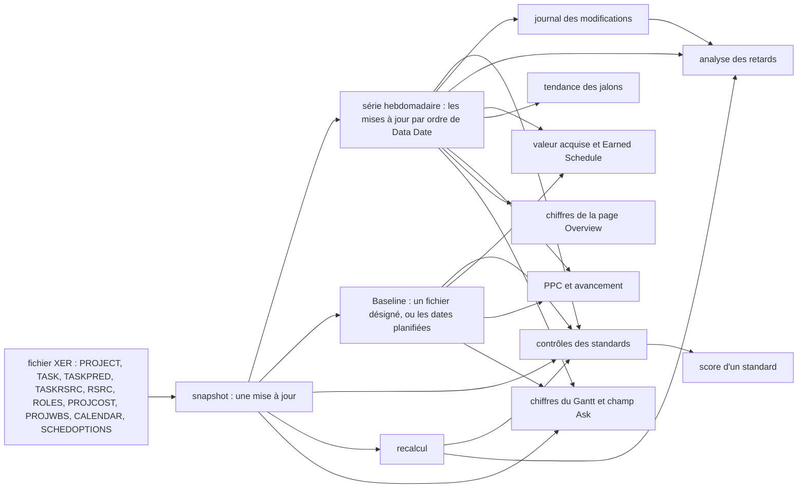

Le tableau 1 reprend le même contenu sous forme de texte.

Tableau 1. Ce que lit chaque famille de chiffres

| Famille | Lit | Partie de cette fiche |
|---|---|---|
| Contrôles d'un standard | une mise à jour ; la Baseline (planning de référence) pour les contrôles qui s'y comparent ; la série pour les trois contrôles DECM qui se comparent à une mise à jour antérieure ; le recalcul pour DCMA-12, 06A401a, INT-01, INT-03, INT-07 et INT-08 | P6 Check Schedule (vérification du planning), DCMA DECM v8.0, DCMA 14-Point, Integrity, Règles pour un standard personnalisé |
| Score d'un standard | les statuts des contrôles d'un standard sur une mise à jour | Score des standards |
| Recalcul | une mise à jour : activités, relations, affectations, calendriers, options de calcul du planning | Recalcul |
| Journal des modifications | deux mises à jour | Journal des modifications |
| Analyse des retards | deux mises à jour, leur journal des modifications et leur recalcul ; la série pour le tableau de toutes les mises à jour | Analyse des retards |
| Valeur acquise et Earned Schedule (méthode du délai acquis) | une mise à jour et sa Baseline ; la série pour les gains hebdomadaires | Valeur acquise et Earned Schedule |
| Tendance des jalons | la série | Tendance des jalons |
| PPC (Percent Plan Complete, pourcentage du plan réalisé) et avancement | deux mises à jour consécutives ; des mises à jour antérieures pour le lookahead (horizon à court terme) ; la Baseline pour les heures acquises | PPC et avancement |
| Chiffres de la page Overview | la série | Chiffres des pages Overview et Gantt |
| Chiffres du Gantt et champ Ask (Interroger) | une mise à jour, sa Baseline et une mise à jour de comparaison | Chiffres des pages Overview et Gantt, Ask |

Un snapshot est construit à partir des tables `PROJECT`, `TASK`, `TASKPRED`, `TASKRSRC`, `RSRC`,
`ROLES`, `PROJCOST`, `PROJWBS`, `CALENDAR` et `SCHEDOPTIONS` d'un projet du fichier. Il contient
aussi les tables des codes d'activité et des champs définis par l'utilisateur (`ACTVTYPE`,
`ACTVCODE`, `TASKACTV`, `UDFTYPE`, `UDFVALUE`), qu'aucune formule de cette fiche ne lit, à
l'exception du filtre par code d'activité des pages.

### Champs d'une entrée

Le tableau 2 liste les champs d'une entrée, dans l'ordre.

Tableau 2. Champs d'une entrée

| Champ | Contenu |
|---|---|
| Identifiant et nom | l'identifiant du contrôle ou le nom de colonne qu'utilise le code, et le libellé qu'affiche l'application |
| Affichage | la page, la section ou la carte, et la commande qui affichent le chiffre |
| Formule | numérateur, dénominateur, unité, et le calendrier sur lequel une durée est comptée |
| Entonnoir (funnel) | la chaîne d'étapes qui découpe la population, avec les décomptes de la série de démonstration |
| Cible et statut | la cible, et la façon dont `pass`, `fail`, `info` ou `n/a` est décidé |
| Prérequis | la Baseline ou la mise à jour antérieure dont le chiffre a besoin, et ce qui s'affiche sans elle |
| Source | l'item du standard, le numéro de la page d'aide Oracle, ou xerscope quand aucun standard publié ne définit le chiffre |
| Code | le module et la fonction |
| Pour approfondir | la section d'un document associé, désignée par son libellé du tableau 9, ou la fiche de calcul d'un contrôle P6 |
| Point ouvert | présent uniquement là où le code marque une lecture comme non tranchée : le point en une ligne et l'endroit qui le consigne |

Les contrôles d'un standard partagent la plupart des champs. Chaque standard a donc un tableau pour
les champs compacts, une ligne d'entonnoir par contrôle et une liste de points ouverts. Dans un
tableau de contrôles, la colonne **Formule** donne ce qui est compté, le numérateur. Le dénominateur
est la population de l'entonnoir du contrôle, sauf indication contraire dans la cellule. L'unité
fixe la valeur : `%` vaut 100 × comptées / population, `count` est le nombre compté, et `ratio` et
`pass/fail` sont la valeur que définit la cellule.

### Anatomie d'un entonnoir

Le schéma suivant montre les parties d'un entonnoir, la chaîne d'étapes nommées qui découpe la
population sur laquelle un chiffre est calculé.

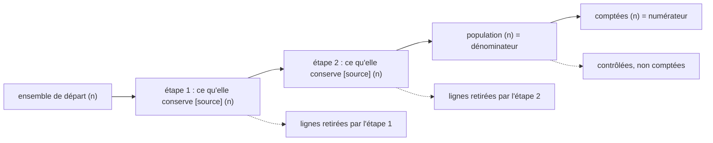

Un entonnoir part d'un ensemble de lignes : les activités de la mise à jour, ses relations, ou les
activités de la Baseline. Chaque étape conserve les lignes qui remplissent une condition et cite le
texte que suit cette condition. Les lignes qui restent après la dernière étape forment la
population, qui est le dénominateur d'un contrôle. Les lignes comptées forment le numérateur. La
page **Audit** affiche les étapes sous **Population, step by step** (Population, étape par étape),
et les lignes dans trois onglets : **Counted** (Comptés), **Checked, not counted** (Vérifiés, non
comptés) et **Excluded** (Exclus).

Cette fiche écrit un entonnoir sur une ligne :

```text
start set (n) → what the step keeps [source] (n) → … → population (n) → counted (n)
```

Dans cette notation, `start set` est l'ensemble de départ, `what the step keeps` ce que l'étape
conserve, et `counted` les lignes comptées. Le nombre entre parenthèses est le nombre de lignes
restantes sur la dernière mise à jour de la série de démonstration. La ligne d'entonnoir d'un
contrôle se termine par le résultat de démonstration : la valeur telle que `xerscope check`
l'affiche dans sa colonne `actual`, et le statut.

Les 56 contrôles des quatre standards intégrés portent un objet `Funnel`
(`analysis/populations.py`), sauf DCMA-12, DCMA-13, 06A401a et INT-03. Le Longest Path (chemin le
plus long) d'une mise à jour, les divergences du recalcul et le champ Ask en portent un aussi. Pour
tout autre chiffre, la ligne d'entonnoir de son entrée décrit la population telle que le code la
découpe. Dans les lignes d'entonnoir et les schémas, une étape d'un objet `Funnel` garde le libellé
du code, en anglais. Chaque libellé est traduit une fois, dans la légende qui accompagne le schéma
ou la ligne où il apparaît pour la première fois.

Le tableau 3 liste les jetons de source que cite une étape (`populations.STEP_SOURCES`).

Tableau 3. Jetons de source des étapes d'entonnoir

| Jeton | Texte que suit l'étape |
|---|---|
| `101248` | aide d'Oracle P6 Professional, page 101248, boîte de dialogue Check Schedule |
| `46278` | aide d'Oracle P6 EPPM, page 46278 |
| `46282` | aide d'Oracle P6 EPPM, page 46282, Large durations |
| `Ten Six` | Ten Six, « Using the P6 Check Schedule tool » |
| `R1` | un rapport Check Schedule de P6 Professional, cité sous ce seul libellé |
| `model` | le modèle : une relation compte quand son successeur est une activité du fichier |
| `PAM 200.1` | DCMA-EA PAM 200.1 (octobre 2012) |
| `DECM 8.0` | DCMA EVMS Compliance Metrics v8.0, fiches de spécification des tests de planning |
| `AACE 29R-03` | AACE RP 29R-03, Forensic Schedule Analysis (révision du 25 avril 2011) |
| `xerscope` | le standard Integrity et les exclusions que fixe un standard personnalisé : pas un standard publié |
| `ask` | un filtre que le champ Ask de la page **Gantt & WBS** a compris à partir de la phrase |

### Unités et calendriers

Le tableau 4 donne l'unité de chaque type de grandeur et le calendrier sur lequel elle est comptée.

Tableau 4. Unités et calendriers

| Grandeur | Unité | Calendrier |
|---|---|---|
| Durées et Floats (marges) tels qu'enregistrés (`target_drtn_hr_cnt`, `remain_drtn_hr_cnt`, `total_float_hr_cnt`, `free_float_hr_cnt`) | heures | aucun : la valeur enregistrée par P6 |
| Colonnes terminées par `_d` (`original_d`, `remaining_d`, `total_float_d`, `free_float_d`) | jours ouvrés (wd) | le calendrier propre à l'activité : heures / `hours_per_day`, arrondi à 0,000001 jour (`calendar.hours_to_days`) |
| `hours_per_day` | heures | `CALENDAR.day_hr_cnt` du calendrier de l'activité ; vide, 0 ou inférieur à une minute : 8 h ; calendrier absent du fichier : la valeur du calendrier du projet, sinon celle du premier calendrier, sinon 8 h |
| Lag (décalage entre activités liées) tel qu'enregistré (`lag_hr`) | heures | aucun ; un Lag vide vaut 0 |
| Lag en jours (`lag_d`) | jours ouvrés | le calendrier du prédécesseur : `lag_hr` / son `hours_per_day` ; affichage, et règle `lag` avec `unit = "days"` |
| Lag dans le recalcul | minutes ouvrées | le calendrier que désignent les options de calcul (`SCHEDOPTIONS.sched_calendar_on_relationship_lag`) : prédécesseur, successeur (par défaut), 24 heures ou calendrier par défaut du projet |
| Temps de travail entre deux dates d'une même activité | heures, ou wd | le calendrier de l'activité, à la minute près (`Snapshot.work_hours`, `working_days`, `activity_working_days`) |
| Temps de travail entre deux dates de projet : Data Dates (dates des données), fins prévisionnelles, fin d'un nœud WBS (Work Breakdown Structure, organigramme des tâches) | wd | le calendrier du projet : `PROJECT.clndr_id`, sinon le premier calendrier du fichier, sinon du lundi au vendredi, 8 h à partir de 08:00 (`Snapshot.project_working_days`) |
| Durées de l'Earned Schedule (PD, AT, ES) | jours de plan | temps de plan : les minutes pendant lesquelles au moins un calendrier de Baseline des activités mesurées travaille ; un jour de plan vaut les heures par jour du calendrier du projet de la mise à jour |
| Écart en temps de l'Earned Schedule | jours calendaires (`cal. d`) | aucun : week-ends compris |
| Quantités de main-d'œuvre (`labor_budget_hr`, `labor_actual_hr`, `labor_remaining_hr`) | heures | aucun |

Un horodatage situé en temps non travaillé compte comme le début de la période de travail suivante.
Un jour ouvré vaut `CALENDAR.day_hr_cnt` heures, et non la longueur de la journée lue dans le
calendrier. P6 convertit avec les heures par période de temps de ses préférences d'administration,
sauf si le réglage du calendrier dit autre chose, et le XER ne porte pas ce réglage (consigné dans
`docs/backlog.md`, section « Checks and earned value »).

Tout déplacement d'une date exprimé en jours ouvrés se lit en négatif quand la date devient plus
tardive : déplacement de la fin, dates du journal des modifications, écart de début et de fin,
glissement d'un jalon, écart de fin de P6-12 et d'un nœud WBS, déplacements de l'analyse des
retards. Trois lignes se lisent dans l'autre sens : la ligne « status date » (date de statut) du
journal des modifications donne les jours ouvrés écoulés, le `reason` de DCMA-11 donne
`finish variance N h` avec un N positif pour une fin en retard, et la note de DCMA-12 et de 06A401a
donne `moved +N wd` avec un N positif pour une fin plus tardive.

### Mots de statut

Le tableau 5 définit les mots qu'emploient les entrées pour l'état et le type d'une activité.

Tableau 5. Mots de statut

| Mot | Définition | Clé dans `exclude` |
|---|---|---|
| terminée | `status_code` vaut `TK_Complete` | `complete` |
| commencée | `status_code` n'est pas `TK_NotStart` : en cours ou terminée | `started` |
| terminée avant la Data Date | `act_end_date` antérieure à la Data Date ; sans Data Date : terminée | `complete_before_data_date` |
| jalon | `task_type` vaut `TT_Mile`, `TT_StartMile` ou `TT_FinMile` | `milestones` |
| jalon de début | `task_type` vaut `TT_Mile` ou `TT_StartMile` | aucune |
| jalon de fin | `task_type` vaut `TT_FinMile` | aucune |
| Level of Effort (LOE, niveau d'effort) | `task_type` vaut `TT_LOE` | `loe` |
| sans durée initiale | `target_drtn_hr_cnt` est vide ou n'est pas supérieur à 0 | `no_duration` |
| synthèse WBS | `task_type` vaut `TT_WBS` : jamais une activité, écartée de toutes les populations | aucune |
| critique | non terminée, et : sur le Longest Path (`driving_path_flag` vaut `Y`) quand `PROJECT.critical_path_type` vaut `CT_DrivPath` ; sinon `total_float_hr_cnt` inférieur ou égal à `PROJECT.critical_drtn_hr_cnt` quand ce champ est renseigné ; sinon `total_float_d` inférieur ou égal à 0 (`Settings.critical_float_days`). Les activités Level of Effort et les jalons sont inclus | aucune |

### Grandeurs lues dans le fichier

Le tableau 6 définit les grandeurs que lit chaque formule (`xer/model.py`, `xer/calendar.py`).

Tableau 6. Grandeurs lues dans le fichier

| Grandeur | Définition | Code |
|---|---|---|
| Data Date | `PROJECT.last_recalc_date`, sinon `PROJECT.plan_start_date`, sinon aucune ; les notes et les libellés d'étape de l'application l'appellent « status date » | `_data_date` |
| Activité | une ligne `TASK` du projet qui n'est pas une synthèse WBS, identifiée par son Activity ID (identifiant d'activité, `task_code`) ; un Activity ID répété garde sa première ligne | `Snapshot.activities`, `by_code` |
| Relation | une ligne `TASKPRED` dont le prédécesseur et le successeur ont une ligne `TASK` dans le fichier ; `type` FS, SS, FF ou SF ; un prédécesseur situé dans un autre projet du fichier est nommé `[ext]` suivi de son `task_id` | `_relationships` |
| Start (début) et Finish (fin) (`start`, `finish`) | la date réelle, sinon la date au plus tôt restante (`restart_date`, `reend_date`), sinon la date au plus tôt, sinon la date planifiée (`target_start_date`, `target_end_date`) | `_task_frame` |
| Début et fin prévisionnels | `restart_date`, sinon `early_start_date` ; `reend_date`, sinon `early_end_date` | `forecast_dates` |
| Fin prévisionnelle du projet (`finish_date`) | le Finish le plus tardif des activités | `_project_finish` |
| Heures de main-d'œuvre | par activité, `TASK.target_work_qty`, `act_work_qty` et `remain_work_qty` ; une valeur vide prend la somme de `TASKRSRC.target_qty`, de `act_reg_qty + act_ot_qty` ou de `remain_qty` sur ses affectations de main-d'œuvre et de rôle ; sinon 0 | `_labor_hours` |
| Pourcentage d'avancement (`pct_complete`) | selon `TASK.complete_pct_type`. `CP_Drtn` : 100 × (durée initiale − durée restante) / durée initiale, pas en dessous de 0, 100 une fois l'activité terminée. `CP_Units` : 100 × unités réelles / (unités réelles + unités restantes), main-d'œuvre et hors main-d'œuvre. Tout autre type : `phys_complete_pct`. Une valeur qui ne peut pas être calculée prend `phys_complete_pct`, puis 100 quand l'activité est terminée, sinon 0. Maintenu dans l'intervalle 0 à 100, non arrondi | `percent_complete` |
| Heures ouvrées de `a` à `b` | minutes ouvrées du calendrier entre les deux horodatages / 60 ; négatif quand `b` est antérieur ; vide quand une date manque | `WorkCalendar.work_hours`, `TimeAxis.between` |
| Jours ouvrés de `a` à `b` | heures ouvrées / `hours_per_day` du calendrier | `WorkCalendar.working_days` |
| A une ressource, a une dépense | l'activité a au moins une ligne `TASKRSRC` de n'importe quel type ; au moins une ligne `PROJCOST` | `build_snapshot` |

### Cibles et statuts

Le tableau 7 donne les formes que prend une cible dans un fichier de standard
(`analysis/standards.py`).

Tableau 7. Cibles

| Texte de la cible | Comparateur | Unité du contrôle |
|---|---|---|
| `< 5%`, `<= 5%`, `> 90%`, `>= 90%`, `== 0%` | `<`, `<=`, `>`, `>=`, `==` | `%` |
| `<= 0`, `<= 10` | les mêmes comparateurs | `count` |
| `>= 0.95`, `> 0.95` | les mêmes comparateurs | `ratio` |
| `pass` | valeur égale à 1 | `pass/fail` |
| `info`, ou aucune cible | aucun | toute unité |

Le statut d'un contrôle est décidé dans cet ordre (`checks.run_metric`, `Metric.evaluate`) :

1. `n/a` avec la note `needs a baseline` quand la règle déclare qu'elle a besoin d'une Baseline et
   qu'aucune n'est fournie.
2. `error` quand la règle lève une exception. La note porte l'exception.
3. `info` quand la règle donne sa valeur pour examen (DCMA-13 sur la Baseline des dates planifiées).
4. `n/a` quand la valeur est absente : une règle sans valeur, ou un `%` dont le dénominateur vaut 0
   (note `nothing to check` quand la règle ne donne pas de note). Un `count` dont la population est
   vide a la valeur 0 et est jugé.
5. `info` quand la cible est `info`.
6. `pass` quand le comparateur est vérifié entre la valeur arrondie à six décimales et le seuil,
   sinon `fail`.

L'application affiche un `%` avec une décimale, un ratio avec deux, un décompte tel quel, `pass` ou
`fail` pour un contrôle `pass/fail`, et `–` pour `n/a` et `error`. `xerscope check` affiche la
valeur avec deux décimales dans la colonne `actual`.

### Baselines et mises à jour antérieures

Une Baseline est un fichier XER désigné (`Baseline.from_snapshot`) ou les dates planifiées de la
mise à jour elle-même (`Baseline.planned`). Ses activités sont rapprochées de celles de la mise à
jour par Activity ID. Le tableau 8 donne les colonnes de Baseline que lisent les formules
(`analysis/baseline.py`).

Tableau 8. Colonnes de Baseline

| Colonne | À partir d'un fichier de Baseline | À partir des dates planifiées |
|---|---|---|
| `bl_start`, `bl_finish` | sur la base `budgeted_planned` (par défaut) : les `target_start_date` et `target_end_date` de l'activité de la Baseline, ses Start et Finish là où ils sont vides ; sur les deux bases à dates courantes : ses Start et Finish | les `target_start_date` et `target_end_date` de la mise à jour |
| `bl_duration_hr` | le `target_drtn_hr_cnt` de l'activité de la Baseline | le `target_drtn_hr_cnt` de la mise à jour |
| `bl_clndr_id` | le calendrier de l'activité de la Baseline, lu dans le fichier de Baseline | le calendrier de la mise à jour |
| `ev_start`, `ev_finish` | `budgeted_planned` : `target_start_date` et `target_end_date`, sinon `bl_start` et `bl_finish` ; `budgeted_current` et `at_completion_current` : Start et Finish | la même règle sur la mise à jour |
| `ev_labor_hr` | `labor_budget_hr` ; sur `at_completion_current` : `labor_actual_hr + labor_remaining_hr` | la même règle sur la mise à jour |
| `bl_cost` | Σ `TASKRSRC.target_cost` de ses affectations + Σ `PROJCOST.target_cost` de ses dépenses | la même chose sur la mise à jour |

Les contrôles qui déclarent une Baseline sont P6-12, P6-13, DCMA-11, DCMA-14 et 06A501a. Trois
autres la lisent sans la déclarer : 06A204b, DCMA-08 et DCMA-13 (`checks.BASELINE_READERS`). Le
champ **Prérequis** de chaque entrée dit ce qui s'affiche sans Baseline. La valeur acquise, l'Earned
Schedule et l'écart de fin d'un nœud WBS en ont besoin.

Les chiffres qui ont besoin d'une mise à jour antérieure le disent dans le même champ : 06A504a,
06A504b et 06A506c se comparent à la mise à jour la plus récente dont la Data Date est antérieure
d'au moins 28 jours, et le journal des modifications, l'analyse des retards, le PPC, les écarts et
les déplacements comparent des mises à jour consécutives de la série. La série contient une mise à
jour par Data Date, triée par Data Date, puis par nom de fichier.

### Chiffres de démonstration

Les décomptes des entonnoirs viennent de la série de démonstration de `xerscope sample` : huit
fichiers hebdomadaires synthétiques du projet PRJ-ALPHA, avec des Data Dates du 2026-08-31 au
2026-10-19. Les chiffres sont ceux de la dernière mise à jour, 2026-10-19, par rapport au premier
fichier pris comme Baseline, sur la base de valeur acquise par défaut. Un chiffre qui porte sur deux
mises à jour lit la semaine du 2026-10-12 au 2026-10-19. Ces chiffres sont écrits comme
l'outil les affiche : la virgule sépare les milliers et le point marque les décimales. Ainsi,
8,040 h se lit huit mille quarante heures.

Les commandes suivantes écrivent la série et affichent les résultats des contrôles de chaque mise à
jour, le dernier bloc étant celui de la dernière mise à jour :

```bash
xerscope sample --out demo
xerscope check demo --standard P6 --baseline demo/PRJ-ALPHA_2026-08-31.xer
```

Les autres standards prennent `--standard DECM`, `--standard DCMA` et `--standard INTEGRITY`. Les
commandes `xerscope info demo`, `xerscope recalc demo/PRJ-ALPHA_2026-10-19.xer` et
`xerscope changelog demo/PRJ-ALPHA_2026-10-12.xer demo/PRJ-ALPHA_2026-10-19.xer` affichent les
décomptes des mises à jour, le recalcul et le journal des modifications. Les étapes d'un entonnoir
et les chiffres des autres pages sont affichés par l'application, démarrée avec
`xerscope app --data demo --baseline demo/PRJ-ALPHA_2026-08-31.xer`.

### Documents associés

Le tableau 9 donne le libellé sous lequel les entrées citent chaque document associé.

Tableau 9. Documents associés

| Libellé | Document et section |
|---|---|
| Formules 1.1 à 1.4 | [Formules, conventions](formulas.md#1-conventions) (en anglais) |
| Formules 1.5 | [Formules, cibles et statuts](formulas.md#15-targets-and-statuses-analysisstandardspy-analysischeckspy) |
| Formules 1.6 | [Formules, score d'un standard](formulas.md#16-standard-score-analysischeckspy-standard_score) |
| Formules 2.1 | [Formules, P6 Check Schedule](formulas.md#21-p6-check-schedule-standardsp6toml-standard-id-p6) |
| Formules 2.2 | [Formules, DCMA DECM v8.0](formulas.md#22-dcma-decm-v80-guideline-6-standardsdecmtoml-standard-id-decm) |
| Formules 2.3 | [Formules, DCMA 14-Point](formulas.md#23-dcma-14-point-standardsdcmatoml-standard-id-dcma) |
| Formules 2.4 | [Formules, Integrity](formulas.md#24-integrity-standardsintegritytoml-standard-id-integrity) |
| Formules 2.5 | [Formules, règles pour un standard d'entreprise](formulas.md#25-rules-for-a-company-standard-only-analysisrulespy-listed-by-xerscope-standards---rules) |
| Formules 2.6 | [Formules, règles du chemin critique](formulas.md#26-critical-path-rules-dcmafourteen_pointpy-dcma_13_cpli-dcma_12_critical_path_test-cpmpy-critical_path_test) |
| Formules 3 | [Formules, valeur acquise](formulas.md#3-earned-value-analysisbaselinepy-analysisevmpy) |
| Formules 4 | [Formules, avancement](formulas.md#4-progress-analysisprogresspy-storepy) |
| Formules 5 | [Formules, journal des modifications](formulas.md#5-changelog-analysischangelogpy) |
| Formules 5.1 | [Formules, lecture d'une semaine par demi-pas (half-step)](formulas.md#51-half-step-reading-of-a-week-analysisforensicspy) |
| Formules 5.2 | [Formules, Longest Path de chaque mise à jour](formulas.md#52-longest-path-of-each-update-analysislongest_pathpy) |
| Formules 5.3 | [Formules, là où le recalcul s'écarte du fichier](formulas.md#53-where-the-recalculation-departs-from-the-file-apprecalculation_departurespy-debug-block-3) |
| Formules 6 | [Formules, sortie du CPM (Critical Path Method, méthode du chemin critique) comparée à P6](formulas.md#6-cpm-output-compared-with-p6-analysiscpmpy-compare_with_stored-compare_assignments) |
| Formules 7 | [Formules, limites connues](formulas.md#7-known-limits) |
| Standards | [Les standards dans xerscope](standards.md) (en anglais) : une section par standard, la comparaison des standards et les sources |
| Standards, sources | [Standards, sources](standards.md#sources) : les pages Oracle, les fiches DECM, PAM 200.1 et le rapport R1 |
| CPM | [Le moteur CPM](cpm.md) (en anglais) |
| CPM, conventions | [CPM, conventions qu'aucun fichier de référence ne tranche](cpm.md#conventions-no-reference-file-settles) |
| CPM, test du chemin critique | [CPM, test du chemin critique](cpm.md#critical-path-test) |
| Backlog, DECM | [Backlog, conformité DECM](backlog.md#decm-conformance) (en anglais) |
| Backlog, contrôles | [Backlog, contrôles et valeur acquise](backlog.md#checks-and-earned-value) |
| Architecture, Ask | [Parcours du code, le champ Ask](architecture.md#the-gantt-ask-field-talking-to-the-schedule-without-a-model-reading-it) (en anglais) |
| Fiches P6 | une fiche de calcul par contrôle P6 dans `src/xerscope/sheets/P6/`, liée depuis le tableau 10 |

## P6 Check Schedule

Le standard `P6` (`standards/p6.toml`, nom `P6 Check Schedule`) contient 18 contrôles, à raison
d'une fonction par contrôle dans `analysis/p6/check_schedule.py`. L'application les affiche sur la
page **Schedule health** (Santé du planning) : tableau des résultats, **Detail by check** (Détail
par contrôle), **Trend across updates** (Tendance au fil des mises à jour). Elle les affiche un par
un sur la page **Audit**. La commande est `xerscope check FILE --standard P6`.

Les limites de P6-04, P6-05 et P6-06 sont des nombres d'heures comparés aux heures enregistrées par
P6 : aucun calendrier ne les convertit. Les sources sont des pages de l'aide Oracle citées par leur
numéro (101248 : aide de P6 Professional, boîte de dialogue Check Schedule ; 46277 à 46291 : aide de
P6 EPPM, sections du Schedule Check Report ; 113174 et 113176 : aide de P6 Professional), le rapport
R1, un rapport P6 Professional 26.8 sur un projet synthétique (`tests/test_p6_checksched.py`) et un
rapport P6 Professional r22.12 analysé par Ten Six. Formules 2.1 contient la forme longue et les
tests qui la figent. Standards contient les textes que suivent les contrôles, et Standards, sources
leurs références. Ces libellés, comme tout libellé d'un champ **Pour approfondir**, sont ceux du
tableau 9.

### Contrôles de P6 Check Schedule

Le tableau 10 donne les champs compacts de chaque contrôle.

Tableau 10. Contrôles de P6 Check Schedule

| Id | Nom | Formule | Unité | Cible | Prérequis | Source | Code | Pour approfondir |
|---|---|---|---|---|---|---|---|---|
| P6-01 | Logic (logique) | sans successeur, ou sans prédécesseur pour une activité non commencée ; un lien vers un autre projet compte comme un lien | `%` | `< 5%` | aucun | 101248 ; 46291 ; rapports P6 Professional 26.8 et r22.12 | `p6_01_logic` | [fiche P6-01](../src/xerscope/sheets/P6/P6-01.md) (en anglais) |
| P6-02 | Hard Constraints (contraintes dures) | contrainte primaire ou secondaire parmi Mandatory start (début obligatoire), Start on (début le), Mandatory finish (fin obligatoire), Finish on (fin le) ; une contrainte de début sur une activité commencée n'est pas comptée | `%` | `< 1%` | aucun | 101248 ; 46286 | `p6_02_hard_constraints` | [fiche P6-02](../src/xerscope/sheets/P6/P6-02.md) (en anglais) |
| P6-03 | Soft Constraints (contraintes souples) | contrainte primaire ou secondaire parmi Start on or before (début au plus tard le), Start on or after (début au plus tôt le), Finish on or before (fin au plus tard le), Finish on or after (fin au plus tôt le), As late as possible (le plus tard possible) ; même exemption une fois l'activité commencée | `%` | `< 5%` | aucun | 101248 ; 113176 ; 46285 | `p6_03_soft_constraints` | [fiche P6-03](../src/xerscope/sheets/P6/P6-03.md) (en anglais) |
| P6-04 | Large Durations (durées longues) | `remain_drtn_hr_cnt > limit_hours` (352 h, heures telles qu'enregistrées) | `%` | `< 5%` | aucun | 101248 ; 46282 ; Ten Six | `p6_04_large_durations` | [fiche P6-04](../src/xerscope/sheets/P6/P6-04.md) (en anglais) |
| P6-05 | Long Lags (décalages longs) | `lag_hr > limit_hours` (352 h, heures telles qu'enregistrées ; vide = 0) | `%` | `< 5%` | aucun | 101248 ; 46288 | `p6_05_long_lags` | [fiche P6-05](../src/xerscope/sheets/P6/P6-05.md) (en anglais) |
| P6-06 | Large Float (marge élevée) | `total_float_hr_cnt > limit_hours` (352 h, heures telles qu'enregistrées) ; un Float vide n'est pas jugé et reste dans la population | `%` | `< 1%` | aucun | 101248 ; 46284 | `p6_06_large_float` | [fiche P6-06](../src/xerscope/sheets/P6/P6-06.md) (en anglais) |
| P6-07 | Relationship Types (types de relation) | relations de type FS ; valeur = 100 × FS / population ; la liste montre les autres | `%` | `> 90%` | aucun | 101248 ; 46287 | `p6_07_relationship_types` | [fiche P6-07](../src/xerscope/sheets/P6/P6-07.md) (en anglais) |
| P6-08 | Positive Lags (décalages positifs) | `lag_hr > 0` | `%` | `< 5%` | aucun | 101248 ; 46289 | `p6_08_lags` | [fiche P6-08](../src/xerscope/sheets/P6/P6-08.md) (en anglais) |
| P6-09 | Negative Lags (décalages négatifs) | `lag_hr < 0` | `%` | `< 1%` | aucun | 101248 ; 46290 | `p6_09_negative_lags` | [fiche P6-09](../src/xerscope/sheets/P6/P6-09.md) (en anglais) |
| P6-10a | Invalid Progress Before Data Date (avancement invalide avant la date des données) | non terminée et début prévisionnel (`restart_date`, sinon `early_start_date`) antérieur à la Data Date, horodatages comparés | `%` | `< 1%` | Data Date ; sans Data Date : `n/a`, note `no status date` | 101248 ; rapport P6 Professional 26.8 | `p6_10a_invalid_progress_before` | [fiche P6-10a](../src/xerscope/sheets/P6/P6-10a.md) (en anglais) |
| P6-10b | Invalid Progress After Data Date (avancement invalide après la date des données) | `act_start_date` ou `act_end_date` postérieur à la Data Date, horodatages comparés | `%` | `< 1%` | Data Date ; sans Data Date : `n/a`, note `no status date` | 101248 ; rapport P6 Professional 26.8 | `p6_10b_invalid_progress_after` | [fiche P6-10b](../src/xerscope/sheets/P6/P6-10b.md) (en anglais) |
| P6-11 | Resource / Cost (ressource / coût) | aucune ligne `TASKRSRC` et aucune ligne `PROJCOST` | `%` | `< 1%` | aucun | 101248 ; 46279 | `p6_11_resource_cost` | [fiche P6-11](../src/xerscope/sheets/P6/P6-11.md) (en anglais) |
| P6-12 | Late Activities (activités en retard) | heures ouvrées de la fin de Baseline au Finish supérieures à 0, sur le calendrier de l'activité ; fin de Baseline = `bl_finish`, sinon le `target_end_date` de la mise à jour ; listée avec `finish_variance_wd` = −heures / `hours_per_day`, arrondi à 0,01 wd | `%` | `< 5%` | Baseline ; sans Baseline : `n/a`, note `needs a baseline` | 101248 ; R1 ; 46278 | `p6_12_late_activities` | [fiche P6-12](../src/xerscope/sheets/P6/P6-12.md) (en anglais) |
| P6-13 | BEI | Baseline Execution Index (BEI, indice d'exécution de la Baseline) : activités terminées de la mise à jour, jalons et Level of Effort écartés ; valeur = comptées / population (les activités de la Baseline) ; la liste montre les activités dont le `bl_finish` est antérieur ou égal à la Data Date et qui ne sont pas terminées | `ratio` | `> 0.95` | Baseline ; sans Baseline : `n/a`, note `needs a baseline` ; sans Data Date : `n/a`, note `no status date` | R1 (prévaut sur 101248) ; rapport P6 Professional 26.8 | `p6_13_bei` | [fiche P6-13](../src/xerscope/sheets/P6/P6-13.md) (en anglais) |
| P6-14 | Negative Float (marge négative) | `total_float_hr_cnt < 0` (heures telles qu'enregistrées) | `%` | `< 1%` | aucun | 101248 ; 46283 | `p6_14_negative_float` | [fiche P6-14](../src/xerscope/sheets/P6/P6-14.md) (en anglais) |
| P6-15 | Out of Sequence (hors séquence) | activités commencées ayant un prédécesseur FS non terminé ou un prédécesseur SS non commencé, une fois par activité | `%` | `< 2%` | aucun | R1 | `p6_15_out_of_sequence` | [fiche P6-15](../src/xerscope/sheets/P6/P6-15.md) (en anglais) |
| P6-16 | Dangling Start Activities (activités au début non piloté) | parmi les activités non terminées, hors jalons et non commencées (`ignore_in_progress = true`) : un prédécesseur existe et aucun n'est FS ou SS | `%` | `<= 0%` | aucun | R1 ; 113174 | `p6_16_dangling_start` | [fiche P6-16](../src/xerscope/sheets/P6/P6-16.md) (en anglais) |
| P6-17 | Dangling Finish Activities (activités à la fin non pilotée) | parmi les activités non terminées et hors jalons (moins les contraintes que nomment `ignore_soft_constraints` et `ignore_hard_constraints`, toutes deux à `false`) : un successeur existe et aucun n'est FS ou FF | `%` | `<= 0%` | aucun | R1 ; 113174 | `p6_17_dangling_finish` | [fiche P6-17](../src/xerscope/sheets/P6/P6-17.md) (en anglais) |

### Arbre des entonnoirs de P6 Check Schedule

Le schéma suivant montre les ensembles de départ des contrôles P6, les étapes qu'ils partagent, et
les contrôles qui utilisent chaque chaîne d'étapes.

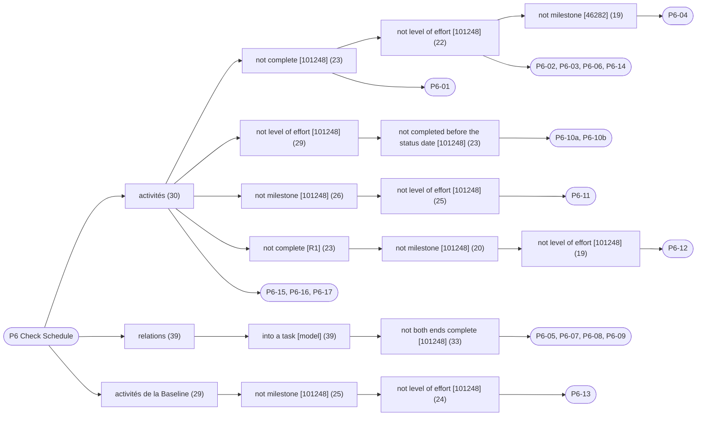

Légende des libellés d'étape, qui restent ceux du code : `not complete` (non terminée),
`not level of effort` (hors Level of Effort), `not milestone` (hors jalon), `into a task` (vers une
tâche du fichier), `not both ends complete` (les deux extrémités ne sont pas toutes deux terminées),
`not completed before the status date` (non terminée avant la Data Date).

### Entonnoirs des contrôles P6

Les lignes suivantes donnent les mêmes chaînes contrôle par contrôle, avec les décomptes de
démonstration.

- P6-01 : activités (30) → not complete [101248] (23) → population (23) → comptées (2) ; résultat de
  démonstration 8.70, fail
- P6-02 : activités (30) → not complete [101248] (23) → not level of effort [101248] (22) →
  population (22) → comptées (0) ; résultat de démonstration 0.00, pass
- P6-03 : activités (30) → not complete [101248] (23) → not level of effort [101248] (22) →
  population (22) → comptées (2) ; résultat de démonstration 9.09, fail
- P6-04 : activités (30) → not complete [101248] (23) → not level of effort [101248] (22) → not
  milestone [46282] (19) → population (19) → comptées (1) ; résultat de démonstration 5.26, fail
- P6-05 : relations (39) → into a task [model] (39) → not both ends complete [101248] (33) →
  population (33) → comptées (0) ; résultat de démonstration 0.00, pass
- P6-06 : activités (30) → not complete [101248] (23) → not level of effort [101248] (22) →
  population (22) → comptées (3) ; résultat de démonstration 13.64, fail
- P6-07 : relations (39) → into a task [model] (39) → not both ends complete [101248] (33) →
  population (33) → comptées (29) ; résultat de démonstration 87.88, fail
- P6-08 : relations (39) → into a task [model] (39) → not both ends complete [101248] (33) →
  population (33) → comptées (2) ; résultat de démonstration 6.06, fail
- P6-09 : relations (39) → into a task [model] (39) → not both ends complete [101248] (33) →
  population (33) → comptées (1) ; résultat de démonstration 3.03, fail
- P6-10a : activités (30) → not level of effort [101248] (29) → not completed before the status date
  [101248] (23) → population (23) → comptées (0) ; résultat de démonstration 0.00, pass
- P6-10b : activités (30) → not level of effort [101248] (29) → not completed before the status date
  [101248] (23) → population (23) → comptées (1) ; résultat de démonstration 4.35, fail
- P6-11 : activités (30) → not milestone [101248] (26) → not level of effort [101248] (25) →
  population (25) → comptées (2) ; résultat de démonstration 8.00, fail
- P6-12 : activités (30) → not complete [R1] (23) → not milestone [101248] (20) → not level of
  effort [101248] (19) → population (19) → comptées (19) ; résultat de démonstration 100.00, fail
- P6-13 : activités de la Baseline (29) → not milestone [101248] (25) → not level of effort [101248]
  (24) → population (24) → comptées (6) ; résultat de démonstration 0.25, fail
- P6-14 : activités (30) → not complete [101248] (23) → not level of effort [101248] (22) →
  population (22) → comptées (13) ; résultat de démonstration 59.09, fail
- P6-15 : activités (30) → population (30) → comptées (0) ; résultat de démonstration 0.00, pass
- P6-16 : activités (30) → population (30) → comptées (0) ; résultat de démonstration 0.00, pass
- P6-17 : activités (30) → population (30) → comptées (0) ; résultat de démonstration 0.00, pass

P6-15, P6-16 et P6-17 divisent par toutes les activités. Les activités qu'ils examinent sont
découpées dans le numérateur, comme le dit leur ligne du tableau 10 : une activité commencée pour
P6-15, une activité qui n'est ni terminée ni un jalon pour les deux autres, et non commencée pour
P6-16.

### Points ouverts des contrôles P6

Les lectures suivantes sont marquées comme non tranchées dans le code ou dans les documents
associés.

- P6-01 : la page 46291 dit que les activités ayant des prédécesseurs ou des successeurs externes
  réussissent le contrôle. La règle le lit côté par côté : un prédécesseur externe ne tient pas lieu
  de successeur manquant. Les activités Level of Effort restent dans la population, l'aide étant
  muette sur ce point (docstring de la règle ; Formules 7).
- P6-02 et P6-03 : une contrainte secondaire compte comme une contrainte primaire. Aucun texte
  d'Oracle ni aucun rapport ne le tranche (docstring de la règle ; Backlog, contrôles).
- P6-05, P6-07, P6-08 et P6-09 : une relation venant d'un autre projet n'est comptée que si ce
  projet est dans le fichier. Un même planning peut donc donner deux dénominateurs selon l'export
  (Standards, section « Same check, several definitions »).
- P6-10a : aucun rapport ne montre une activité en cours dont le début au plus tôt restant est
  antérieur à la Data Date (Formules 7).
- P6-13 : les deux rapports mesurent un projet qui est sa propre Baseline. Un rapport sur un projet
  doté d'une Baseline séparée trancherait la question de savoir si toutes les activités de la
  Baseline y sont comptées aussi (Standards, section « P6 Check Schedule » ; Backlog, contrôles).
- P6-15 : les relations FF et SF ne sont pas lues (docstring de la règle).
- P6-16 et P6-17 : les activités terminées ne sont jamais comptées, un prédécesseur ou un successeur
  situé dans un autre projet n'est pas lu comme P6-01 le lit, et Oracle ne documente aucune valeur
  par défaut pour les options de la boîte de dialogue (docstrings des règles ; Standards, section
  « P6 Check Schedule »).

## DCMA DECM v8.0

Le standard `DECM` (`standards/decm.toml`, nom `DCMA DECM v8.0 (schedule)`) contient 16 contrôles du
Guideline 6, à raison d'une fonction par contrôle dans `analysis/decm/schedule_metrics.py`.
L'application les affiche sur les pages **Schedule health** et **Audit**. La commande est
`xerscope check FILE --standard DECM`.

La source de chaque contrôle est sa fiche de spécification des DCMA EVMS Compliance Metrics v8.0,
citée sous la forme « fiche » suivie de l'identifiant de la métrique. La « status date » des fiches
est la Data Date. Les limites en jours (`limit_days`, `riding_window_wd`, `remaining_tolerance_wd`)
sont des jours ouvrés du calendrier propre à l'activité. `status_period_days` vaut 28 jours
calendaires. Formules 2.2 contient la forme longue et les tests qui la figent.

### Contrôles de DCMA DECM v8.0

Le tableau 11 donne les champs compacts de chaque contrôle.

Tableau 11. Contrôles de DCMA DECM v8.0

| Id | Nom | Formule | Unité | Cible | Prérequis | Source | Code | Pour approfondir |
|---|---|---|---|---|---|---|---|---|
| 06A204b | Dangling logic (logique qui ne pilote pas une extrémité) | début ouvert (jalon : pas de prédécesseur ; autre activité : pas de prédécesseur FS ou SS) ou fin ouverte (jalon : pas de successeur ; autre activité : pas de successeur FS ou FF) ; un lien vers un autre projet compte selon son type ; exemptés : le début de Baseline le plus précoce (côté début) et la fin de Baseline la plus tardive (côté fin), ex æquo compris | `%` | `<= 0%` | Baseline lue, non requise ; sans Baseline : dates planifiées, note `no baseline: first/last by planned dates` ; quand la mise à jour est sa propre Baseline : dates planifiées, note `first/last by baseline dates` | fiche 06A204b | `decm_06a204b_dangling_logic` | Formules 2.2 |
| 06A205a | Lags (décalages) | successeur d'au moins une relation dont `lag_hr > 0` | `%` | `<= 10%` | aucun | fiche 06A205a | `decm_06a205a_lags` | Formules 2.2 |
| 06A208a | Summary tasks with logic (tâches de synthèse avec logique) | ligne de synthèse WBS qui est le prédécesseur ou le successeur d'une relation | `count` | `<= 0` | aucun | fiche 06A208a | `decm_06a208a_summary_logic` | Formules 2.2 |
| 06A209a | Hard constraints | contrainte primaire ou secondaire parmi Mandatory start, Mandatory finish ; pas d'exemption une fois l'activité commencée | `%` | `<= 0%` | aucun | fiche 06A209a | `decm_06a209a_hard_constraints` | Formules 2.2 |
| 06A210a | LOE with discrete successors (LOE avec successeurs discrets) | au moins un successeur dans le fichier qui n'est pas Level of Effort | `%` | `<= 0%` | aucun | fiche 06A210a | `decm_06a210a_loe_successors` | Formules 2.2 |
| 06A211a | High total float (marge totale élevée) | `total_float_d > limit_days` (44 wd du calendrier de l'activité) | `%` | `info` | aucun | fiche 06A211a | `decm_06a211a_high_float` | Formules 2.2 |
| 06A212a | Out of sequence | avec les Start et Finish des deux extrémités (réels, sinon prévisionnels) : FS, début du successeur avant la fin du prédécesseur ; SS, début avant début ; FF, fin avant fin ; SF, fin avant début ; le Lag n'est pas ajouté | `count` | `<= 0` | aucun | fiche 06A212a | `decm_06a212a_out_of_sequence` | Formules 2.2 |
| 06A401a | Critical path test (test du chemin critique) | valeur 1 quand le test du chemin critique de DCMA-12 réussit, sinon 0 (`slip_days` 600 wd du calendrier de l'activité retardée) | `pass/fail` | `pass` | Data Date ; sans Data Date : `n/a`, note `no status date` | fiche 06A401a ; méthode : xerscope | `decm_06a401a_critical_path_test` | Formules 2.6 ; CPM, test du chemin critique |
| 06A501a | Missing baseline dates (dates de référence manquantes) | pas de `bl_start` ou pas de `bl_finish` | `%` | `<= 5%` | Baseline ; sans Baseline : `n/a`, note `needs a baseline` | fiche 06A501a | `decm_06a501a_missing_baseline` | Formules 2.2 |
| 06A504a | Actual starts changed (débuts réels modifiés) | présente dans les deux mises à jour, avec un début réel dans la mise à jour antérieure et un autre, ou aucun, dans celle-ci | `%` | `<= 10%` | une mise à jour antérieure d'au moins 28 jours ; sans elle : `n/a`, note `needs an update 28 days older` | fiche 06A504a | `decm_06a504a_actual_starts_changed` | Formules 2.2 |
| 06A504b | Actual finishes changed (fins réelles modifiées) | la même chose sur la fin réelle | `%` | `<= 10%` | une mise à jour antérieure d'au moins 28 jours ; sans elle : `n/a`, note `needs an update 28 days older` | fiche 06A504b | `decm_06a504b_actual_finishes_changed` | Formules 2.2 |
| 06A505a | In progress without actual start (en cours sans début réel) | pas de `act_start_date` | `%` | `<= 5%` | aucun | fiche 06A505a | `decm_06a505a_in_progress_without_actual_start` | Formules 2.2 |
| 06A505b | Complete without actual finish (terminée sans fin réelle) | pas de `act_end_date` | `%` | `<= 5%` | aucun | fiche 06A505b | `decm_06a505b_complete_without_actual_finish` | Formules 2.2 |
| 06A506a | Actual dates after the status date (dates réelles après la date de statut) | `act_start_date` ou `act_end_date` postérieur à la Data Date, lu sur toutes les activités (la population n'est que le dénominateur) | `%` | `<= 5%` | Data Date ; sans Data Date : `n/a`, note `no status date` | fiche 06A506a | `decm_06a506a_actual_dates_after_status_date` | Formules 2.2 |
| 06A506b | Forecast dates before the status date (dates prévisionnelles avant la date de statut) | non commencée avec un début prévisionnel antérieur ou égal à la Data Date, ou une fin prévisionnelle antérieure ou égale à celle-ci | `count` | `<= 0` | Data Date ; sans Data Date : `n/a`, note `no status date` | fiche 06A506b | `decm_06a506b_forecast_dates_before_status_date` | Formules 2.2 |
| 06A506c | Riding the status date (dates qui avancent avec la date de statut) | non commencée dans les deux mises à jour avec un Start de 0 wd à 3 wd après la Data Date dans les deux (`riding_window_wd`, chaque mise à jour sur sa propre Data Date et son propre calendrier) ; ou commencée dans les deux avec des durées restantes à 2 wd au plus l'une de l'autre (`remaining_tolerance_wd`) | `%` | `<= 1%` | une mise à jour antérieure d'au moins 28 jours ; sans elle : `n/a`, note `needs an update 28 days older` | fiche 06A506c | `decm_06a506c_riding_status_date` | Formules 2.2 |

### Arbre des entonnoirs de DCMA DECM v8.0

Le schéma suivant montre les ensembles de départ des contrôles DECM, les étapes qu'ils partagent, et
les contrôles qui utilisent chaque chaîne d'étapes.

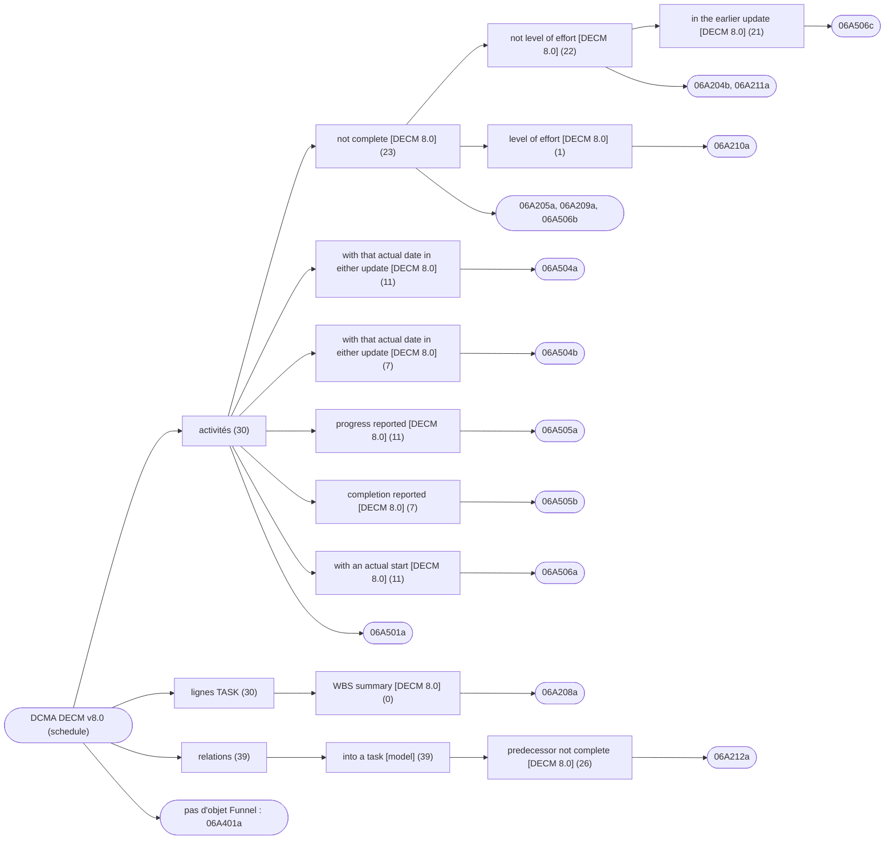

Légende des libellés d'étape qui n'ont pas encore été traduits : `WBS summary` (synthèse WBS),
`level of effort` (Level of Effort), `predecessor not complete` (prédécesseur non terminé),
`with that actual date in either update` (avec cette date réelle dans l'une ou l'autre mise à jour),
`progress reported` (avancement déclaré), `completion reported` (achèvement déclaré),
`with an actual start` (avec un début réel), `in the earlier update` (présente dans la mise à jour
antérieure).

### Entonnoirs des contrôles DECM

Les lignes suivantes donnent les mêmes chaînes contrôle par contrôle, avec les décomptes de
démonstration.

- 06A204b : activités (30) → not complete [DECM 8.0] (23) → not level of effort [DECM 8.0] (22) →
  population (22) → comptées (2) ; résultat de démonstration 9.09, fail
- 06A205a : activités (30) → not complete [DECM 8.0] (23) → population (23) → comptées (2) ;
  résultat de démonstration 8.70, pass
- 06A208a : lignes TASK (30) → WBS summary [DECM 8.0] (0) → population (0) → comptées (0) ; résultat
  de démonstration 0.00, pass
- 06A209a : activités (30) → not complete [DECM 8.0] (23) → population (23) → comptées (0) ;
  résultat de démonstration 0.00, pass
- 06A210a : activités (30) → not complete [DECM 8.0] (23) → level of effort [DECM 8.0] (1) →
  population (1) → comptées (1) ; résultat de démonstration 100.00, fail
- 06A211a : activités (30) → not complete [DECM 8.0] (23) → not level of effort [DECM 8.0] (22) →
  population (22) → comptées (3) ; résultat de démonstration 13.64, info
- 06A212a : relations (39) → into a task [model] (39) → predecessor not complete [DECM 8.0] (26) →
  population (26) → comptées (0) ; résultat de démonstration 0.00, pass
- 06A401a : la chaîne de DCMA-12 ; pas d'objet `Funnel` ; résultat de démonstration 1.00, pass
- 06A501a : activités (30) → population (30) → comptées (1) ; résultat de démonstration 3.33, pass
- 06A504a : activités (30) → with that actual date in either update [DECM 8.0] (11) → population
  (11) → comptées (0) ; résultat de démonstration 0.00, pass
- 06A504b : activités (30) → with that actual date in either update [DECM 8.0] (7) → population (7)
  → comptées (1) ; résultat de démonstration 14.29, fail
- 06A505a : activités (30) → progress reported [DECM 8.0] (11) → population (11) → comptées (0) ;
  résultat de démonstration 0.00, pass
- 06A505b : activités (30) → completion reported [DECM 8.0] (7) → population (7) → comptées (0) ;
  résultat de démonstration 0.00, pass
- 06A506a : activités (30) → with an actual start [DECM 8.0] (11) → population (11) → comptées (1) ;
  résultat de démonstration 9.09, fail
- 06A506b : activités (30) → not complete [DECM 8.0] (23) → population (23) → comptées (0) ;
  résultat de démonstration 0.00, pass
- 06A506c : activités (30) → not complete [DECM 8.0] (23) → not level of effort [DECM 8.0] (22) → in
  the earlier update [DECM 8.0] (21) → population (21) → comptées (0) ; résultat de démonstration
  0.00, pass

L'ensemble de départ `TASK rows` (lignes TASK) de 06A208a contient les lignes de synthèse WBS que
tous les autres ensembles de départ écartent. La série de démonstration n'en a aucune. L'étape
`with that actual date in either update` de 06A504a et 06A504b conserve les activités qui ont la
date dans cette mise à jour, et celles des deux mises à jour qui ont la date dans la mise à jour
antérieure.

### Points ouverts des contrôles DECM

Les lectures suivantes sont marquées comme non tranchées dans le code ou dans les documents
associés.

- 06A205a et 06A209a : les activités Level of Effort restent dans la population, et 06A205a ne
  compte que les Lags positifs. Les fiches ne le précisent pas (Backlog, DECM).
- 06A210a : l'exemption que prévoit la fiche pour une activité Level of Effort dont les seuls
  successeurs sont des livrables finaux (« end-item deliverables ») ou l'achèvement du contrat n'est
  pas modélisée (Backlog, DECM).
- 06A212a : un prédécesseur Level of Effort est conservé, la fiche ne le mettant pas à part
  (docstring de la règle).
- 06A401a : la fiche compare le chemin critique au chemin que donne une méthode par contrainte. La
  règle exécute le test de glissement de DCMA-12, une approximation et non la méthode de la fiche
  (Backlog, DECM).
- 06A504a et 06A504b : le dénominateur est l'union des deux mises à jour. Celui de la fiche est
  l'ensemble des activités qui ont la date dans la mise à jour antérieure (Backlog, DECM).
- 06A505a : le « in progress » de la fiche est un pourcentage de valeur acquise supérieur à 0 et
  inférieur à 100, et son numérateur compte aussi une fin réelle. La règle retient une activité
  commencée ou un pourcentage d'avancement supérieur à 0, et le seul début réel (Backlog, DECM).
- 06A506b : le bloc 6 de la fiche, « on or before the status date », est appliqué. L'étape 3 du bloc
  10 garde « before » (Standards, section « DCMA DECM v8.0, Guideline 6 (schedule) »).
- 06A506c : la population écarte les activités Level of Effort et les activités absentes de la mise
  à jour antérieure. Le bloc 6 compte chaque tâche et chaque jalon non terminés (docstring de la
  règle ; Backlog, DECM).

## DCMA 14-Point

Le standard `DCMA` (`standards/dcma.toml`, nom `DCMA 14-Point`) contient 14 contrôles, à raison
d'une fonction par contrôle dans `analysis/dcma/fourteen_point.py`. L'application les affiche sur
les pages **Schedule health** et **Audit**. La commande est `xerscope check FILE --standard DCMA`.

La source est DCMA-EA PAM 200.1 (octobre 2012), citée par section. Les limites de Lag sont en heures
telles qu'enregistrées. Les limites de Float et de durée sont des jours ouvrés du calendrier propre
à l'activité. DCMA-09, DCMA-11 et DCMA-14 comparent des jours calendaires (`date_grain = "day"`), là
où les contrôles P6 comparent des horodatages. Formules 2.3 et 2.6 contiennent la forme longue et
les tests qui la figent.

### Contrôles de DCMA 14-Point

Le tableau 12 donne les champs compacts de chaque contrôle.

Tableau 12. Contrôles de DCMA 14-Point

| Id | Nom | Formule | Unité | Cible | Prérequis | Source | Code | Pour approfondir |
|---|---|---|---|---|---|---|---|---|
| DCMA-01 | Logic | pas de prédécesseur ou pas de successeur ; un lien vers un autre projet compte comme un lien | `%` | `<= 5%` | aucun | PAM 200.1 §4.1, §4.0 | `dcma_01_logic` | Formules 2.3 |
| DCMA-02 | Leads (avances) | `lag_hr < 0` | `count` | `<= 0` | aucun | PAM 200.1 §4.2, §4.0 | `dcma_02_leads` | Formules 2.3 |
| DCMA-03 | Lags | `lag_hr > 0` | `%` | `<= 5%` | aucun | PAM 200.1 §4.3, §4.0 | `dcma_03_lags` | Formules 2.3 |
| DCMA-04 | Relationship types | relations de type FS ; valeur = 100 × FS / population ; la liste montre les autres | `%` | `>= 90%` | aucun | PAM 200.1 §4.4, §4.0 | `dcma_04_relationship_types` | Formules 2.3 |
| DCMA-05 | Hard constraints | contrainte primaire ou secondaire parmi Start on, Start on or before, Finish on, Finish on or before, Mandatory start, Mandatory finish ; pas d'exemption une fois l'activité commencée | `%` | `<= 5%` | aucun | PAM 200.1 §4.5, §4.0 | `dcma_05_hard_constraints` | Formules 2.3 |
| DCMA-06 | High float (marge élevée) | `total_float_d > limit_days` (44 wd du calendrier de l'activité) | `%` | `<= 5%` | aucun | PAM 200.1 §4.6, §4.0 | `dcma_06_high_float` | Formules 2.3 |
| DCMA-07 | Negative float | `total_float_d < 0` | `count` | `<= 0` | aucun | PAM 200.1 §4.7, §4.0 | `dcma_07_negative_float` | Formules 2.3 |
| DCMA-08 | High duration (durée élevée) | durée de Baseline supérieure à `limit_days` (44 wd du calendrier actuel de l'activité) : `bl_duration_hr` / le `hours_per_day` actuel de l'activité ; une activité que la Baseline ne contient pas n'est pas comptée | `%` | `<= 5%` | Baseline lue ; sans Baseline : `n/a`, note `needs a baseline` | PAM 200.1 §4.8, §4.0 | `dcma_08_high_duration` | Formules 2.3 |
| DCMA-09 | Invalid dates (dates invalides) | non commencée avec un début prévisionnel antérieur à la Data Date, ou une fin prévisionnelle antérieure à celle-ci, ou un début réel ou une fin réelle postérieurs à celle-ci ; jours calendaires comparés (`date_grain = "day"`) | `count` | `<= 0` | Data Date ; sans Data Date : `n/a`, note `no status date` | PAM 200.1 §4.9, §4.0 | `dcma_09_invalid_dates` | Formules 2.3 |
| DCMA-10 | Resources (ressources) | aucune ligne `TASKRSRC` et aucune ligne `PROJCOST` ; `n/a` quand le projet n'a aucune affectation et aucune activité avec `labor_budget_hr > 0` | `%` | `<= 0%` | aucun | PAM 200.1 §4.10, §4.0 | `dcma_10_resources` | Formules 2.3 |
| DCMA-11 | Missed tasks (tâches manquées) | Finish (réel, sinon prévisionnel) à un jour calendaire postérieur à `bl_finish`, ou postérieur d'un temps de travail quelconque sur le calendrier de l'activité | `%` | `<= 5%` | Baseline ; sans Baseline : `n/a`, note `needs a baseline` ; sans Data Date : `n/a`, note `no status date` | PAM 200.1 §4.11, §4.0 | `dcma_11_missed_tasks` | Formules 2.3 |
| DCMA-12 | Critical path test | valeur 1 quand un glissement de `slip_days` (600 wd) appliqué à la première activité ouverte du Longest Path recalculé atteint la fin du projet, sinon 0 | `pass/fail` | `pass` | Data Date ; sans Data Date : `n/a`, note `no status date` | PAM 200.1 §4.12 ; longueur du glissement et lecture : xerscope | `dcma_12_critical_path_test` | Formules 2.6 ; CPM, test du chemin critique |
| DCMA-13 | CPLI | Critical Path Length Index (CPLI, indice de longueur du chemin critique) = (CPL + TF) / CPL, en wd du calendrier du projet ; CPL, la longueur du chemin critique, de la Data Date à la fin mesurée ; TF, le Total Float (marge totale), son Float ou sa marge jusqu'à sa fin de Baseline | `ratio` | `>= 0.95` | Data Date ; un Must Finish By (date de fin imposée au projet), ou une Baseline (pas les dates planifiées, qui donnent `info`) ; sans l'un ni l'autre : `n/a` | PAM 200.1 §3.1.2.3 ; marge sans Must Finish By : xerscope | `dcma_13_cpli` | Formules 2.6 |
| DCMA-14 | BEI | activités terminées, moins celles dont la fin réelle est postérieure à la Data Date (jours calendaires comparés) ; valeur = comptées / population | `ratio` | `>= 0.95` | Baseline ; sans Baseline : `n/a`, note `needs a baseline` ; sans Data Date : `n/a`, note `no status date` | PAM 200.1 §3.1.2.4 | `dcma_14_bei` | Formules 2.3 |

### Arbre des entonnoirs de DCMA 14-Point

Le schéma suivant montre les ensembles de départ des contrôles 14-Point, les étapes qu'ils
partagent, et les contrôles qui utilisent chaque chaîne d'étapes.

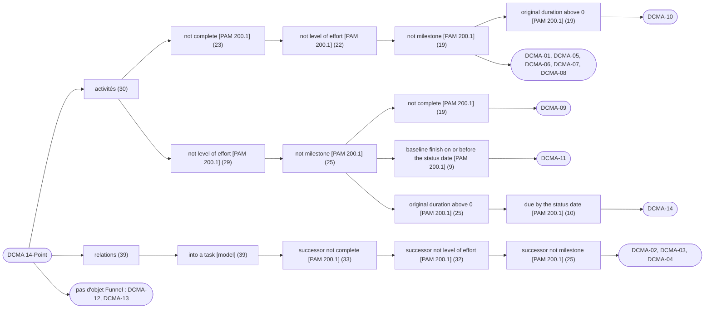

Légende des libellés d'étape qui n'ont pas encore été traduits : `successor not complete`
(successeur non terminé), `successor not level of effort` (successeur hors Level of Effort),
`successor not milestone` (successeur hors jalon), `original duration above 0` (durée initiale
supérieure à 0), `baseline finish on or before the status date` (fin de Baseline antérieure ou égale
à la Data Date), `due by the status date` (due au plus tard à la Data Date).

### Entonnoirs des contrôles 14-Point

Les lignes suivantes donnent les mêmes chaînes contrôle par contrôle, avec les décomptes de
démonstration.

- DCMA-01 : activités (30) → not complete [PAM 200.1] (23) → not level of effort [PAM 200.1] (22) →
  not milestone [PAM 200.1] (19) → population (19) → comptées (1) ; résultat de démonstration 5.26,
  fail
- DCMA-02 : relations (39) → into a task [model] (39) → successor not complete [PAM 200.1] (33) →
  successor not level of effort [PAM 200.1] (32) → successor not milestone [PAM 200.1] (25) →
  population (25) → comptées (1) ; résultat de démonstration 1.00, fail
- DCMA-03 : relations (39) → into a task [model] (39) → successor not complete [PAM 200.1] (33) →
  successor not level of effort [PAM 200.1] (32) → successor not milestone [PAM 200.1] (25) →
  population (25) → comptées (2) ; résultat de démonstration 8.00, fail
- DCMA-04 : relations (39) → into a task [model] (39) → successor not complete [PAM 200.1] (33) →
  successor not level of effort [PAM 200.1] (32) → successor not milestone [PAM 200.1] (25) →
  population (25) → comptées (23) ; résultat de démonstration 92.00, pass
- DCMA-05 : activités (30) → not complete [PAM 200.1] (23) → not level of effort [PAM 200.1] (22) →
  not milestone [PAM 200.1] (19) → population (19) → comptées (0) ; résultat de démonstration 0.00,
  pass
- DCMA-06 : activités (30) → not complete [PAM 200.1] (23) → not level of effort [PAM 200.1] (22) →
  not milestone [PAM 200.1] (19) → population (19) → comptées (3) ; résultat de démonstration 15.79,
  fail
- DCMA-07 : activités (30) → not complete [PAM 200.1] (23) → not level of effort [PAM 200.1] (22) →
  not milestone [PAM 200.1] (19) → population (19) → comptées (12) ; résultat de démonstration
  12.00, fail
- DCMA-08 : activités (30) → not complete [PAM 200.1] (23) → not level of effort [PAM 200.1] (22) →
  not milestone [PAM 200.1] (19) → population (19) → comptées (1) ; résultat de démonstration 5.26,
  fail
- DCMA-09 : activités (30) → not level of effort [PAM 200.1] (29) → not milestone [PAM 200.1] (25) →
  not complete [PAM 200.1] (19) → population (19) → comptées (0) ; résultat de démonstration 0.00,
  pass
- DCMA-10 : activités (30) → not complete [PAM 200.1] (23) → not level of effort [PAM 200.1] (22) →
  not milestone [PAM 200.1] (19) → original duration above 0 [PAM 200.1] (19) → population (19) →
  comptées (2) ; résultat de démonstration 10.53, fail
- DCMA-11 : activités (30) → not level of effort [PAM 200.1] (29) → not milestone [PAM 200.1] (25) →
  baseline finish on or before the status date [PAM 200.1] (9) → population (9) → comptées (9) ;
  résultat de démonstration 100.00, fail
- DCMA-12 : activités (30) → non terminées, hors Level of Effort, hors jalons [xerscope] (19) → sur
  le Longest Path recalculé [xerscope] (7) → début restant le plus précoce, puis Activity ID le plus
  bas [xerscope] (1 : `P2030`) → retardée de 600 wd ; fin lue sur les points de fin (2) ; pas
  d'objet `Funnel` ; résultat de démonstration 1.00, pass
- DCMA-13 : activités (30) → non terminées, hors Level of Effort, jalons de fin, avec une fin
  [xerscope] (3) → fin la plus tardive, puis Activity ID le plus élevé [xerscope] (1 : `M9999`) →
  CPL 156 wd, TF −15 wd ; pas d'objet `Funnel` ; résultat de démonstration 0.90, fail
- DCMA-14 : activités (30) → not level of effort [PAM 200.1] (29) → not milestone [PAM 200.1] (25) →
  original duration above 0 [PAM 200.1] (25) → due by the status date [PAM 200.1] (10) → population
  (10) → comptées (5) ; résultat de démonstration 0.50, fail

Dans DCMA-11, l'étape `baseline finish on or before the status date` retire aussi les activités sans
début de Baseline : les 25 activités qui la précèdent contiennent 1 activité sans dates de Baseline.
Dans DCMA-14, une activité sans fin de Baseline est due et reste dans la population.

### Test du chemin critique et CPLI, étape par étape

DCMA-12, 06A401a et DCMA-13 ne portent pas d'objet `Funnel`. Leurs règles découpent leur population
comme suit (`rules.critical_path_output`, `cpm.critical_path_test`, `dcma_13_cpli`).

Le test du chemin critique procède dans cet ordre :

1. La valeur est `n/a` sans Data Date (note `no status date`), ou quand aucune activité n'est à la
   fois non terminée, hors Level of Effort et datée (note `no remaining work`).
2. La mise à jour est recalculée. Un planning que le moteur refuse est un échec.
3. L'activité retardée est, parmi les activités non terminées, hors Level of Effort et hors jalons
   qui sont sur le Longest Path recalculé, celle dont le début restant est le plus précoce, puis
   dont l'Activity ID est le plus bas. Sans une telle activité, le test échoue.
4. Le retard vaut `slip_days` × le `hours_per_day` de cette activité, soit 600 wd × 8 h dans la
   démonstration. Il est ajouté à la durée restante, l'Expected Finish (fin attendue) de l'activité
   retardée est supprimée, et la mise à jour est recalculée de nouveau.
5. La fin est la fin au plus tôt la plus tardive des points de fin, avant et après. Un point de fin
   est une activité du recalcul qu'aucune activité autre qu'une activité Level of Effort ne suit.
   Une activité Level of Effort n'en est jamais un.
6. Le déplacement est le nombre d'heures ouvrées entre les deux fins sur le calendrier de l'activité
   retardée.
7. Le test réussit quand le déplacement est au moins égal au retard, ou quand la fin s'est déplacée
   au moins autant que la propre fin de l'activité retardée. Il réussit aussi quand une partie du
   retard est arrivée, que les points de fin qui terminent le planning sans retard ajouté se sont
   déplacés, et qu'aucune Expected Finish en aval n'a cédé de durée restante. Sinon il échoue.

La note de la démonstration indique
`+600 wd on P2030: forecast finish 2027-03-23 -> 2028-11-12, moved +600.0 wd`.

Le CPLI procède dans cet ordre :

1. La valeur est `n/a` dans les deux conditions de l'étape 1 du test du chemin critique.
2. Avec un Must Finish By (`PROJECT.plan_end_date`), l'activité mesurée est celle qui pilote la
   fin : l'activité non terminée et hors Level of Effort dont le Finish est le plus tardif. Entre
   plusieurs, un Total Float vide passe en premier, puis le Total Float le plus faible, puis
   l'Activity ID le plus bas. TF est son `total_float_hr_cnt` / les heures par jour du calendrier du
   projet, et la valeur est `n/a` quand ce Float est vide.
3. Sans Must Finish By, l'activité mesurée est le jalon de fin non terminé et hors Level of Effort
   dont le Finish est le plus tardif, puis dont l'Activity ID est le plus élevé. TF est le nombre de
   jours ouvrés du projet de son Finish à son `bl_finish`, négatif en cas de retard. La valeur est
   `n/a` sans Baseline, sans un tel jalon ou sans sa fin de Baseline. Sur la Baseline des dates
   planifiées, TF vaut 0 et le statut est `info`.
4. CPL est le nombre de jours ouvrés du projet de la Data Date au Finish de l'activité mesurée. La
   valeur est (CPL + TF) / CPL, et `n/a` quand CPL n'est pas supérieur à 0.

La série de démonstration n'a pas de Must Finish By : CPL vaut 156 wd jusqu'à `M9999`, TF vaut
−15 wd, et la valeur est (156 − 15) / 156 = 0.90.

### Points ouverts des contrôles 14-Point

Les lectures suivantes sont marquées comme non tranchées dans le code ou dans les documents
associés.

- Tous les contrôles sur les activités : un jalon est le type d'activité de P6. Une activité d'un
  autre type sans durée initiale reste donc dans la population, sauf dans DCMA-10 et DCMA-14
  (docstring de `_discrete_tasks`).
- DCMA-02, DCMA-03 et DCMA-04 : une relation compte quand son successeur est conservé. C'est la
  lecture que fait xerscope de la section 4.0, qui nomme des tâches et non des relations (docstrings
  des règles).
- DCMA-05 : une contrainte secondaire dure compte, et une activité ayant deux contraintes dures est
  comptée une fois (docstring de la règle).
- DCMA-08 : les fichiers hebdomadaires ne portent pas de période de planification détaillée. Tout
  début de Baseline est donc retenu, et les heures de Baseline sont divisées par les heures par jour
  actuelles de l'activité (docstring de la règle ; Backlog, DECM).
- DCMA-09 : l'intention de « actual start/finish » dans la section 4.9 pour les tâches terminées.
  Une activité terminée dont la fin réelle est postérieure à la Data Date est écartée, et non
  comptée (docstring de la règle).
- DCMA-12 : la part du glissement qui doit arriver quand l'activité retardée a du Float sur sa
  propre fin. La longueur du glissement et la lecture du résultat sont celles de xerscope (docstring
  de la règle ; CPM, test du chemin critique).
- DCMA-13 : la marge jusqu'à la fin de Baseline sans Must Finish By est la lecture de xerscope
  (docstring de la règle). Avec un Must Finish By, le Float de l'activité qui pilote la fin, mesuré
  sur son propre calendrier, est divisé par les heures par jour du calendrier du projet (Backlog,
  contrôles).
- DCMA-14 : « tasks missing baseline finish dates » est lu comme les tâches sans date de fin de
  Baseline (docstring de la règle).

## Integrity

Le standard `INTEGRITY` (`standards/integrity.toml`, nom `Integrity`) contient huit contrôles, à
raison d'une fonction par contrôle dans `analysis/integrity.py`. L'application les affiche sur les
pages **Schedule health** et **Audit**. La commande est `xerscope check FILE --standard INTEGRITY`.

Integrity n'est pas un standard publié. INT-01 et INT-03 comparent le fichier au recalcul décrit
dans la partie « Recalcul » de cette fiche. INT-02 et INT-04 à INT-08 suivent le Schedule Project
Log de l'aide d'Oracle P6 EPPM 26, citée par numéro de page. Formules 2.4 contient la forme longue
et les tests qui la figent.

### Contrôles d'Integrity

Le tableau 13 donne les champs compacts de chaque contrôle.

Tableau 13. Contrôles d'Integrity

| Id | Nom | Formule | Unité | Cible | Prérequis | Source | Code | Pour approfondir |
|---|---|---|---|---|---|---|---|---|
| INT-01 | Schedule recalculated (planning recalculé) | au moins une valeur enregistrée parmi `early_start_date`, `early_end_date`, `late_start_date`, `late_end_date`, `total_float_hr_cnt` que le recalcul ne donne pas (dates : même horodatage ; Float : différence de 0 à 0,01 h près) | `%` | `<= 0%` | aucun | aide de P6 EPPM 26, 99351, 99352 ; comparaison : xerscope | `int_01_recalculated` | Formules 2.4, 6 |
| INT-02 | Out of sequence activities (activités hors séquence) | prédécesseur FS non terminé, ou prédécesseur SS non commencé | `count` | `info` | aucun | aide de P6 EPPM 26, 99350 ; R1 | `int_02_out_of_sequence_progress` | Formules 2.4 |
| INT-03 | Assignments recalculated (affectations recalculées) | affectation dont un `restart_date`, `reend_date`, `rem_late_start_date` ou `rem_late_end_date` enregistré n'est pas l'horodatage recalculé | `%` | `<= 0%` | aucun | xerscope (le fichier du standard n'indique aucune source) | `int_03_assignments_recalculated` | Formules 2.4, 6 |
| INT-04 | Relationship loops (boucles de relations) | sur une boucle logique : un groupe fortement connexe de plus d'une activité, ou une activité liée à elle-même, parmi les activités qui ne sont pas Level of Effort | `count` | `<= 0` | aucun | aide de P6 EPPM 26, 99374 | `int_04_relationship_loops` | Formules 2.4 |
| INT-05 | Without predecessors or successors (sans prédécesseurs ou sans successeurs) | aucune relation entrante, ou aucune relation sortante ; un lien vers un autre projet compte | `count` | `info` | aucun | aide de P6 EPPM 26, 99350 | `int_05_without_predecessors_or_successors` | Formules 2.4 |
| INT-06 | Actual date later than data date (date réelle postérieure à la date des données) | `act_start_date` ou `act_end_date` postérieur à la Data Date, horodatages comparés | `count` | `<= 0` | Data Date ; sans Data Date : `n/a`, note `no status date` | aide de P6 EPPM 26, 99350 | `int_06_actual_date_after_data_date` | Formules 2.4 |
| INT-07 | Unsatisfied constraints (contraintes non respectées) | début ou fin au plus tôt recalculés qui ne sont pas du côté de la date de contrainte qu'exige son type, en heures ouvrées du calendrier de l'activité | `count` | `info` | aucun | aide de P6 EPPM 26, 99352 ; lecture : xerscope | `int_07_unsatisfied_constraints` | Formules 2.4 |
| INT-08 | Unsatisfied relationships (relations non respectées) | FS, début du successeur avant la fin du prédécesseur ; SS, début avant début ; FF, fin avant fin ; SF, fin avant début ; successeur à sa date au plus tôt recalculée, prédécesseur à sa date réelle, sinon à sa date au plus tôt recalculée ; le Lag n'est pas ajouté | `count` | `info` | aucun | aide de P6 EPPM 26, 99352 ; lecture : xerscope | `int_08_unsatisfied_relationships` | Formules 2.4 |

### Arbre des entonnoirs d'Integrity

Le schéma suivant montre les ensembles de départ des contrôles Integrity, les étapes qu'ils
partagent, et les contrôles qui utilisent chaque chaîne d'étapes.

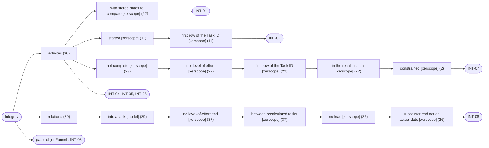

Légende des libellés d'étape qui n'ont pas encore été traduits : `with stored dates to compare`
(avec des dates enregistrées à comparer), `started` (commencée), `first row of the Task ID`
(première ligne du Task ID, le nom de l'Activity ID dans l'application), `in the recalculation`
(dans le recalcul), `constrained` (contrainte), `no level-of-effort end` (aucune extrémité Level of
Effort), `between recalculated tasks` (entre des tâches recalculées), `no lead` (pas de Lead),
`successor end not an actual date` (extrémité du successeur qui n'est pas une date réelle).

### Entonnoirs des contrôles Integrity

Les lignes suivantes donnent les mêmes chaînes contrôle par contrôle, avec les décomptes de
démonstration.

- INT-01 : activités (30) → with stored dates to compare [xerscope] (22) → population (22) →
  comptées (0) ; résultat de démonstration 0.00, pass
- INT-02 : activités (30) → started [xerscope] (11) → first row of the Task ID [xerscope] (11) →
  population (11) → comptées (0) ; résultat de démonstration 0.00, info
- INT-03 : lignes `TASKRSRC` (25) → sur une activité que le recalcul planifie, non terminée, hors
  Level of Effort [xerscope] (19) → avec une date enregistrée à comparer [xerscope] (19) →
  population (19) → comptées (0) ; pas d'objet `Funnel` ; résultat de démonstration 0.00, pass
- INT-04 : activités (30) → population (30) → comptées (0) ; résultat de démonstration 0.00, pass
- INT-05 : activités (30) → population (30) → comptées (3) ; résultat de démonstration 3.00, info
- INT-06 : activités (30) → population (30) → comptées (1) ; résultat de démonstration 1.00, fail
- INT-07 : activités (30) → not complete [xerscope] (23) → not level of effort [xerscope] (22) →
  first row of the Task ID [xerscope] (22) → in the recalculation [xerscope] (22) → constrained
  [xerscope] (2) → population (2) → comptées (1) ; résultat de démonstration 1.00, info
- INT-08 : relations (39) → into a task [model] (39) → no level-of-effort end [xerscope] (37) →
  between recalculated tasks [xerscope] (37) → no lead [xerscope] (36) → successor end not an actual
  date [xerscope] (26) → population (26) → comptées (0) ; résultat de démonstration 0.00, info

L'étape `with stored dates to compare` d'INT-01 conserve les activités que le recalcul compare, non
terminées et hors Level of Effort, qui portent au moins une des cinq valeurs enregistrées. Sa note
compte des valeurs, `110 of 110 stored values reproduced` dans la démonstration, là où le ratio
compte des activités. Dans INT-07, une contrainte de début sur une activité commencée n'en fait pas
une activité contrainte.

### Points ouverts des contrôles Integrity

Les lectures suivantes sont marquées comme non tranchées dans le code ou dans les documents
associés.

- INT-02 : les relations FF et SF ne sont pas listées. La lecture par type de relation est calibrée
  sur le rapport R1 (champ source du fichier du standard).
- INT-03 : le fichier du standard n'indique aucune source pour ce contrôle.
- INT-07 : la lecture est celle de xerscope et n'est pas confirmée par rapport à un journal de P6
  (docstring de la règle).
- INT-08 : la comparaison porte sur des heures d'horloge. D'un calendrier à l'autre, une relation
  peut être listée comme rompue alors que les deux dates sont la même minute ouvrée (Backlog,
  contrôles).

## Règles pour un standard personnalisé

Un standard personnalisé est un fichier TOML qui choisit des règles de `analysis/rules.py` par leur
nom et donne à chacune ses paramètres et sa cible. Les 12 règles paramétrées tirent la population de
leurs paramètres : `exclude` liste des clés du tableau 5, à raison d'une étape d'entonnoir par clé
dans l'ordre donné, chaque étape citant le jeton `xerscope`. Une règle sur les relations part des
relations, conserve celles qui sont `into a task`, puis applique `links` (`all`, `not_both_complete`
ou `succ_incomplete`), une étape par clé de `exclude` sur le successeur, et `exclude_loe`. Ces
étapes citent le jeton `model`.

L'application affiche un standard personnalisé comme un standard intégré, sur les pages
**Schedule health** et **Audit**. Les commandes sont `xerscope check FILE --standard my.toml` et
`xerscope standards --rules`, qui affiche chaque règle avec ses paramètres. Un standard personnalisé
peut aussi nommer n'importe quelle règle des standards intégrés. Formules 2.5 et la section « Your
own standard » de Standards contiennent la forme longue.

### Règles paramétrées

Le tableau 14 donne les champs compacts de chaque règle. Une valeur entre parenthèses est la valeur
par défaut du paramètre.

Tableau 14. Règles paramétrées

| Règle | Libellé de liste | Formule | Unité | Cible | Prérequis | Source | Code | Pour approfondir |
|---|---|---|---|---|---|---|---|---|
| `missing_logic` | Missing a predecessor or a successor (prédécesseur ou successeur manquant) | pas de prédécesseur ou pas de successeur parmi les relations du projet ; `external_passes` (true) compte un lien vers un autre projet ; `pred_exempt` et `succ_exempt` (aucun) dispensent d'un côté pour `started`, `start_milestone`, `finish_milestone`, `project_start`, `project_finish`, `single_project_start`, `single_project_finish` ; `dangling` (false) compte aussi une activité non commencée dont les prédécesseurs ne comprennent ni FS ni SS, et une activité dont les successeurs ne comprennent ni FS ni FF ; un lien vers un autre projet de ce côté, ou le début ou la fin du projet, l'en dispense ; `exclude` (`complete`) | `%` | fixée par le fichier du standard | aucun | xerscope | `missing_logic` | Formules 2.5 |
| `dangling` | Logic that does not drive the task (logique qui ne pilote pas la tâche) | `end = "finish"` (par défaut) : un successeur existe et aucun n'est FS ou FF ; `end = "start"` : un prédécesseur existe et aucun n'est FS ou SS, les activités commencées étant écartées de la population ; `exclude` (`complete`) | `%` | fixée par le fichier du standard | aucun | xerscope | `dangling` | Formules 2.5 |
| `lag` | Relationships with the lag in question (relations ayant le décalage en question) | `lag_hr` comparé à `value` (0) par `op` (`>`) ; `unit = "days"` lit `lag_d`, en jours du calendrier du prédécesseur ; `unit = "project_pct"` compare `lag_hr` à `value` % des heures ouvrées du début planifié à la fin prévisionnelle sur le calendrier du projet ; `links` (`succ_incomplete`), `exclude_loe` (false), `exclude` (aucun) | `%` | fixée par le fichier du standard | aucun ; `project_pct` sans ces deux dates : `n/a` | xerscope | `lag` | Formules 2.5 |
| `relationship_type` | Relationships of another type (relations d'un autre type) | relations de type `type` (FS), avec en plus un Lag de 0 quand `zero_lag` ; valeur = 100 × comptées / population ; `listed` choisit la liste : les autres, ou celles du type ; `links` (`succ_incomplete`), `exclude_loe` (false), `exclude` (aucun) | `%` | fixée par le fichier du standard | aucun | xerscope | `relationship_type` | Formules 2.5 |
| `constraints` | Constrained tasks (tâches contraintes) | contrainte primaire ou secondaire parmi `types` (aucun), des codes P6 comme `CS_MANDSTART` ; `ignore_start_when_started` (true) écarte une contrainte de début sur une activité commencée ; `exclude` (`complete`) | `%` | fixée par le fichier du standard | aucun | xerscope | `constraints` | Formules 2.5 |
| `float` | Tasks outside the float limit (tâches hors de la limite de marge) | `total_float_d`, en wd du calendrier de l'activité, comparé à `value` (44) par `op` (`>`) ; `unit = "hours"` lit `total_float_hr_cnt` ; `op = "between"` compte un Float de `value` à `value_max`, bornes comprises ; `exclude` (`complete`) | `%` | fixée par le fichier du standard | aucun | xerscope | `total_float` | Formules 2.5 |
| `duration` | Tasks outside the duration limit (tâches hors de la limite de durée) | `original_d` comparé à `value` (44) par `op` (`>`) ; `field` lit la durée restante, ou la durée de Baseline (`bl_duration_hr` / le `hours_per_day` actuel de l'activité) ; `unit = "hours"` lit les heures telles qu'enregistrées ; `exclude` (`complete`) | `%` | fixée par le fichier du standard | Baseline pour `field = "baseline"` ; sans Baseline : `n/a`, note `needs a baseline` | xerscope | `duration` | Formules 2.5 |
| `invalid_dates` | Progress dates on the wrong side of the status date (dates d'avancement du mauvais côté de la date de statut) | `kind` (both) : une prévision antérieure à la Data Date (non commencée : début prévisionnel ; toute activité ouverte : fin prévisionnelle ; `in_progress = "start"` : début prévisionnel de toute activité ouverte), ou une date réelle postérieure à celle-ci ; `include_data_date` (false) compte aussi une prévision à la Data Date ; `denominator = "started"` divise par les activités ayant un début réel ; `exclude` (`loe`, `complete_before_data_date`) | `%` | fixée par le fichier du standard | Data Date ; sans Data Date : `n/a`, note `no status date` | xerscope | `invalid_dates` | Formules 2.5 |
| `on_data_date` | Starting or finishing on the data date (début ou fin à la date des données) | Start ou Finish à la Data Date ; `date_grain` (day) compare des jours calendaires, ou des horodatages ; `exclude` (`complete`) | `%` | fixée par le fichier du standard | Data Date ; sans Data Date : `n/a`, note `no status date` | xerscope | `on_data_date` | Formules 2.5 |
| `no_resource` | Tasks with no resource assignment (tâches sans affectation de ressource) | aucune ligne `TASKRSRC`, et aucune ligne `PROJCOST` quand `expenses_count` (true) ; `kind = "labour_units"` compte à la place un `labor_budget_hr` qui n'est pas supérieur à 0 ; `exclude` (`complete`, `loe`, `milestones`) | `%` | fixée par le fichier du standard | aucun | xerscope | `no_resource` | Formules 2.5 |
| `late_vs_baseline` | Forecast to finish after their baseline finish (fin prévue après leur fin de référence) | heures ouvrées de `bl_finish` au Finish supérieures à `tolerance_hours` (0), sur le calendrier de l'activité ; `no_baseline = "planned"` prend le `target_end_date` de la mise à jour là où la Baseline n'a pas de fin ; `exclude` (`complete`, `milestones`, `loe`) | `%` | fixée par le fichier du standard | Baseline ; sans Baseline : `n/a`, note `needs a baseline` | xerscope | `late_vs_baseline` | Formules 2.5 |
| `bei` | Due by the status date but not completed (dues au plus tard à la date de statut mais non terminées) | activités terminées ; valeur = comptées / population, les activités dues : `bl_finish` antérieur ou égal à la Data Date, ou pas de fin de Baseline (`missing_baseline = "due"`) ; `due_from = "baseline"` compte les activités dues dans la Baseline elle-même ; `exclude` (`loe`, `milestones`) | `ratio` | fixée par le fichier du standard | Baseline ; sans Baseline : `n/a`, note `needs a baseline` ; sans Data Date : `n/a`, note `no status date` | xerscope | `bei` | Formules 2.5 |

### Entonnoirs des règles paramétrées

Les lignes suivantes donnent la chaîne de chaque règle avec ses paramètres par défaut sur la série
de démonstration, et la valeur que renvoie la règle.

- `missing_logic` : activités (30) → not complete [xerscope] (23) → population (23) → comptées (2) ;
  valeur de démonstration 8.70
- `dangling` : activités (30) → not complete [xerscope] (23) → population (23) → comptées (0) ;
  valeur de démonstration 0.00
- `lag` : relations (39) → into a task [model] (39) → successor not complete [model] (33) →
  population (33) → comptées (2) ; valeur de démonstration 6.06
- `relationship_type` : relations (39) → into a task [model] (39) → successor not complete [model]
  (33) → population (33) → comptées (29) ; valeur de démonstration 87.88
- `constraints` : activités (30) → not complete [xerscope] (23) → population (23) → comptées (0) ;
  valeur de démonstration 0.00
- `float` : activités (30) → not complete [xerscope] (23) → population (23) → comptées (3) ; valeur
  de démonstration 13.04
- `duration` : activités (30) → not complete [xerscope] (23) → population (23) → comptées (1) ;
  valeur de démonstration 4.35
- `invalid_dates` : activités (30) → not level of effort [xerscope] (29) → not completed before the
  status date [xerscope] (23) → population (23) → comptées (1) ; valeur de démonstration 4.35
- `on_data_date` : activités (30) → not complete [xerscope] (23) → population (23) → comptées (0) ;
  valeur de démonstration 0.00
- `no_resource` : activités (30) → not complete [xerscope] (23) → not level of effort [xerscope]
  (22) → not milestone [xerscope] (19) → population (19) → comptées (2) ; valeur de démonstration
  10.53
- `late_vs_baseline` : activités (30) → not complete [xerscope] (23) → not milestone [xerscope] (20)
  → not level of effort [xerscope] (19) → population (19) → comptées (18) ; valeur de démonstration
  94.74
- `bei` : activités (30) → not level of effort [xerscope] (29) → not milestone [xerscope] (25) → due
  by the status date [xerscope] (9) → population (9) → comptées (6) ; valeur de démonstration 0.67

## Score des standards

Le score lit les statuts des contrôles d'un standard et ne recalcule aucun contrôle. Le schéma
suivant montre comment les 18 contrôles de P6 Check Schedule deviennent le score de la série de
démonstration.

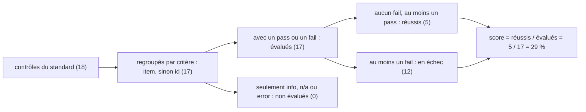

### Score d'un standard

- **Identifiant** : `StandardScore` (`passed`, `evaluated`, `failed_ids`) ; la carte affiche une
  valeur comme `29 %` et un détail comme `17 evaluated · 12 fail: P6-01, …`.
- **Affichage** : page **Overview**, section **Score by standard** (Score par standard), une carte
  par standard listé sur la dernière mise à jour ; page **Schedule health**, la carte du standard
  choisi. Aucune commande ne l'affiche.
- **Formule** : critères en `pass` / (critères en `pass` + critères en `fail`), affiché en
  pourcentage sans décimale. Un critère est un contrôle, ou les contrôles qui partagent un `item`.
  Il échoue quand un de ses contrôles échoue, réussit quand aucun n'échoue et qu'au moins un
  réussit, et n'est pas évalué dans les autres cas.
- **Entonnoir** : contrôles de P6 (18) → regroupés par critère (17) → avec un `pass` ou un `fail`
  (17) → population (17) → comptés : réussis (5) ; résultat de démonstration 29 %. P6-10a et P6-10b
  forment un seul critère, nommé `P6-10 (P6-10b)` quand il échoue. Les autres standards donnent 11 /
  15 pour DECM, 4 / 14 pour DCMA et 3 / 4 pour INTEGRITY.
- **Cible et statut** : aucune. Un standard sans critère évalué affiche `–` et `0 evaluated`.
- **Prérequis** : les résultats des contrôles. Un contrôle qui est `n/a` faute de Baseline sort des
  deux termes. Deux scores calculés avec et sans Baseline ne se comparent donc pas.
- **Source** : xerscope. Aucun standard publié ne définit de score pour un planning.
- **Code** : `analysis/checks.py`, `standard_score`.
- **Pour approfondir** : Formules 1.6.

### Décomptes des contrôles par statut

- **Identifiant** : `status_counts` (`pass`, `fail`, `info`, `n/a`, `error`, `scored`).
- **Affichage** : page **Schedule health**, cartes **Checks passed** (Contrôles réussis),
  **Checks failed** (Contrôles en échec), **For review** (Pour examen), **Not applicable** (Non
  applicable), et **Errors** (Erreurs) quand il y en a une.
- **Formule** : nombre de contrôles dans chaque statut ; **Checks passed** affiche `pass` /
  `scored`, où `scored` = `pass` + `fail`. L'unité est un contrôle, pas un critère.
- **Entonnoir** : contrôles de P6 (18) → avec un `pass` ou un `fail` : scored (18) → population (18)
  → comptés : `pass` (6) ; résultat de démonstration 6 / 18.
- **Cible et statut** : aucune.
- **Prérequis** : les résultats des contrôles.
- **Source** : xerscope.
- **Code** : `analysis/checks.py`, `status_counts`.
- **Pour approfondir** : Formules 1.5.

## Recalcul

Le moteur recalcule les dates au plus tôt et au plus tard et les Floats d'une mise à jour comme P6
la calcule, puis les compare aux valeurs qu'enregistre le fichier. Le schéma suivant montre la
comparaison sur la dernière mise à jour de la série de démonstration.

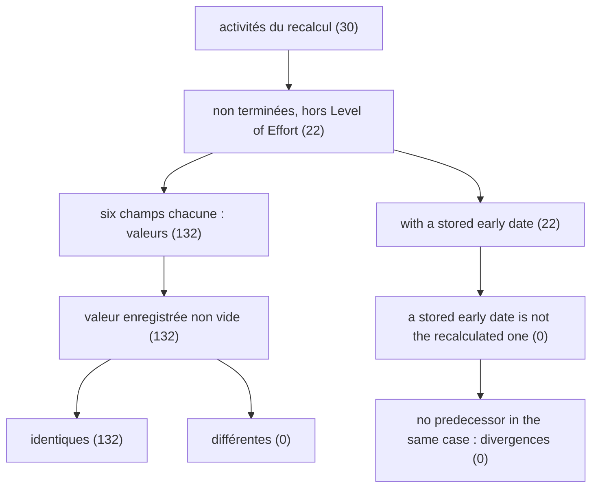

Légende des libellés d'étape qui n'ont pas encore été traduits : `with a stored early date` (avec
une date au plus tôt enregistrée), `a stored early date is not the recalculated one` (une date au
plus tôt enregistrée n'est pas la date recalculée), `no predecessor in the same case` (aucun
prédécesseur dans le même cas).

### Dates et Floats recalculés

- **Identifiant** : `es`, `ef`, `remaining_start`, `ls`, `lf`, `tf_hr`, `ff_hr`, `longest_path`
  (`Schedule.frame`) ; `Schedule.finish`.
- **Affichage** : `xerscope recalc FILE` affiche la fin recalculée, et `--out` écrit les dates et
  les Floats. INT-01, INT-03, INT-07, INT-08, DCMA-12, 06A401a et la page **Delay analysis**
  (Analyse des retards) les lisent.
- **Formule** : une passe avant et une passe arrière, à la minute près, chaque date sur le
  calendrier propre à l'activité et chaque Lag sur le calendrier que désignent les options de
  calcul. Le Total Float `tf_hr` est le nombre d'heures ouvrées du calendrier de l'activité de la
  fin au plus tôt à la fin au plus tard, ou le Float de début, ou le plus petit des deux, selon
  l'option **Compute Total Float as** (Calculer le Total Float comme). La fin du projet est la fin
  au plus tôt la plus tardive. `longest_path` marque les activités non terminées dont la fin au plus
  tôt est la fin du projet, puis toute activité atteinte à partir d'elles en remontant les relations
  pilotantes. Quand seuls des jalons terminent le projet, une activité sans aucune minute ouvrée de
  son calendrier entre sa fin au plus tôt et la fin du projet lance elle aussi le parcours. Une
  relation pilote quand la date qu'elle autorise pour son successeur (la fin au plus tôt du
  prédécesseur pour FS et FF, le début à partir duquel une relation SS ou SF est mesurée, plus le
  Lag sur le calendrier du Lag) n'est pas antérieure à la date qu'elle borne (début restant pour FS
  et SS, fin au plus tôt pour FF et SF), en minutes ouvrées du calendrier du successeur. Une
  relation qui entre dans une activité terminée ou qui en sort ne pilote rien. Il en va de même
  d'une relation qui entre dans une activité en cours sous Progress Override (priorité à
  l'avancement), et d'une relation qui autorise une date plus tardive que celle que tient une
  contrainte obligatoire sur un successeur non commencé. Une activité Level of Effort est marquée
  quand une de ses relations pilote une activité du chemin.
- **Entonnoir** : activités (30) → population : dans le recalcul (30). Une activité Level of Effort
  tire ses dates des activités auxquelles elle est liée et ne pilote rien.
- **Cible et statut** : aucune. Une boucle logique, ou une durée ou un Lag qui n'est pas fini ou
  dépasse 1 000 000 h, arrête le recalcul : INT-01, INT-03, INT-07 et INT-08 sont alors `n/a` avec
  la note `cannot schedule:` suivie de la raison, et DCMA-12 et 06A401a échouent avec la raison pour
  note.
- **Prérequis** : une mise à jour.
- **Source** : règles de calcul d'Oracle P6, validées par rapport à des sorties de P6 ; xerscope
  pour les conventions qu'aucune référence ne tranche.
- **Code** : `analysis/cpm.py`, `schedule`.
- **Pour approfondir** : CPM.
- **Point ouvert** : le nivellement des ressources, les Multiple Float Paths (chemins de Float
  multiples) et les relations vers des projets absents du fichier ne sont pas modélisés (CPM,
  section « Not modelled » ; CPM, conventions).

### Valeurs enregistrées comparées au recalcul

- **Identifiant** : `compare_with_stored` : une ligne par activité et par champ, avec `stored`,
  `computed`, `gap_hr` et `agree`.
- **Affichage** : `xerscope recalc FILE`, une ligne par champ avec identiques / enregistrées ; page
  **Debug** (Débogage), bloc 3 ; INT-01.
- **Formule** : `es` par rapport à `early_start_date` (`remaining_start` pour une activité en
  cours), `ef` par rapport à `early_end_date`, `ls` par rapport à `late_start_date`, `lf` par
  rapport à `late_end_date`, `tf_hr` par rapport à `total_float_hr_cnt`, `ff_hr` par rapport à
  `free_float_hr_cnt`. Une date concorde quand les deux horodatages sont égaux. Un Float concorde
  quand calculé − enregistré, arrondi à 0,01 h, vaut 0. Le `gap_hr` d'une date est le nombre
  d'heures ouvrées de la date enregistrée à la date calculée sur le calendrier de l'activité : 0
  avec un `agree` faux signifie la même minute ouvrée écrite à une autre heure d'horloge.
- **Entonnoir** : activités du recalcul (30) → non terminées, hors Level of Effort (22) → six champs
  chacune (132 valeurs) → population : valeur enregistrée non vide (132) → comptées : identiques
  (132).
- **Cible et statut** : aucune ici ; INT-01 fixe la cible sur cinq des six champs, le Free Float
  (marge libre) étant écarté.
- **Prérequis** : une mise à jour que P6 a calculée ; un fichier sans dates enregistrées affiche
  `no stored dates to compare (never scheduled in P6?)`.
- **Source** : xerscope.
- **Code** : `analysis/cpm.py`, `compare_with_stored`.
- **Pour approfondir** : Formules 6.

### Dates d'affectation comparées au recalcul

- **Identifiant** : `compare_assignments` : une ligne par affectation et par date.
- **Affichage** : `xerscope recalc FILE`, ligne `assignments` ; page **Debug**, bloc 3 ; INT-03.
- **Formule** : le début et la fin au plus tôt restants et le début et la fin au plus tard
  recalculés de chaque affectation par rapport à `TASKRSRC.restart_date`, `reend_date`,
  `rem_late_start_date` et `rem_late_end_date`. Une date concorde quand les deux horodatages sont
  égaux ; `gap_hr` est en heures ouvrées du calendrier de l'activité.
- **Entonnoir** : lignes `TASKRSRC` (25) → sur une activité du recalcul, non terminée, hors Level of
  Effort (19) → quatre dates chacune (76 valeurs) → population : valeur enregistrée non vide (76) →
  comptées : identiques (76).
- **Cible et statut** : aucune ici ; INT-03 la fixe.
- **Prérequis** : une mise à jour avec des affectations de ressources.
- **Source** : xerscope.
- **Code** : `analysis/cpm.py`, `compare_assignments`.
- **Pour approfondir** : Formules 6.

### Divergences du recalcul

- **Identifiant** : `departures`, `departure_forms`, `departure_funnel`.
- **Affichage** : page **Debug**, bloc 3, avec les étapes de l'entonnoir ; le diagnostic anonyme
  contient les décomptes par forme.
- **Formule** : les activités où les dates au plus tôt recalculées diffèrent pour la première fois
  des dates enregistrées. Par activité : la fin au plus tôt enregistrée et la fin au plus tôt
  recalculée, et `gap_hr`, recalculé moins enregistré en heures ouvrées de son calendrier.
  `departure_forms` compte les mêmes lignes par statut, type, contrainte, Expected Finish,
  dépendance aux ressources et Longest Path.
- **Entonnoir** : activités (30) → not complete [xerscope] (23) → not level of effort [xerscope]
  (22) → with a stored early date [xerscope] (22) → a stored early date is not the recalculated one
  [xerscope] (0) → no predecessor in the same case [xerscope] (0) → population (0).
- **Cible et statut** : aucune.
- **Prérequis** : une mise à jour que P6 a calculée.
- **Source** : xerscope.
- **Code** : `app/recalculation_departures.py`, `departure_funnel`, `departures`.
- **Pour approfondir** : Formules 5.3.

## Journal des modifications

Le journal des modifications compare deux mises à jour d'un même projet. Les activités sont
rapprochées par Activity ID, sur la première ligne de chaque identifiant. Il liste une ligne par
modification, et ses décomptes alimentent la page **Changelog** (Journal des modifications) et
l'analyse des retards.

### Lignes de modification

- **Identifiant** : `changelog(old, new)` : colonnes `category`, `change`, `task_code`, `field`,
  `before`, `after`, `delta`, `unit`.
- **Affichage** : page **Changelog**, section **All changes** (Toutes les modifications) ;
  `xerscope changelog OLD NEW` affiche les décomptes.
- **Formule** : une ligne par condition du tableau 15 qui est remplie. Le signe de `delta` pour un
  début, une fin ou la fin prévisionnelle correspond aux jours ouvrés gagnés (+) ou perdus (−). Tout
  autre `delta` vaut après moins avant.
- **Entonnoir** : activités de la mise à jour antérieure (30) et de la mise à jour postérieure (30)
  → dans les deux (30), ajoutées (0), supprimées (0) → lignes (60), dont 4 lignes Project (projet).
- **Cible et statut** : aucune.
- **Prérequis** : deux mises à jour.
- **Source** : xerscope.
- **Code** : `analysis/changelog.py`, `changelog`.
- **Pour approfondir** : Formules 5.

Le tableau 15 donne la condition de chaque ligne ainsi que l'unité et le calendrier de son `delta`.

Tableau 15. Lignes du journal des modifications

| Catégorie | Modification | Condition | Delta |
|---|---|---|---|
| Project | status date | toujours | jours ouvrés de l'ancienne à la nouvelle Data Date, calendrier du projet de la mise à jour postérieure (wd) |
| Project | forecast finish (fin prévisionnelle) | toujours | −(jours ouvrés de l'ancienne à la nouvelle fin prévisionnelle), même calendrier (wd) |
| Project | activities, relationships (activités, relations) | toujours | nouveau décompte − ancien décompte |
| Scope (périmètre) | added, deleted (ajoutée, supprimée) | Activity ID présent seulement dans la mise à jour postérieure, seulement dans la mise à jour antérieure | aucun |
| Tasks (tâches) | renamed, moved to another WBS, type changed, calendar changed (renommée, déplacée vers un autre WBS, type modifié, calendrier modifié) | `task_name`, `wbs_code`, `type` ou `clndr_id` diffère | aucun |
| Durations (durées) | original duration changed (durée initiale modifiée) | `target_drtn_hr_cnt` diffère, heures comparées | `original_d` après − anciennes heures / `hours_per_day` après (wd du calendrier de l'activité dans la mise à jour postérieure) |
| Durations | remaining duration increased (durée restante augmentée) | `remain_drtn_hr_cnt` plus élevé, et non terminée dans la mise à jour postérieure | la même chose sur la durée restante (wd) |
| Durations | remaining duration cut (durée restante réduite) | `remain_drtn_hr_cnt` plus faible, et non commencée dans la mise à jour postérieure | la même chose sur la durée restante (wd) |
| Progress (avancement) | started, finished, status reverted (commencée, terminée, statut revenu en arrière) | `status` diffère ; revenu en arrière quand il recule dans l'ordre non commencée, en cours, terminée | aucun |
| Progress | actual start or finish changed (retroactive), removed (début réel ou fin réelle modifié rétroactivement, ou retiré) | les deux dates présentes et différentes ; présente avant et vide après | aucun |
| Progress | % complete (% d'avancement) | `pct_complete` après − avant, arrondi à 0,01, n'est pas 0 | cette différence (points) |
| Dates | start moved, finish moved (début déplacé, fin déplacée) | non terminée dans la mise à jour postérieure, et le déplacement, arrondi à 0,01 wd, dépasse 0,005 wd en valeur absolue | −(jours ouvrés de l'ancienne à la nouvelle date), calendrier de l'activité dans la mise à jour postérieure (wd) |
| Float | total float changed (Total Float modifié) | non terminée dans la mise à jour postérieure, les deux Floats présents, variation supérieure à 0,005 wd en valeur absolue | (`total_float_hr_cnt` après − avant) / `hours_per_day` après (wd) |
| Float | became critical, no longer critical (devenue critique, plus critique) | critique après et pas avant ; critique avant, pas après, et non terminée | aucun |
| Constraints (contraintes) | primary or secondary constraint added, removed, changed (contrainte primaire ou secondaire ajoutée, retirée, modifiée) | le type diffère, ou le type est présent et sa date diffère | aucun |
| Resources (ressources) | budgeted labour hours changed (heures de main-d'œuvre budgétées modifiées) | `labor_budget_hr` après − avant, arrondi à 0,01, n'est pas 0 | cette différence (h) |
| Resources | resource assigned, resource removed, budgeted units changed (ressource affectée, ressource retirée, unités budgétées modifiées) | par activité des deux mises à jour et par ressource : la somme des `TASKRSRC.target_qty` apparaît, disparaît, ou diffère une fois la différence arrondie à 0,01 | la différence d'unités, pour la dernière |
| Relationships (relations) | added, deleted | la paire formée du prédécesseur et du successeur n'est présente que dans la mise à jour postérieure, que dans la mise à jour antérieure | aucun |
| Relationships | type changed, lag changed (type modifié, Lag modifié) | la paire est dans les deux avec un autre ensemble de types ; avec les mêmes types et un autre Lag en heures | aucun |
| Calendars (calendriers) | working time changed (temps de travail modifié) | un calendrier des deux mises à jour dont les heures par jour, par semaine ou les exceptions datées diffèrent | aucun |
| Options | scheduling option changed (option de calcul modifiée) | une option de calcul ou le Must Finish By diffère ; vide et absent sont égaux | aucun |

### Décomptes des modifications

- **Identifiant** : `summary`, `category_totals`, `headline_counts` (`added`, `deleted`, `logic`,
  `durations`, `retroactive_actuals`, `became_critical`).
- **Affichage** : page **Changelog**, cartes **Forecast finish** (Fin prévisionnelle),
  **Added / deleted** (Ajoutées / supprimées), **Logic changes** (Modifications de logique),
  **Durations changed** (Durées modifiées), **Retroactive actuals** (Dates réelles rétroactives),
  **Became critical** (Devenues critiques), et section **Changes by category** (Modifications par
  catégorie) ; `xerscope changelog OLD NEW`.
- **Formule** : nombre de lignes par catégorie et par modification. **Logic changes** compte les
  lignes de la catégorie Relationships, **Durations changed** celles de Durations,
  **Retroactive actuals** les dates réelles modifiées ou retirées. **Forecast finish** affiche la
  fin prévisionnelle de la mise à jour postérieure et le `delta` de sa ligne Project, en wd du
  calendrier du projet.
- **Entonnoir** : lignes (60) → hors catégorie Project (56) → population (56) → comptées par
  catégorie : Progress (6), Dates (36), Float (14). Les cartes affichent 0 / 0, 0, 0, 1 et 0 dans la
  démonstration, et la fin prévisionnelle 2027-03-23 avec −2.0 wd.
- **Cible et statut** : aucune.
- **Prérequis** : deux mises à jour.
- **Source** : xerscope.
- **Code** : `analysis/changelog.py`, `summary`, `category_totals`, `headline_counts`,
  `forecast_finish`.
- **Pour approfondir** : Formules 5.

### Modifications par semaine

- **Identifiant** : `weekly_change_counts`, `weekly_change_matrix`.
- **Affichage** : page **Changelog**, volet dépliable **Every week, side by side** (Chaque semaine,
  côte à côte).
- **Formule** : les décomptes de l'entrée précédente pour chaque paire de mises à jour consécutives,
  une colonne par semaine, nommée par la Data Date la plus tardive.
- **Entonnoir** : mises à jour de la série (8) → paires consécutives (7) → lignes de chaque paire,
  hors catégorie Project → comptées par catégorie et par modification.
- **Cible et statut** : aucune.
- **Prérequis** : au moins deux mises à jour.
- **Source** : xerscope.
- **Code** : `analysis/changelog.py`, `weekly_change_counts`, `weekly_change_matrix`.
- **Pour approfondir** : Formules 5.

## Analyse des retards

L'analyse des retards lit une semaine par demi-pas : la mise à jour antérieure reçoit les
modifications de la mise à jour postérieure un type à la fois, et chaque planning dérivé est
recalculé. Le schéma suivant montre la semaine du 2026-10-12 au 2026-10-19 de la série de
démonstration, avec la fin recalculée après chaque étape et son déplacement.

```mermaid
flowchart LR
  earlier["mise à jour antérieure, recalculée : 2027-03-21"]
  progress["progress : 2027-03-23, déplacement -2.0 wd"]
  scope["scope : déplacement 0.0 wd"]
  durations["durations : déplacement 0.0 wd"]
  logic["logic : déplacement 0.0 wd"]
  constraints["constraints : déplacement 0.0 wd"]
  options["calendars and options : déplacement 0.0 wd"]
  later["mise à jour postérieure, recalculée : 2027-03-23, résidu 0.0 wd"]
  earlier --> progress
  progress --> scope
  scope --> durations
  durations --> logic
  logic --> constraints
  constraints --> options
  options --> later
```

Le tableau 16 donne ce que chaque étape reporte de la mise à jour postérieure sur le planning qui la
précède, et les lignes du journal des modifications comptées à cette étape.

Tableau 16. Étapes de la lecture par demi-pas

| Étape | Reporté depuis la mise à jour postérieure | Lignes du journal des modifications comptées |
|---|---|---|
| progress (avancement) | la Data Date ; le statut, les dates réelles, les dates de suspension et de reprise, `phys_complete_pct`, les bornes de dates externes ; la durée restante des activités commencées dans la mise à jour postérieure dont la durée restante a diminué | Progress |
| scope (périmètre) | les activités ajoutées, avec les relations et les affectations qui les atteignent ; les activités supprimées, retirées avec les leurs ; les types d'activité | Scope ; Tasks, type changed |
| durations (durées) | `target_drtn_hr_cnt`, `expect_end_date`, toute autre durée restante qui a changé, les affectations de ressources | Durations, Resources |
| logic (logique) | toutes les relations de la mise à jour postérieure | Relationships |
| constraints (contraintes) | les types et les dates de contrainte, et le Must Finish By du projet | Constraints |
| calendars and options (calendriers et options) | `clndr_id`, les définitions des calendriers, les options de calcul, le début planifié | Calendars, Options ; Tasks, calendar changed |

### Déplacement de chaque étape, glissement et replanification

- **Identifiant** : `shift_wd` d'une étape ; `slip_wd` ; `replanning_wd` ;
  `finish_before_replanning`.
- **Affichage** : page **Delay analysis**, cartes **Finish before replanning** (Fin avant
  replanification), **Finish shown** (Fin affichée) et **Tasks matched** (Tâches rapprochées ;
  `matched`, avec `added` et `deleted` en dessous), section **Step by step** (Étape par étape),
  section **Every update** (Chaque mise à jour) ; téléchargement **Download steps (CSV)**
  (Télécharger les étapes).
- **Formule** : `shift_wd` = −(jours ouvrés de la fin avant l'étape à la fin après l'étape), sur le
  calendrier du projet de la mise à jour postérieure, arrondi à 0,01 wd. `slip_wd` est le
  déplacement de l'étape progress. `replanning_wd` est la somme des déplacements des cinq autres
  étapes. La fin avant replanification est la fin recalculée après l'étape progress.
- **Entonnoir** : activités de la mise à jour antérieure (30) et de la mise à jour postérieure (30)
  → rapprochées par Activity ID (30), ajoutées (0), supprimées (0) ; lignes du journal des
  modifications (60) → reportées par une étape : progress (6), toutes les autres étapes (0). La fin
  recalculée passe de 2027-03-21 à 2027-03-23. La démonstration donne un glissement de −2.0 wd et
  une replanification de 0.0 wd.
- **Cible et statut** : aucune.
- **Prérequis** : deux mises à jour que le moteur peut calculer ; une semaine qu'il ne peut pas
  calculer garde sa ligne dans la série avec `not read:` suivi de la raison.
- **Source** : AACE RP 29R-03, MIP 3.4, 3.4.K.4 ; xerscope pour l'ordre des étapes et pour les
  champs que la pratique recommandée ne nomme pas.
- **Code** : `analysis/forensics.py`, `half_step`, `half_step_series`.
- **Pour approfondir** : Formules 5.1.
- **Point ouvert** : l'ordre dans lequel les types de révision sont appliqués, et l'étape qui reçoit
  les options de calcul, sont des conventions qu'aucune source ne tranche (Formules 5.1).

### Résidu et période

- **Identifiant** : `residual_wd` ; `period_wd` ; `is_slip_beyond_period`.
- **Affichage** : page **Delay analysis**, avertissements sous **Step by step**, et tableau de
  **Every update**.
- **Formule** : `residual_wd` = −(jours ouvrés de la fin après la dernière étape à la fin recalculée
  de la mise à jour postérieure). `period_wd` = jours ouvrés de la Data Date antérieure à la Data
  Date postérieure. Les deux sont sur le calendrier du projet de la mise à jour postérieure. Le
  glissement dépasse la période quand `slip_wd` est inférieur à −`period_wd` − 0,005.
- **Entonnoir** : les deux mises à jour de la semaine ; aucune population n'est découpée. La
  démonstration donne un résidu de 0.0 wd et une période de 7.0 wd.
- **Cible et statut** : aucune ; la page avertit quand le résidu dépasse 0,005 wd en valeur absolue
  et quand le glissement dépasse la période.
- **Prérequis** : deux mises à jour.
- **Source** : AACE RP 29R-03, 3.4.K.4.f et 3.4.K.4.g.
- **Code** : `analysis/forensics.py`, `half_step`, `HalfStep.is_slip_beyond_period`.
- **Pour approfondir** : Formules 5.1.

### Écart du moteur

- **Identifiant** : `engine_gap_wd` ; `is_finish_reproduced`.
- **Affichage** : page **Delay analysis**, avertissement au-dessus des cartes quand il n'est pas 0,
  et tableau de **Every update**.
- **Formule** : −(jours ouvrés de la fin prévisionnelle du fichier à la fin recalculée), sur le
  calendrier du projet de la mise à jour, arrondi à 0,01 wd. La fin est reproduite quand l'écart
  vaut 0 pour les deux mises à jour de la semaine.
- **Entonnoir** : une mise à jour ; aucune population n'est découpée. La démonstration donne 0.0 wd
  sur chaque mise à jour.
- **Cible et statut** : aucune ; la page avertit que les déplacements peuvent venir du recalcul
  quand l'écart n'est pas 0.
- **Prérequis** : une mise à jour.
- **Source** : xerscope.
- **Code** : `analysis/forensics.py`, `engine_gap_wd`.
- **Pour approfondir** : Formules 5.1.

### Cas de fin

- **Identifiant** : `finish_case` ; `held_by`.
- **Affichage** : page **Delay analysis**, légende **Finish held by** (Fin tenue par), et tableau de
  **Every update**.
- **Formule** : `mandatory finish` quand un point de fin porte un Mandatory Finish comme contrainte
  primaire et que sa fin au plus tôt recalculée est celle du projet ; sinon `must finish by` quand
  le projet en a un ; sinon `last task` (dernière tâche). `held_by` est la date de contrainte, le
  Must Finish By, ou la fin recalculée.
- **Entonnoir** : activités (30) → hors Level of Effort, non terminées (22) → sans successeur dans
  le projet → avec un Mandatory Finish → fin au plus tôt égale à la fin du projet (0). La
  démonstration donne `last task`.
- **Cible et statut** : aucune.
- **Prérequis** : une mise à jour.
- **Source** : aide d'Oracle P6 pour les trois cas ; xerscope pour l'ordre dans lequel ils sont lus.
- **Code** : `analysis/forensics.py`, `finish_case`.
- **Pour approfondir** : Formules 5.1.

### Float du Longest Path

- **Identifiant** : `longest_path_float_d`.
- **Affichage** : page **Delay analysis**, carte **Longest path float** (Float du Longest Path), et
  tableau de **Every update**.
- **Formule** : `tf_hr` le plus bas des activités du Longest Path recalculé / heures par jour du
  calendrier du projet. Le Float est en heures ouvrées du calendrier de chaque activité. La division
  se fait par le jour du calendrier du projet.
- **Entonnoir** : activités du recalcul (30) → sur le Longest Path recalculé → Total Float le plus
  bas. La démonstration donne −12.0 wd.
- **Cible et statut** : aucune.
- **Prérequis** : une mise à jour.
- **Source** : xerscope.
- **Code** : `analysis/forensics.py`, `longest_path_float_d`.
- **Pour approfondir** : Formules 5.1.

### Révisions par horizon

- **Identifiant** : `revisions_by_horizon` : `within the lookahead` (dans le lookahead),
  `beyond the lookahead` (au-delà du lookahead), `beyond_pct`.
- **Affichage** : page **Delay analysis**, tableau sous la légende **Where the revisions fall** (Où
  tombent les révisions).
- **Formule** : par étape après progress, et pour l'ensemble de ces étapes : les lignes du journal
  des modifications que l'étape reporte et qui nomment une activité, comptées dans le lookahead
  quand le Start de l'activité est antérieur ou égal à la Data Date postérieure plus 6 semaines
  (`Settings.lookahead_weeks`), au-delà sinon. `beyond_pct` = 100 × au-delà / (dans le lookahead +
  au-delà). Le Start est celui de la mise à jour postérieure, et celui de la mise à jour antérieure
  pour une activité supprimée depuis.
- **Entonnoir** : lignes du journal des modifications (60) → reportées par une étape après progress
  (0) → nommant une activité avec un Start (0) → comptées : au-delà du lookahead (0). La semaine de
  démonstration n'a aucune révision.
- **Cible et statut** : aucune ; `beyond_pct` est vide quand rien n'a été révisé.
- **Prérequis** : deux mises à jour.
- **Source** : xerscope ; le lookahead, vu comme l'horizon où le travail est rendu prêt à être
  exécuté, suit le Last Planner System, et aucune source ne fixe de seuil sur cette part.
- **Code** : `analysis/forensics.py`, `revisions_by_horizon`.
- **Pour approfondir** : Formules 5.1.

### Longest Path d'une mise à jour

- **Identifiant** : `longest_path`, `longest_path_funnel` ; source `P6 longest path`, `recalculated`
  ou `none`.
- **Affichage** : page **Delay analysis**, section **Longest path** (Chemin le plus long), avec les
  étapes de l'entonnoir.
- **Formule** : les activités non terminées que P6 a marquées (`TASK.driving_path_flag`). Quand le
  fichier n'en marque aucune, les activités non terminées du Longest Path recalculé.
- **Entonnoir** : activités (30) → not complete [AACE 29R-03] (23) → on the longest path (P6 longest
  path) [AACE 29R-03] (10) → population (10). La dernière étape se lit « sur le Longest Path
  (Longest Path de P6) ».
- **Cible et statut** : aucune.
- **Prérequis** : une mise à jour.
- **Source** : AACE RP 29R-03, 3.4.E.9.
- **Code** : `analysis/longest_path.py`, `longest_path_funnel`.
- **Pour approfondir** : Formules 5.2.

### Changements du Longest Path et stabilité

- **Identifiant** : `path_changes` (`change`, `float_before_d`) ; `path_churn` (`on_path`, `stayed`,
  `entered`, `left_finished`, `left_open`, `left_deleted`, `stability`).
- **Affichage** : page **Delay analysis**, section **Longest path**, tableau des changements et
  tableau de chaque mise à jour ; téléchargement **Download longest path (CSV)** (Télécharger le
  Longest Path).
- **Formule** : chaque activité présente sur le chemin de l'une ou l'autre mise à jour est `stayed`
  (restée), `entered` (entrée), `left: finished` (sortie, terminée), `left: still open` (sortie,
  encore ouverte) ou `left: deleted` (sortie, supprimée). `on_path` = stayed + entered. `stability`
  = stayed / (stayed + left still open). `float_before_d` est le Total Float enregistré de la mise à
  jour antérieure, en wd du calendrier de l'activité.
- **Entonnoir** : activités sur le Longest Path de la mise à jour antérieure (10) ou de la mise à
  jour postérieure (10) → sur l'un ou l'autre (10) → comptées : stayed (10), entered (0), left (0) ;
  stabilité de démonstration 1.00.
- **Cible et statut** : aucune ; `stability` est vide quand aucune activité du chemin antérieur
  n'est encore ouverte.
- **Prérequis** : deux mises à jour.
- **Source** : AACE RP 29R-03, SVP 2.3.B.6 ; xerscope pour le ratio de stabilité.
- **Code** : `analysis/longest_path.py`, `path_changes`, `path_churn`.
- **Pour approfondir** : Formules 5.2.

### PPC sur le Longest Path

- **Identifiant** : `path_commitments` ; `path_committed`, `path_kept`, `ppc_path`, `ppc_week`.
- **Affichage** : page **Delay analysis**, légende et tableau des engagements sur le Longest Path de
  la mise à jour précédente, et tableau de chaque mise à jour.
- **Formule** : `ppc_path` = 100 × tenus / pris sur les engagements de la semaine dont l'activité
  est sur le Longest Path de la mise à jour antérieure. `ppc_week` est la même chose sur tous les
  engagements, comme sur la page **PPC & progress** (PPC et avancement).
- **Entonnoir** : engagements de la semaine (4) → encore dans la mise à jour postérieure (4) →
  activité sur le Longest Path de la mise à jour antérieure (0) → population (0) → comptés : tenus
  (0). La démonstration affiche `ppc_week` 50.0 et un `ppc_path` vide.
- **Cible et statut** : aucune ; vide quand rien n'a été engagé sur le chemin.
- **Prérequis** : deux mises à jour.
- **Source** : xerscope ; le PPC lui-même suit le Last Planner System.
- **Code** : `analysis/longest_path.py`, `path_commitments`, `path_churn`.
- **Pour approfondir** : Formules 5.2.

## Valeur acquise et Earned Schedule

L'Earned Value (EV, valeur acquise) est calculée en heures de main-d'œuvre par rapport à une
Baseline, avec des chiffres de coût à côté quand la case à cocher **Costs** (Coûts) de la barre
latérale est cochée. La page **Earned value** (Valeur acquise) lit la Baseline de la première mise à
jour de la série, et la Baseline de chaque mise à jour quand **P6 view: the file's baseline** (Vue
P6 : la Baseline du fichier) est activé. Le schéma suivant montre la chaîne qui va de la Baseline et
de la mise à jour aux indices, avec les chiffres de la série de démonstration.

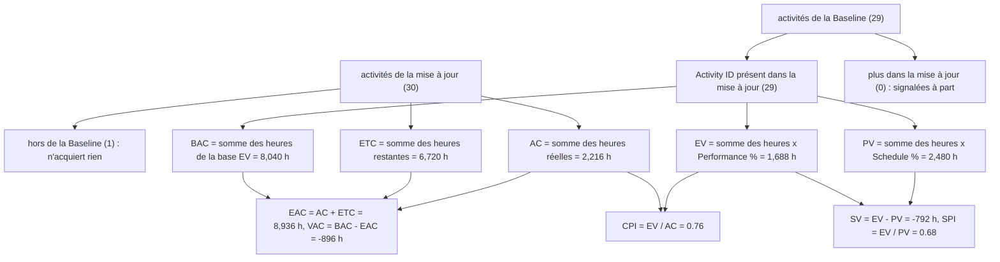

### Budget à l'achèvement

- **Identifiant** : `bac_hr` ; `unbaselined` ; `deleted_since_bl`, `pv_deleted_hr` ;
  `Baseline.bac_hours`.
- **Affichage** : page **Earned value** : volet dépliable **How it is calculated** (Mode de calcul)
  pour le BAC ; tableau de **Performance indices by update** (Indices de performance par mise à
  jour) pour `unbaselined`, `deleted_since_bl` et `pv_deleted_hr` ; légendes sous
  **Earned hours by task** (Heures acquises par tâche).
- **Formule** : le Budget at Completion (BAC, budget à l'achèvement) = Σ `ev_labor_hr` sur les
  activités de la Baseline dont l'Activity ID est dans la mise à jour, en heures.
  `Baseline.bac_hours` additionne toutes les activités de la Baseline : c'est la taille du plan.
  Avec l'option **Link renumbered tasks by GUID** (Lier par GUID les tâches renumérotées), une
  activité renumérotée depuis la Baseline est rapprochée par `TASK.guid`.
- **Entonnoir** : activités de la Baseline (29) → Activity ID présent dans la mise à jour (29) →
  population (29) ; plus dans la mise à jour (0) ; activités de la mise à jour absentes de la
  Baseline (1, `C3045`). Le BAC de démonstration est de 8,040 h.
- **Cible et statut** : aucune.
- **Prérequis** : une Baseline avec des heures de main-d'œuvre ; sans Baseline la page en demande
  une, et une Baseline sans heures n'a rien à acquérir.
- **Source** : P6 totalise ses champs de valeur acquise sur les activités du projet courant (P6
  Professional 25, How data is summarized) ; la base de valeur acquise suit l'onglet Earned Value
  des préférences d'administration de P6.
- **Code** : `analysis/evm.py`, `earned`, `ev_point` ; `analysis/baseline.py`, `Baseline`.
- **Pour approfondir** : Formules 3.

### Schedule % Complete et valeur planifiée

- **Identifiant** : `schedule_pct` ; `pv_hr` ; `pv_pct`, carte **Percent scheduled** (Pourcentage
  planifié).
- **Affichage** : page **Earned value**, carte, volet dépliable **How it is calculated**,
  **Earned hours by task**.
- **Formule** : le Schedule % (le Schedule % Complete de P6, pourcentage d'avancement planifié) à la
  Data Date = 100 × minutes ouvrées de `ev_start` à la Data Date / minutes ouvrées de `ev_start` à
  `ev_finish`, maintenu dans l'intervalle 0 à 100, sur le calendrier de l'activité de la Baseline lu
  dans le fichier de Baseline. Un intervalle sans temps de travail vaut 100 une fois `ev_finish`
  atteint, sinon 0. Une date manquante donne une valeur vide, lue comme 0. La Planned Value (PV,
  valeur planifiée) = Σ `ev_labor_hr` × Schedule % / 100, en heures, non arrondie. `pv_pct` = 100 ×
  PV / BAC.
- **Entonnoir** : activités de la Baseline présentes dans la mise à jour (29) → avec des heures de
  la base EV (22) → avec les deux dates EV (22) → population (22) → comptées : Schedule % supérieur
  à 0 (11). La PV de démonstration est de 2,480 h, soit 30.8 % du BAC.
- **Cible et statut** : aucune.
- **Prérequis** : une Baseline et une Data Date.
- **Source** : P6, Planned Value Labor Units = unités de main-d'œuvre de la Baseline × Schedule %
  Complete.
- **Code** : `analysis/evm.py`, `schedule_pct`, `earned`.
- **Pour approfondir** : Formules 3.
- **Point ouvert** : le Schedule % court jusqu'à la fin de Baseline, là où l'aide de P6 Professional
  26 nomme la fin planifiée courante pour le coût de la valeur planifiée (`UNRESOLVED` dans
  `schedule_pct` ; Backlog, contrôles).

### Performance % Complete et valeur acquise

- **Identifiant** : `perf_pct`, `ev_technique` ; `ev_hr` ; `ev_pct`, carte **Percent complete**
  (Pourcentage d'avancement).
- **Affichage** : page **Earned value**, carte, volet dépliable **How it is calculated**,
  **Earned hours by task**.
- **Formule** : EV = Σ `ev_labor_hr` × Performance % / 100, en heures. Le Performance % (le
  Performance % Complete de P6, pourcentage d'avancement de performance) suit la technique de valeur
  acquise de l'élément WBS de l'activité, telle que la donne le tableau 17. `ev_pct` = 100 × EV /
  BAC.
- **Entonnoir** : activités de la Baseline présentes dans la mise à jour (29) → population (29) →
  comptées : qui acquièrent des heures (8). L'EV de démonstration est de 1,688 h, soit 21.0 % du BAC.
- **Cible et statut** : aucune.
- **Prérequis** : une Baseline.
- **Source** : P6, Earned Value Labor Units = unités de main-d'œuvre de la Baseline × Performance %
  Complete ; `PROJWBS.ev_compute_type`.
- **Code** : `analysis/evm.py`, `performance_pct`, `earned`.
- **Pour approfondir** : Formules 3.
- **Point ouvert** : la technique des jalons WBS et tout code inconnu se rabattent sur le
  pourcentage d'avancement de l'activité et sont listés. Seul `EC_Cmp_pct` a été lu dans des exports
  P6 (Formules 7 ; Backlog, contrôles).

Le tableau 17 donne le Performance % de chaque technique de valeur acquise.

Tableau 17. Performance % Complete par technique de valeur acquise

| `PROJWBS.ev_compute_type` | Technique | Performance % |
|---|---|---|
| vide, `EC_Cmp_pct` | `activity` | `pct_complete` |
| `EC_0_100` | `0/100` | 100 quand l'activité est terminée, sinon 0 |
| `EC_50_50` | `50/50` | 100 quand l'activité est terminée, 50 quand elle est commencée, sinon 0 |
| `EC_User_pct` | `custom` | 100 quand l'activité est terminée, `PROJWBS.ev_user_pct` quand elle est commencée (vide : 0), sinon 0 |
| `EC_WBS_pct` | `wbs_milestones` | `pct_complete` ; l'activité est listée comme non modélisée |
| tout autre code | `unknown` | `pct_complete` ; l'activité est listée comme non modélisée |

### Heures réelles et estimation à l'achèvement

- **Identifiant** : `ac_hr`, `ac_unbaselined_hr` ; `etc_hr` ; `eac_hr` ; `vac_hr`, carte **EAC**.
- **Affichage** : page **Earned value**, carte **EAC** avec la VAC comme delta, volet dépliable
  **How it is calculated**.
- **Formule** : l'Actual Cost (AC, coût réel) = Σ `labor_actual_hr` et l'Estimate to Complete (ETC,
  estimation du reste à faire) = Σ `labor_remaining_hr` sur toutes les activités de la mise à jour,
  dans la Baseline ou non. L'Estimate at Completion (EAC, estimation à l'achèvement) = AC + ETC. La
  Variance at Completion (VAC, écart à l'achèvement) = BAC − EAC, négative en cas de dépassement.
  Tout est en heures.
- **Entonnoir** : activités de la mise à jour (30) → population (30) → comptées : avec des heures
  réelles (9), avec des heures restantes (17). La démonstration donne AC 2,216 h, ETC 6,720 h, EAC
  8,936 h, VAC −896 h.
- **Cible et statut** : aucune.
- **Prérequis** : une Baseline pour la VAC.
- **Source** : P6, Actual Labor Units et Remaining Labor Units ; EAC = ACWP + ETC dans le
  vocabulaire EVMS.
- **Code** : `analysis/evm.py`, `ev_point`, `EvPoint`.
- **Pour approfondir** : Formules 3.
- **Point ouvert** : la technique d'ETC de chaque élément WBS (`PROJWBS.ev_etc_compute_type`) est
  signalée, pas appliquée : l'ETC reste égal aux heures restantes (Formules 7 ; Backlog, contrôles).

### Écart de délais et indice de performance des délais

- **Identifiant** : `sv_hr`, carte **SV** ; `spi`, carte **SPI (labor units)** (SPI en unités de
  main-d'œuvre).
- **Affichage** : page **Earned value**, cartes, et **Performance indices by update**.
- **Formule** : la Schedule Variance (SV, écart de délais) = EV − PV, en heures. Le Schedule
  Performance Index (SPI, indice de performance des délais) = EV / PV, sans unité ; aucune valeur
  quand PV vaut 0.
- **Entonnoir** : les populations de PV et de EV. La démonstration donne −792 h et 0.68.
- **Cible et statut** : aucune ; le graphique trace une ligne pointillée au seuil d'alerte de la
  page.
- **Prérequis** : une Baseline et une Data Date.
- **Source** : colonne P6 Schedule Performance Index - Labor Units ; SPI = BCWP / BCWS dans le
  vocabulaire EVMS.
- **Code** : `analysis/evm.py`, `EvPoint.spi`, `EvPoint.as_row`.
- **Pour approfondir** : Formules 3.

### Indice de performance des coûts et productivité

- **Identifiant** : `cpi` ; `productivity`, libellé **EV / AC (baselined work)** (EV / AC, travail
  présent dans la Baseline) ; `ac_baselined_hr`.
- **Affichage** : page **Earned value**, **Performance indices by update** et volet dépliable
  **How it is calculated**.
- **Formule** : le Cost Performance Index (CPI, indice de performance des coûts) = EV / AC sur
  toutes les heures réelles ; aucune valeur quand AC vaut 0. Productivité = EV / (AC −
  `ac_unbaselined_hr`), soit les heures réelles des activités que contient la Baseline ; aucune
  valeur quand ce terme vaut 0. Les deux sont sans unité.
- **Entonnoir** : AC : activités de la mise à jour (30) → dans la Baseline (29) pour la
  productivité. La démonstration donne 0.76 pour les deux, l'activité hors Baseline n'ayant pas
  d'heures réelles.
- **Cible et statut** : aucune.
- **Prérequis** : une Baseline.
- **Source** : colonne P6 Cost Performance Index - Labor Units (aide d'Oracle P6 EPPM, page 47224) ;
  xerscope pour la productivité.
- **Code** : `analysis/evm.py`, `EvPoint.cpi`, `EvPoint.productivity`.
- **Pour approfondir** : Formules 3.

### Chiffres de coût

- **Identifiant** : `bac_cost`, `pv_cost`, `ev_cost` ; `spi_cost`, carte **SPI**.
- **Affichage** : page **Earned value**, quand la case à cocher **Costs** de la barre latérale est
  cochée.
- **Formule** : BAC en coût = Σ `bl_cost` sur les activités de la Baseline que contient la mise à
  jour. PV en coût : par affectation, `target_cost` × la part de son propre intervalle, de son début
  à sa fin, écoulée à la Data Date, maintenue dans l'intervalle 0 à 1, en temps de travail du
  calendrier de la ressource, sinon de celui de l'activité ; les dépenses et la partie du budget
  qu'aucune affectation ne porte prennent la part de l'intervalle `ev_start` à `ev_finish` de
  l'activité. EV en coût = Σ `bl_cost` × Performance % / 100. SPI = EV en coût / PV en coût ; aucune
  valeur quand la PV en coût vaut 0.
- **Entonnoir** : activités de la Baseline présentes dans la mise à jour (29) → avec un coût budgété
  (0). Les fichiers de démonstration ne portent aucun coût, et la carte affiche
  `n/a — no cost in the baseline`.
- **Cible et statut** : aucune.
- **Prérequis** : une Baseline dont les affectations ou les dépenses portent `target_cost`.
- **Source** : aide de P6 Professional 26, glossaire : Budget At Completion, Planned Value Cost,
  Earned Value Cost, Schedule Performance Index.
- **Code** : `analysis/evm.py`, `planned_value_cost`, `earned`, `EvPoint.spi_cost` ;
  `analysis/baseline.py`, `_with_costs`.
- **Pour approfondir** : Formules 3.
- **Point ouvert** : la différence de dates du coût de la valeur planifiée est prise en temps de
  travail, ce qui est supposé et non vérifié (`evm.PV_COST_WORKING_TIME`) ; les courbes de
  ressources ne sont pas modélisées et les activités qui en portent une sont listées (Backlog,
  contrôles).

### Courbe de valeur planifiée et courbe prévisionnelle

- **Identifiant** : `pv_curve` (`pv_cum_hr`, `pv_hr`, `pv_pct`) ; `forecast_curve` (`fc_cum_hr`).
- **Affichage** : page **Earned value**, section **S-curve** (Courbe en S).
- **Formule** : la courbe de PV est la PV à chaque minuit, du jour du premier `ev_start` au
  lendemain du dernier `ev_finish`, et à la Data Date. La courbe prévisionnelle part de l'AC à la
  Data Date et ajoute les heures restantes des activités non terminées, réparties en ligne droite en
  temps de travail du calendrier de chaque activité, de la plus tardive des deux dates entre son
  Start et la Data Date jusqu'à son Finish. Une ligne contient la valeur à son instant. Avec le
  bouton bascule **Show as % of BAC** (Afficher en % du BAC), l'EV, l'AC et la SV de chaque mise à
  jour sont divisés par le BAC de cette mise à jour, et les deux courbes par le BAC de la mise à
  jour affichée.
- **Entonnoir** : courbe de PV : activités de la Baseline présentes dans la mise à jour (29) → avec
  des heures de la base EV et les deux dates EV (22). Courbe prévisionnelle : activités (30) → non
  terminées (23) → avec des heures restantes supérieures à 0 et un Finish (17). Dans la
  démonstration, la courbe de PV se termine à 8,040 h et la courbe prévisionnelle à 8,936 h.
- **Cible et statut** : aucune.
- **Prérequis** : une Baseline pour la courbe de PV ; une Data Date pour les deux.
- **Source** : xerscope ; la répartition est celle du Schedule %.
- **Code** : `analysis/evm.py`, `pv_curve`, `forecast_curve`.
- **Pour approfondir** : Formules 3.

### Baseline Execution Index par mise à jour

- **Identifiant** : `bei_series` (`bei_p6`, `bei_dcma`), carte **BEI (P6 / DCMA)**.
- **Affichage** : page **Earned value**, carte et **Performance indices by update**.
- **Formule** : les valeurs de P6-13 et de DCMA-14 sur chaque mise à jour, chacune par rapport à la
  Baseline de cette mise à jour.
- **Entonnoir** : les entonnoirs de P6-13 et de DCMA-14. La démonstration donne 0.25 et 0.50.
- **Cible et statut** : aucune sur cette page ; les deux contrôles portent les cibles.
- **Prérequis** : une Baseline ; sans Baseline les deux sont vides.
- **Source** : les sources de P6-13 et de DCMA-14.
- **Code** : `analysis/evm.py`, `bei_series`.
- **Pour approfondir** : Formules 3.

### Earned Schedule

Le schéma suivant montre comment l'Earned Schedule est lu à partir des activités mesurées, avec les
chiffres de la série de démonstration.

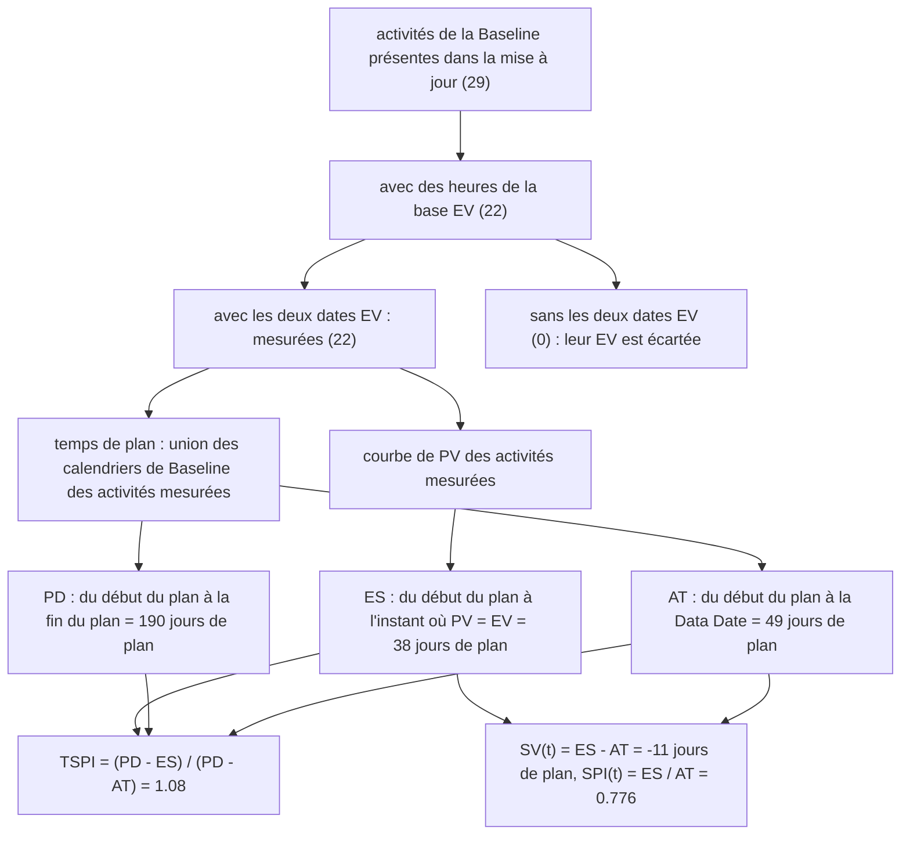

- **Identifiant** : `earned_schedule` : `plan_start`, `plan_finish`, `pd_min`, `at_min`, `es_min`,
  `es_date`, `ev_left_out_hr` ; cartes **Plan reached** (Plan atteint) et **Planned finish** (Fin
  planifiée).
- **Affichage** : page **Earned value**, section **Earned Schedule**, pour `es_date` (carte
  **Plan reached**) et `plan_finish` (carte **Planned finish**) ; page **Debug**, bloc 9, pour
  `plan_start`, pour PD, AT et ES en jours de plan (`pd_plan_d`, `at_plan_d`, `es_plan_d`) et pour
  `ev_left_out_hr`.
- **Formule** : les activités mesurées sont les activités de la Baseline de la mise à jour qui ont
  des heures de la base EV et les deux dates EV. Le début du plan et la fin du plan sont leur
  première et leur dernière date EV. PD est le temps de plan du début du plan à la fin du plan, AT
  celui jusqu'à la Data Date, et ES celui jusqu'à l'instant où la courbe de PV des activités
  mesurées atteint l'EV, lu à la minute près. Là où le plan ne demande aucune heure sur un
  intervalle qui contient l'EV, ES prend la Data Date quand elle se trouve dans l'intervalle, sinon
  l'extrémité la plus proche. Une fois toutes les heures acquises, ES = PD. Une durée en jours de
  plan vaut ses minutes / 60 / les heures par jour du calendrier du projet de la mise à jour.
- **Entonnoir** : activités de la Baseline présentes dans la mise à jour (29) → avec des heures de
  la base EV (22) → avec les deux dates EV (22) → population : mesurées (22). La démonstration donne
  PD 190 jours de plan, AT 49, ES 38, plan atteint le 2026-10-08 et fin planifiée le 2027-03-08.
- **Cible et statut** : aucune. Sans Data Date, sur la Baseline des dates planifiées, sans activité
  mesurée, ou avec une Data Date antérieure au début du plan, la section affiche `Not computed:`
  suivi d'une note.
- **Prérequis** : un fichier de Baseline et une Data Date.
- **Source** : Lipke, « Schedule is Different » (2003) ; xerscope pour la lecture à l'intérieur d'un
  intervalle sans heures planifiées.
- **Code** : `analysis/evm.py`, `earned_schedule`, `EarnedSchedule`.
- **Pour approfondir** : Formules 3.

### Écart en temps, indice en temps et indice restant à réaliser

- **Identifiant** : `sv_min` ; `spi_t`, carte **SPI(t)** ; `gap_calendar_d`, carte **Time gap**
  (Écart en temps) ; `tspi`, carte **TSPI (planned finish)** (TSPI, fin planifiée).
- **Affichage** : page **Earned value**, section **Earned Schedule**, pour SPI(t), l'écart en temps
  et TSPI ; page **Debug**, bloc 9, pour SV(t) en jours de plan (`sv_t_plan_d`).
- **Formule** : SV(t) = ES − AT, en temps de plan, négatif en cas de retard. SPI(t) = ES / AT. Écart
  en temps = `es_date` − Data Date, en jours calendaires ; aucune valeur une fois ES = PD. TSPI =
  (PD − ES) / (PD − AT) ; aucune valeur une fois que ES atteint au moins PD ou que AT atteint au
  moins PD.
- **Entonnoir** : les activités mesurées de l'Earned Schedule (22). La démonstration donne SV(t)
  −11 jours de plan, SPI(t) 0.776, un écart en temps de −11 cal. d et TSPI 1.08.
- **Cible et statut** : aucune.
- **Prérequis** : un fichier de Baseline et une Data Date.
- **Source** : Lipke : SV(t), SPI(t), et TSPI avec la durée totale voulue prise égale à PD.
- **Code** : `analysis/evm.py`, `EarnedSchedule.sv_min`, `spi_t`, `gap_calendar_d`, `tspi`.
- **Pour approfondir** : Formules 3.

### Gains hebdomadaires, indice sur quatre semaines et rythme

- **Identifiant** : `weekly_gains` (`ev_gain_hr`, `pv_gain_hr`, `es_gain_min`, `at_gain_min`,
  `baseline_changed`) ; `moving_window` ; `gain_ratio` ; `spi_4w` ; cartes **SPI (4 weeks)** (SPI
  sur 4 semaines), **Pace (4 weeks)** (Rythme sur 4 semaines) et **Pace (all updates)** (Rythme sur
  toutes les mises à jour).
- **Affichage** : page **Earned value**, section **Earned Schedule**, volet dépliable
  **The weeks of the 4 weeks' figures** (Les semaines des chiffres sur 4 semaines), et
  **Performance indices by update**.
- **Formule** : une semaine est une paire de mises à jour consécutives. Ses gains sont l'EV, la PV,
  l'ES et l'AT de la mise à jour de clôture moins ceux de la mise à jour d'ouverture, tous lus sur
  la Baseline de la mise à jour d'ouverture. La fenêtre contient les semaines à partir de la mise à
  jour la plus récente datée d'au moins 28 jours avant la Data Date. SPI (4 weeks) = Σ EV gagnée / Σ
  PV gagnée sur la fenêtre. Pace (4 weeks) = Σ ES gagné / Σ AT gagné sur la fenêtre. Pace (all
  updates) est le même ratio sur toutes les semaines qui contiennent les quatre gains.
- **Entonnoir** : mises à jour (8) → paires consécutives : semaines (7) → à partir de la mise à jour
  du 2026-09-21 : fenêtre (4). La démonstration donne 872.8 h / 1,584 h = 0.55, un rythme de 0.66
  sur la fenêtre et de 0.78 sur toutes les mises à jour.
- **Cible et statut** : aucune ; vide sans mise à jour datée de 28 jours avant, avec une semaine
  sans Baseline, ou quand rien n'était planifié sur la fenêtre.
- **Prérequis** : la série, et la Baseline de chaque mise à jour d'ouverture.
- **Source** : xerscope pour la fenêtre et le ratio des sommes ; le rythme est le facteur de
  performance de Lipke, ES gagné sur temps écoulé.
- **Code** : `analysis/evm.py`, `weekly_gains`, `moving_window`, `gain_ratio`, `gains_since_first`,
  `spi_by_window`.
- **Pour approfondir** : Formules 3.

### Fins prévisionnelles de l'Earned Schedule

- **Identifiant** : `finish_at(pace)` ; cartes **Forecast finish (4 weeks)** (Fin prévisionnelle sur
  4 semaines) et **Forecast finish (all updates)** (Fin prévisionnelle sur toutes les mises à jour).
- **Affichage** : page **Earned value**, section **Earned Schedule**.
- **Formule** : Data Date + (PD − ES) / rythme, en minutes de temps de plan, avec le rythme de la
  fenêtre ou le rythme de toutes les mises à jour.
- **Entonnoir** : les activités mesurées de l'Earned Schedule (22) et les semaines de chaque rythme.
  La démonstration donne 2027-06-06 et 2027-05-02.
- **Cible et statut** : aucune ; `n/a` sans ES, une fois ES = PD, ou sans rythme supérieur à 0.
- **Prérequis** : un fichier de Baseline, une Data Date et la série.
- **Source** : Lipke, IEAC(t) = AT + (PD − ES) / PF(t).
- **Code** : `analysis/evm.py`, `EarnedSchedule.finish_at`.
- **Pour approfondir** : Formules 3.

### Changements de Baseline, retard copié et écart par statut

- **Identifiant** : `baseline_changes` (`gap_old_d`, `gap_new_d`, `absorbed_d`, `bac_old_hr`,
  `bac_new_hr`, `added`, `removed`) ; `copied_lag` ; `schedule_gap_by_status`.
- **Affichage** : page **Earned value**, avertissement sous les chiffres de l'Earned Schedule pour
  le retard copié ; page **Debug**, bloc 9, pour les deux tableaux.
- **Formule** : `baseline_changes` contient une ligne par mise à jour dont la Baseline n'est pas
  celle de la mise à jour précédente : l'écart en temps sur l'ancienne et sur la nouvelle Baseline,
  `absorbed_d` = nouveau − ancien en jours calendaires, le BAC sur chacune, et les activités
  ajoutées et retirées. `copied_lag` compte les activités mesurées en cours que le propre projet de
  la Baseline avait commencées, dont la fin EV est antérieure à la Data Date de la Baseline, et
  additionne leur PV − EV en heures. `schedule_gap_by_status` additionne EV − PV des activités
  mesurées par statut, avec les heures en avance et en retard.
- **Entonnoir** : activités mesurées de l'Earned Schedule (22) → en cours (3) → commencées dans le
  propre projet de la Baseline (0) → population (0). Par statut : terminées (6), en cours (3), non
  commencées (13). La démonstration donne 472 h de retard pour les activités en cours et 320 h de
  retard pour les activités non commencées.
- **Cible et statut** : aucune.
- **Prérequis** : un fichier de Baseline ; la série pour les changements de Baseline.
- **Source** : xerscope ; P6 cesse de déplacer les dates planifiées d'une activité une fois qu'elle
  a commencé (guide utilisateur d'Oracle P6 EPPM, Planned Dates).
- **Code** : `analysis/evm.py`, `baseline_changes`, `copied_lag`, `schedule_gap_by_status`.
- **Pour approfondir** : Formules 3.

## Tendance des jalons

La tendance des jalons suit la date prévisionnelle de chaque jalon, et de toute activité choisie,
d'une mise à jour à la suivante.

### Prévision d'un jalon par mise à jour

- **Identifiant** : `milestone_trend` (`forecast`) ; `plotted_trend`.
- **Affichage** : page **Milestone trend** (Tendance des jalons), graphique, et volet dépliable
  **Data** (Données).
- **Formule** : par jalon et par mise à jour, la prévision est le Start d'un jalon de début et le
  Finish de toute autre activité. Le graphique laisse vide la prévision d'une mise à jour dans
  laquelle le jalon est terminé avec une prévision antérieure à la Data Date de cette mise à jour.
- **Entonnoir** : activités de toutes les mises à jour (30 Activity ID) → jalon dans au moins une
  mise à jour (4) → population (4) ; non terminés dans la dernière mise à jour (3). La page démarre
  avec les jalons de fin de la dernière mise à jour déjà choisis (3 dans la démonstration). Le champ
  **Milestones and key tasks (up to 6)** (Jalons et tâches clés, 6 au plus) ajoute les autres.
- **Cible et statut** : aucune.
- **Prérequis** : au moins deux mises à jour pour le graphique.
- **Source** : xerscope ; le graphique est une analyse de tendance des jalons (milestone trend
  analysis).
- **Code** : `analysis/progress.py`, `milestone_codes`, `milestone_trend`, `plotted_trend`.
- **Pour approfondir** : Formules 4.

### Glissement d'un jalon

- **Identifiant** : `slip_wd`, colonne **Slip since first (wd)** (Glissement depuis la première, en
  wd) ; `last_week_wd` ; `deleted`.
- **Affichage** : page **Milestone trend**, section **Slippage** (Glissement), et dernier point de
  chaque ligne du graphique.
- **Formule** : `slip_wd` = −(jours ouvrés de la première prévision à la dernière prévision),
  arrondi à 0,1 wd. `last_week_wd` est la même chose entre les deux dernières mises à jour : 0 avec
  une seule mise à jour, vide pour un jalon absent de la dernière mise à jour. Les deux sont sur le
  calendrier propre au jalon, tel que la dernière mise à jour le définit.
- **Entonnoir** : les jalons de la tendance (4). La démonstration donne −15.0 wd et −2.0 wd pour
  `M9999`, et 0.0 wd pour `M1000`.
- **Cible et statut** : aucune.
- **Prérequis** : la série.
- **Source** : xerscope.
- **Code** : `analysis/progress.py`, `milestone_slips`.
- **Pour approfondir** : Formules 4.

## PPC et avancement

Le PPC, le pourcentage du plan réalisé (percent plan complete), lit les engagements que la mise à
jour W−1 a pris pour la semaine et leur résultat dans la mise à jour W. Le schéma suivant montre les
engagements de la semaine du 2026-10-12 au 2026-10-19 de la série de démonstration.

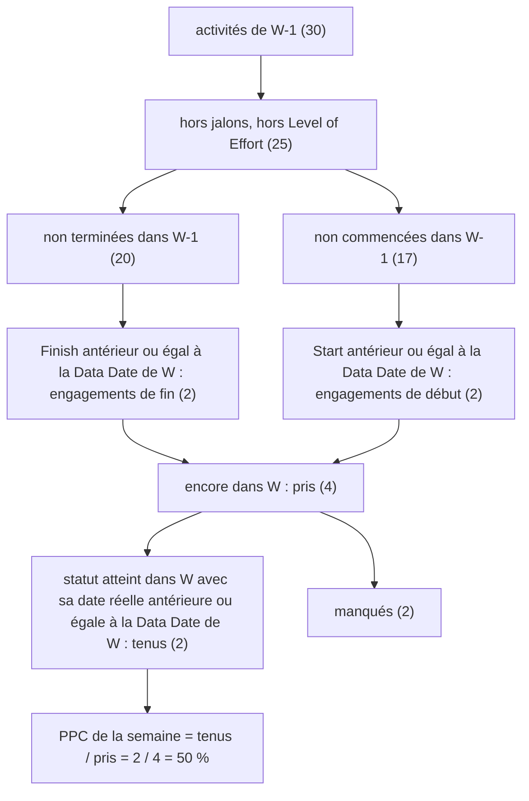

### Engagements et leur résultat

- **Identifiant** : `committed` : colonnes `commitment`, `planned_date`, `in_update`, `kept`,
  `actual_date`, `forecast_now`, `status_now`.
- **Affichage** : page **PPC & progress**, section **Commitments** (Engagements), et cartes
  **Starts kept** (Débuts tenus) et **Finishes kept** (Fins tenues).
- **Formule** : un engagement de fin est une activité non terminée dans W−1 dont le Finish dans W−1
  est antérieur ou égal à la Data Date de W. Il est tenu quand l'activité est terminée dans W avec
  une fin réelle antérieure ou égale à cette Data Date. Un engagement de début est la même chose
  avec non commencée, Start et début réel. Une activité qui doit commencer et finir dans la semaine
  compte pour deux engagements. Quand **Include commitments late at W−1** (Inclure les engagements
  en retard à W−1) est décoché, seules les dates postérieures à la Data Date de W−1 engagent.
- **Entonnoir** : activités de W−1 (30) → hors jalons, hors Level of Effort (25) → non terminées
  (20) : engagements de fin (2) ; non commencées (17) : engagements de début (2) → encore dans W (4)
  → population (4) → comptés : tenus (2). Les cartes affichent 1 / 2 et 1 / 2.
- **Cible et statut** : aucune.
- **Prérequis** : deux mises à jour consécutives ; sans Data Date dans W rien n'engage.
- **Source** : Last Planner System pour les engagements de fin ; xerscope pour les engagements de
  début.
- **Code** : `analysis/progress.py`, `committed`.
- **Pour approfondir** : Formules 4.

### Pourcentage du plan réalisé

- **Identifiant** : `ppc_series` : `ppc_start`, `ppc_finish`, `ppc_week`, avec `starts_committed`,
  `starts_kept`, `finishes_committed`, `finishes_kept`, `committed`, `kept`, `note` ; cartes
  **PPC Start** (PPC des débuts), **PPC Finish** (PPC des fins) et **PPC W/W−1** (PPC de W par
  rapport à W−1).
- **Affichage** : page **PPC & progress**, cartes, graphique **Percent plan complete by week** (PPC
  par semaine), et volet dépliable **Every week: counts behind the three PPC** (Chaque semaine :
  décomptes derrière les trois PPC).
- **Formule** : PPC Start = 100 × débuts tenus / débuts pris. PPC Finish = 100 × fins tenues / fins
  prises. PPC W/W−1 = 100 × tenus / pris sur les deux types. Chacun est sans valeur, et non 0, quand
  son dénominateur vaut 0. Une activité supprimée dans W sort des deux termes.
- **Entonnoir** : engagements de la semaine (4) → encore dans W (4) → population (4) → comptés :
  tenus (2) ; résultat de démonstration 50.0 % pour les trois.
- **Cible et statut** : aucune ; **PPC target (%)** (Cible de PPC), 80 par défaut, trace une ligne
  sur le graphique et ne juge rien.
- **Prérequis** : deux mises à jour consécutives. La note signale quand les deux sont séparées de
  plus de 7 jours calendaires, quand W n'a pas de Data Date, quand W−1 ne porte aucune date sur son
  travail ouvert, et quand des Activity ID ont changé.
- **Source** : Last Planner System, PPC = réalisé / planifié, pour PPC Finish ; xerscope pour PPC
  Start et PPC W/W−1.
- **Code** : `analysis/progress.py`, `ppc_series`, `percent_kept`.
- **Pour approfondir** : Formules 4.

### Jalons engagés et travail non planifié

- **Identifiant** : `committed_milestones` ; `unplanned_work`.
- **Affichage** : page **PPC & progress**, sections **Milestones committed** (Jalons engagés) et
  **Unplanned work** (Travail non planifié).
- **Formule** : un jalon de début engage son Start et un jalon de fin son Finish, lus comme les
  engagements des autres activités. Ils sont listés et restent hors des décomptes du PPC. Le travail
  non planifié correspond aux activités de W qui ne sont pas dans W−1, hors jalons et hors Level of
  Effort, avec un début réel antérieur ou égal à la Data Date de W.
- **Entonnoir** : activités de W−1 (30) → jalons (4) → dus au plus tard à la Data Date de W (0) ;
  activités de W (30) → absentes de W−1 (0). Les deux listes sont vides dans la semaine de
  démonstration.
- **Cible et statut** : aucune.
- **Prérequis** : deux mises à jour consécutives.
- **Source** : xerscope.
- **Code** : `analysis/progress.py`, `committed_milestones`, `unplanned_work`.
- **Pour approfondir** : Formules 4.

### Fiabilité du lookahead

- **Identifiant** : `lookahead_series` : `ta_pct`, `tmr_pct`, avec `wwp`, `anticipated`,
  `lookahead`, `lookahead_kept`, `horizon` ; cartes **TA (n ahead)** (TA, n mises à jour à l'avance)
  et **TMR (n ahead)** (TMR, n mises à jour à l'avance).
- **Affichage** : page **PPC & progress**, section **Lookahead reliability** (Fiabilité du
  lookahead), et volet dépliable **Every week: counts behind TA and TMR** (Chaque semaine :
  décomptes derrière TA et TMR).
- **Formule** : pour la semaine de W−1 à W et un horizon de n mises à jour, le plan antérieur est
  l'ensemble des engagements que la mise à jour W−1−n portait pour des dates antérieures ou égales à
  la Data Date de W, avec leur résultat dans W. TA = 100 × engagements de la semaine que le plan
  antérieur portait / engagements de la semaine. TMR = 100 × engagements du plan antérieur tenus
  dans W / engagements du plan antérieur. Les horizons sont de 1, 2, 4 et 8 mises à jour.
- **Entonnoir** : horizon 1 dans la démonstration : engagements de la semaine (4) → portés par le
  plan du 2026-10-05 (4), TA 100 % ; engagements de ce plan (7) → tenus dans W (4), TMR 57.1 %.
- **Cible et statut** : aucune ; un horizon que la série n'atteint pas n'a pas de ligne.
- **Prérequis** : n + 2 mises à jour pour l'horizon n.
- **Source** : Hamzeh, Ballard et Tommelein (2012), Tasks Anticipated et Tasks Made Ready ; xerscope
  pour les horizons de 4 et 8 mises à jour et pour l'engagement pris comme unité.
- **Code** : `analysis/progress.py`, `planned_for_week`, `lookahead_series`.
- **Pour approfondir** : Formules 4.

### Avancement par activité

- **Identifiant** : `progress_delta` : `pct_prev`, `pct_now`, `pct_delta`, `labor_budget_hr`,
  `earned_hr_week`, `actual_hr_week`, `new`, `deleted`.
- **Affichage** : page **PPC & progress**, section **Progress by task** (Avancement par tâche).
- **Formule** : `pct_delta` = pourcentage d'avancement dans W − dans W−1, en points, arrondi à
  0,01 ; une activité absente compte pour 0. Avec une Baseline, `earned_hr_week` = `ev_labor_hr` ×
  (Performance % dans W − dans W−1) / 100, si bien que la somme de la colonne vaut EV dans W − EV
  dans W−1. Sans Baseline, ou avec une Baseline sans heures, `earned_hr_week` = `labor_budget_hr` ×
  `pct_delta` / 100. `actual_hr_week` = heures réelles dans W − dans W−1.
- **Entonnoir** : Activity ID de W−1 ou de W (30) → population (30) → comptés : pourcentage
  d'avancement, heures acquises ou heures réelles modifiés (4).
- **Cible et statut** : aucune.
- **Prérequis** : deux mises à jour consécutives ; la Baseline change les pondérations.
- **Source** : xerscope.
- **Code** : `analysis/progress.py`, `progress_delta`, `progressed_tasks`.
- **Pour approfondir** : Formules 4.

### Avancement par WBS et avancement du projet

- **Identifiant** : `rollup_delta` : `budget_hr`, `earned_hr_week`, `actual_hr_week`,
  `activities_progressed`, `progress_pts` ; carte **Project progress** (Avancement du projet).
- **Affichage** : page **PPC & progress**, carte et section **Progress by WBS** (Avancement par
  WBS).
- **Formule** : par élément WBS de niveau 1 et pour le projet, les sommes des colonnes de l'entrée
  précédente ; `activities_progressed` compte les `pct_delta` supérieurs à 0 ; `progress_pts` = 100
  × `earned_hr_week` / `budget_hr`, en points, vide quand le budget vaut 0.
- **Entonnoir** : Activity ID de W−1 ou de W (30) → regroupés par élément WBS de niveau 1 (6) →
  ligne du projet. La démonstration donne 230.4 h acquises sur 8,040 h, +2.87 points, avec la
  Baseline.
- **Cible et statut** : aucune.
- **Prérequis** : deux mises à jour consécutives.
- **Source** : xerscope.
- **Code** : `analysis/progress.py`, `rollup_delta`, `project_progress`.
- **Pour approfondir** : Formules 4.

### Écart de début et de fin

- **Identifiant** : `date_variances` : `start_var_w1`, `finish_var_w1`, `start_var_w2`,
  `finish_var_w2` ; `moved_variances`.
- **Affichage** : page **PPC & progress**, section **Start and finish variance** (Écart de début et
  de fin) ; téléchargement **Download variances (CSV)** (Télécharger les écarts).
- **Formule** : jours ouvrés de la date dans W à la date dans W−1, ou dans W−2, sur le calendrier de
  l'activité dans W : négatif quand la date dans W est plus tardive. Les dates sont Start et Finish.
  Une date manquante donne une valeur vide. Un jalon de début n'a que les colonnes de début, un
  jalon de fin que les colonnes de fin.
- **Entonnoir** : activités de W (30) → hors Level of Effort (29) → population (29) → comptées : un
  des quatre écarts n'est pas 0 (24).
- **Cible et statut** : aucune.
- **Prérequis** : une mise à jour antérieure pour les colonnes W−1, deux pour les colonnes W−2.
- **Source** : xerscope ; l'aide d'Oracle ne nomme aucun calendrier pour un écart.
- **Code** : `analysis/progress.py`, `date_variances`, `moved_variances`.
- **Pour approfondir** : Formules 1.1 à 1.4 ; Formules 4.

## Chiffres des pages Overview et Gantt

La page **Overview** lit la série. La page **Gantt & WBS** lit une mise à jour, sa Baseline et une
mise à jour de comparaison.

### Fin prévisionnelle et son déplacement

- **Identifiant** : `finish_date`, carte **Forecast finish** ; `finish_shift_wd` ;
  `finish_shift_since_first`, carte **Shift since first update** (Déplacement depuis la première
  mise à jour).
- **Affichage** : page **Overview**, cartes, graphique **Forecast finish by update** (Fin
  prévisionnelle par mise à jour) et tableau **Updates loaded** (Mises à jour chargées) ;
  `xerscope info FOLDER` pour `forecast_finish` et `finish_shift_wd`.
- **Formule** : la fin prévisionnelle est le Finish le plus tardif des activités. `finish_shift_wd`
  = −(jours ouvrés de la fin prévisionnelle de la mise à jour précédente à celle de cette mise à
  jour), sur le calendrier du projet de cette mise à jour, non arrondi. Le déplacement depuis la
  première mise à jour est la même chose de la première à la dernière mise à jour, sur le calendrier
  du projet de la dernière.
- **Entonnoir** : activités (30) → population (30) → Finish le plus tardif. La démonstration donne
  2027-03-23, −2.0 wd par rapport à la mise à jour précédente et −15.0 wd depuis la première.
- **Cible et statut** : aucune.
- **Prérequis** : une mise à jour antérieure pour les déplacements ; vide pour la première mise à
  jour.
- **Source** : P6, le Finish le plus tardif des activités ; xerscope pour les déplacements et leur
  calendrier.
- **Code** : `xer/model.py`, `_project_finish` ; `store.py`, `SnapshotStore.summary` ;
  `analysis/progress.py`, `finish_shift_since_first`.
- **Pour approfondir** : Formules 4.

### Décomptes d'une mise à jour

- **Identifiant** : `summary` : `activities`, `complete`, `in_progress`, `not_started`,
  `relationships`, `pct_complete_count` ; carte **Tasks complete** (Tâches terminées).
- **Affichage** : page **Overview**, carte et tableau **Updates loaded** ; `xerscope info FOLDER`
  pour `activities`, `complete` et `relationships`.
- **Formule** : décomptes des activités par statut, et des relations. `pct_complete_count` = 100 ×
  terminées / activités, arrondi à 0,1.
- **Entonnoir** : activités (30) → population (30) → comptées : terminées (7), en cours (4), non
  commencées (19) ; relations (39). La carte affiche 7 / 30.
- **Cible et statut** : aucune.
- **Prérequis** : une mise à jour ; le delta de la carte a besoin de la précédente.
- **Source** : statuts de P6.
- **Code** : `store.py`, `SnapshotStore.summary`.
- **Pour approfondir** : Formules 4.

### Activités critiques

- **Identifiant** : `critical`, carte **Critical tasks** (Tâches critiques) ; `is_critical`.
- **Affichage** : page **Overview**, carte et tableau **Updates loaded** ; `xerscope info FOLDER`.
- **Formule** : nombre d'activités critiques, selon la définition de critique que donne le tableau 5
  pour le projet.
- **Entonnoir** : activités (30) → non terminées (23) → population (23) → comptées : Total Float
  inférieur ou égal à 0 wd (18). Le projet de démonstration définit le critique par le Total Float,
  sans seuil dans le fichier.
- **Cible et statut** : aucune.
- **Prérequis** : une mise à jour.
- **Source** : P6, la définition des activités critiques du projet (`PROJECT.critical_path_type`,
  `critical_drtn_hr_cnt`).
- **Code** : `xer/model.py`, `_task_frame` ; `analysis/explain.py`, `critical_definition`.
- **Pour approfondir** : Formules 1.1 à 1.4.

### Consolidation par WBS

- **Identifiant** : `rollup` : `pct_complete`, `weight`, `activities`, `complete`, `critical`,
  `min_float_d`, `start`, `finish`, `bl_finish`, `finish_variance_wd`, `outside_bl`, `budget_hr`,
  `actual_hr`, `remaining_hr` ; cartes **% complete** (% d'avancement), **Forecast finish**,
  **Labor hours** (Heures de main-d'œuvre) et **Open critical** (Critiques ouvertes).
- **Affichage** : page **Gantt & WBS**, cartes du nœud sélectionné et lignes WBS du graphique.
- **Formule** : par nœud WBS, sur toutes les activités situées sous lui, et pour le projet.
  `pct_complete` = Σ `labor_budget_hr` × `pct_complete` / Σ `labor_budget_hr` quand le nœud a des
  heures budgétées, sinon Σ `original_d` × `pct_complete` / Σ `original_d` ; `weight` indique la
  pondération utilisée. `critical` compte les activités critiques et non terminées.
  `finish_variance_wd` = −(jours ouvrés du `bl_finish` le plus tardif au Finish le plus tardif des
  activités que contient la Baseline), sur le calendrier du projet, arrondi à 0,1 wd.
- **Entonnoir** : activités (30) → sous le nœud ; ligne du projet : population (30) → dans la
  Baseline pour l'écart (29). La ligne du projet de démonstration donne 20.2 % en heures, 2,216 /
  8,360 heures de main-d'œuvre, 18 critiques ouvertes et −15.0 wd.
- **Cible et statut** : aucune.
- **Prérequis** : une Baseline pour l'écart ; sans Baseline il est vide.
- **Source** : xerscope ; le pourcentage d'avancement d'un nœud n'est pas un champ de P6.
- **Code** : `analysis/wbs.py`, `rollup`.
- **Pour approfondir** : Formules 4 ; Formules 7.

### Catégorie de Float du Gantt

- **Identifiant** : `category` : `Complete` (terminée), `Critical` (critique), `Near critical`
  (quasi critique), `Normal` (normale).
- **Affichage** : page **Gantt & WBS**, couleur des barres et légende, et filtre de Float.
- **Formule** : terminée d'abord ; sinon critique ; sinon quasi critique quand `total_float_d` est
  inférieur ou égal à 10 wd du calendrier de l'activité (`Settings.near_critical_float_days`) ;
  sinon normale.
- **Entonnoir** : activités (30) → population (30) → comptées : terminées (7), critiques (18), quasi
  critiques (0), normales (5).
- **Cible et statut** : aucune.
- **Prérequis** : une mise à jour.
- **Source** : xerscope pour la limite du quasi critique.
- **Code** : `viz/gantt.py`, `categorise`.
- **Pour approfondir** : Formules 1.1 à 1.4.

### Déplacement de la fin d'une activité

- **Identifiant** : `shift_wd` d'une ligne du Gantt ; `activity_finish_shift`, delta **since first**
  (depuis la première) de la carte de l'activité.
- **Affichage** : page **Gantt & WBS**, colonne du graphique et de **Table view** (Vue tableau), et
  carte de l'activité choisie.
- **Formule** : `shift_wd` = −(jours ouvrés du Finish dans la mise à jour de comparaison au Finish
  dans la mise à jour affichée), sur le calendrier de l'activité dans la mise à jour affichée. Cette
  carte donne la même chose de la première à la dernière fin prévisionnelle de l'activité, sur son
  calendrier dans la dernière mise à jour qui la contient. Une ligne WBS porte le
  `finish_variance_wd` de son nœud.
- **Entonnoir** : activités de la mise à jour affichée (30) → dans la mise à jour de comparaison
  (30) → comptées : déplacement différent de 0 (21) par rapport à la mise à jour précédente.
- **Cible et statut** : aucune.
- **Prérequis** : une mise à jour de comparaison ; vide sans elle.
- **Source** : xerscope.
- **Code** : `viz/gantt.py`, `_compare_columns` ; `analysis/progress.py`, `activity_finish_shift`.
- **Pour approfondir** : Formules 1.1 à 1.4.

## Ask

Le champ Ask de la page **Gantt & WBS** transforme une phrase en filtres de la page. Il ne calcule
aucun chiffre qui lui soit propre : chaque décompte qu'il affiche est la taille d'un ensemble que
les filtres de la page peuvent construire.

### Entonnoir d'une phrase

- **Identifiant** : `query.apply` ; `funnel_line`.
- **Affichage** : page **Gantt & WBS**, champ **Ask the schedule** (Interroger le planning) : la
  légende sous la réponse, et le volet dépliable **Population, step by step**.
- **Formule** : les lignes de la page après ses propres filtres, découpées par une étape par filtre
  que contient la phrase : branche WBS, statut, catégorie de Float, code d'activité, ressource,
  jalons, Level of Effort, mots du nom, et les clauses avec `not` et `or`. Le décompte est le nombre
  de lignes restantes. Une comparaison en jours est faite en heures, le nombre de jours × le
  `hours_per_day` de l'activité.
- **Entonnoir** : pour `critical not started` sur la démonstration : lignes de la page (30) → status
  Not started [ask] (19) → float Critical [ask] (14) → population (14). La page affiche
  `30 → status Not started 19 → float Critical 14`. Les deux étapes se lisent « statut non
  commencée » et « Float critique ».
- **Cible et statut** : aucune. Une phrase dont rien n'est compris ne conserve aucune ligne.
- **Prérequis** : une mise à jour ; le mot `late` lit la Baseline de la page, et la fin planifiée là
  où la Baseline n'en a pas.
- **Source** : xerscope ; `late` suit P6-12 et les mots de contrainte suivent P6-02 et P6-03.
- **Code** : `analysis/ask/funnel.py`, `apply`, `mask` ; `analysis/query.py`.
- **Pour approfondir** : Architecture, Ask.

### Phrase de réponse

- **Identifiant** : `query.answer`.
- **Affichage** : page **Gantt & WBS**, bandeau sous **Ask the schedule**.
- **Formule** : le nombre de lignes de l'entonnoir, le pire Total Float parmi elles et le Finish le
  plus tardif. Le pire Float est celui de la ligne dont le `total_float_hr_cnt` est le plus bas,
  affiché en wd du calendrier de cette activité.
- **Entonnoir** : la population de l'entonnoir de la phrase.
- **Cible et statut** : aucune.
- **Prérequis** : une mise à jour.
- **Source** : xerscope.
- **Code** : `analysis/ask/answer.py`, `answer`.
- **Pour approfondir** : Architecture, Ask.

## Autres chiffres des pages

Les chiffres suivants sont affichés par l'application et ont leur formule ailleurs.

- Page **Audit**, cartes **Standard**, **Standard status** (Statut selon le standard), **Audit** et
  **Audit status** (Statut de l'audit) : le résultat d'un contrôle tel que son standard le fixe, et
  avec les paramètres modifiés sur la page. La formule est celle du contrôle.
- Page **Schedule health**, section **Trend across updates** : la valeur d'un contrôle sur chaque
  mise à jour (`checks.health_history`). La formule est celle du contrôle.
- Page **Schedule health**, tableau **Results** (Résultats) : `count` vaut comptées / population du
  contrôle et `flagged` le nombre de lignes que contient sa liste (`checks.summary_frame`) ; volet
  dépliable **All checks, all updates** (Tous les contrôles, toutes les mises à jour) : la valeur de
  chaque contrôle sur chaque mise à jour (`checks.health_wide`).
- Page **Schedule health**, volet dépliable **Compare with a P6 Check Schedule report** (Comparer
  avec un rapport P6 Check Schedule) : les décomptes saisis d'après un rapport, comparés au `found`
  et au `total` de chaque contrôle (`checks.compare_counts`).
- Page **Gantt & WBS**, carte de l'activité choisie et **History across updates** (Historique au fil
  des mises à jour) : les grandeurs des tableaux 4 à 6 telles que la mise à jour les contient ; le
  delta **since first** est l'entrée « Déplacement de la fin d'une activité ».
- Page **Export for Power BI** (Export pour Power BI) : la table `dim_snapshot` contient les
  décomptes de chaque mise à jour, et les tables `fact_activity`, `fact_relationship` et
  `fact_assignment` contiennent les colonnes des activités, des relations et des affectations telles
  que le modèle les lit, sans aucun autre calcul (`export.export_tables`).
- Page **Debug** : les options de calcul, les coûts du fichier, les réglages de valeur acquise du
  WBS, les unités de main-d'œuvre de la valeur planifiée par affectation (`evm.pv_labor_check`) et
  la comparaison avec un export Activities de P6 (`evm.pv_p6_comparison`, aussi
  `xerscope pv-compare`). Ces deux comparaisons sont des diagnostics qu'aucun chiffre des autres
  pages ne lit. Formules 3 et les docstrings de `analysis/evm.py` contiennent leurs définitions.
- Page **Debug**, blocs 2, 4, 5, 6, 11, 13 et 14 : ce que contient le fichier et ce que
  l'application lui a appliqué, sans formule qui leur soit propre. Ils listent les activités ayant
  une Expected Finish à côté de leurs dates enregistrées et recalculées, les cibles et les options
  du standard P6, la Baseline de chaque mise à jour et les calendriers, les activités à l'origine
  des avertissements de chargement, les réglages du projet, le détail des calendriers, et les
  décomptes des variantes de mots que le champ Ask lit comme un seul mot.
