# Formula sheet

Français : [Fiche formules](formula-sheet.fr.md)

This sheet lists every number xerscope computes: its formula, the population it is computed on, its
unit and calendar, its target and its source. It is the compact view of the calculations. The long
reference, the sources of the standards and the scheduling engine have their own documents, listed
in [Related documents](#related-documents) in this sheet.

File and function names refer to `src/xerscope/`. Where this sheet and the code differ, the code is
right.

## How to read this sheet

The sheet has one part per family of numbers, in the order of the app's pages. Every calculation is
one entry, and every entry has the same fields in the same order.

### Map of the calculations

The following diagram shows what xerscope reads from a P6 export and which families of numbers each
object feeds.

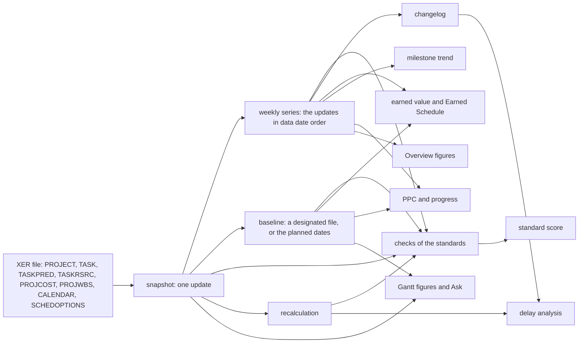

Table 1 gives the same content in words.

Table 1. What each family of numbers reads

| Family | Reads | Part of this sheet |
|---|---|---|
| Checks of a standard | one update; the baseline for the checks that compare with it; the series for the three DECM checks that compare with an earlier update; the recalculation for DCMA-12, 06A401a and the Integrity checks | P6 Check Schedule, DCMA DECM v8.0, DCMA 14-Point, Integrity, Rules for a custom standard |
| Standard score | the statuses of the checks of one standard on one update | Standard score |
| Recalculation | one update: activities, relationships, assignments, calendars, scheduling options | Recalculation |
| Changelog | two updates | Changelog |
| Delay analysis | two updates, their changelog and their recalculation; the series for the table of every update | Delay analysis |
| Earned value and Earned Schedule | one update and its baseline; the series for the weekly gains | Earned value and Earned Schedule |
| Milestone trend | the series | Milestone trend |
| PPC and progress | two consecutive updates; earlier updates for the lookahead; the baseline for the earned hours | PPC and progress |
| Overview figures | the series | Overview and Gantt figures |
| Gantt figures and Ask | one update, its baseline, and a comparison update | Overview and Gantt figures, Ask |

A snapshot is built from the tables `PROJECT`, `TASK`, `TASKPRED`, `TASKRSRC`, `RSRC`, `ROLES`,
`PROJCOST`, `PROJWBS`, `CALENDAR` and `SCHEDOPTIONS` of one project of the file. It also holds the
activity code and user-defined field tables (`ACTVTYPE`, `ACTVCODE`, `TASKACTV`, `UDFTYPE`,
`UDFVALUE`), which no formula of this sheet reads except the activity code filter of the pages.

### Fields of an entry

Table 2 lists the fields of an entry, in their order.

Table 2. Fields of an entry

| Field | Content |
|---|---|
| Identifier and name | the check id or the column name the code uses, and the label the app prints |
| Shown | the page, the section or card, and the command that print the number |
| Formula | numerator, denominator, unit, and the calendar a duration is counted on |
| Funnel | the chain of steps that cuts the population, with the counts of the demo series |
| Target and status | the target, and how `pass`, `fail`, `info` or `n/a` is decided |
| Needs | the baseline or the earlier update the number needs, and what is printed without it |
| Source | the item of the standard, the Oracle help page number, or xerscope when no published standard defines the number |
| Code | the module and the function |
| Deeper reading | the section of a related document, by its label in Table 9, or the calculation sheet of a P6 check |
| Open point | present only where the code marks a reading as unresolved: the point in one line and the place that records it |

The checks of a standard share most fields, so each standard has one table for the compact fields,
one funnel line per check and one list of open points. In a check table, the **Formula** column
gives what is counted, the numerator. The denominator is the population of the check's funnel unless
the cell says otherwise. The unit sets the value: `%` is 100 × counted / population, `count` is the
number counted, and `ratio` and `pass/fail` are the value the cell defines.

### Anatomy of a funnel

The following diagram shows the parts of a funnel, the chain of named steps that cuts the
population a number is computed on.

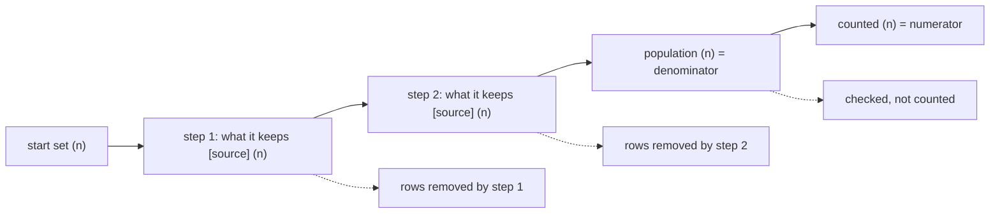

A funnel starts from a set of rows: the activities of the update, its relationships, or the
activities of the baseline. Each step keeps the rows that meet one condition and cites the text the
condition follows. The rows left after the last step are the population, which is the denominator
of a check. The rows counted are the numerator. The **Audit** page shows the steps under
**Population, step by step**, and the rows on three tabs: **Counted**, **Checked, not counted** and
**Excluded**.

This sheet writes a funnel on one line:

```text
start set (n) → what the step keeps [source] (n) → … → population (n) → counted (n)
```

The number in parentheses is the count of rows left on the latest update of the demo series. A
funnel line of a check ends with the demo result: the value as `xerscope check` prints it in its
`actual` column, and the status.

The 56 checks of the four built-in standards carry a `Funnel` object (`analysis/populations.py`),
except DCMA-12, DCMA-13, 06A401a and INT-03. The longest path of an update, the recalculation
departures and the Ask field carry one too. For every other number, the funnel line of its entry
describes the population as the code cuts it.

Table 3 lists the source tokens a step cites (`populations.STEP_SOURCES`).

Table 3. Source tokens of the funnel steps

| Token | Text the step follows |
|---|---|
| `101248` | Oracle P6 Professional help, page 101248, Check Schedule dialog box |
| `46278` | Oracle P6 EPPM help, page 46278 |
| `46282` | Oracle P6 EPPM help, page 46282, Large durations |
| `Ten Six` | Ten Six, "Using the P6 Check Schedule tool" |
| `R1` | a P6 Professional Check Schedule report, cited by this label only |
| `model` | the model: a relationship counts when its successor is an activity of the file |
| `PAM 200.1` | DCMA-EA PAM 200.1 (October 2012) |
| `DECM 8.0` | DCMA EVMS Compliance Metrics v8.0, schedule test specification sheets |
| `AACE 29R-03` | AACE RP 29R-03, Forensic Schedule Analysis (revision of April 25, 2011) |
| `xerscope` | the Integrity standard and the exclusions a custom standard sets: not a published standard |
| `ask` | a filter the Ask field of the **Gantt & WBS** page understood from the sentence |

### Units and calendars

Table 4 gives the unit of each kind of quantity and the calendar it is counted on.

Table 4. Units and calendars

| Quantity | Unit | Calendar |
|---|---|---|
| Durations and floats as stored (`target_drtn_hr_cnt`, `remain_drtn_hr_cnt`, `total_float_hr_cnt`, `free_float_hr_cnt`) | hours | none: the value P6 stored |
| Columns ending in `_d` (`original_d`, `remaining_d`, `total_float_d`, `free_float_d`) | working days (wd) | the activity's own calendar: hours / `hours_per_day`, rounded to 0.000001 day (`calendar.hours_to_days`) |
| `hours_per_day` | hours | `CALENDAR.day_hr_cnt` of the activity's calendar; blank, 0 or under a minute: 8 h; calendar not in the file: the project calendar's value, else the first calendar's, else 8 h |
| Lag as stored (`lag_hr`) | hours | none; a blank lag is 0 |
| Lag in days (`lag_d`) | working days | the predecessor's calendar: `lag_hr` / its `hours_per_day`; display, and the `lag` rule with `unit = "days"` |
| Lag in the recalculation | working minutes | the calendar the scheduling options designate (`SCHEDOPTIONS.sched_calendar_on_relationship_lag`): predecessor, successor (the default), 24 hours or project default |
| Working time between two dates of one activity | hours, or wd | the activity's calendar, to the minute (`Snapshot.work_hours`, `working_days`, `activity_working_days`) |
| Working time between two project dates (data dates, forecast finishes, the finish of a WBS node) | wd | the project calendar: `PROJECT.clndr_id`, else the first calendar of the file, else Monday to Friday, 8 h from 08:00 (`Snapshot.project_working_days`) |
| Earned Schedule durations (PD, AT, ES) | plan days | plan time: the minutes at least one baseline calendar of the measured activities works; a plan day is the hours per day of the update's project calendar |
| Time gap of the Earned Schedule | calendar days (`cal. d`) | none: weekends included |
| Labour quantities (`labor_budget_hr`, `labor_actual_hr`, `labor_remaining_hr`) | hours | none |

A timestamp in non-working time counts as the start of the next working period. A working day is
`CALENDAR.day_hr_cnt` hours, not the length of the parsed day. P6 converts with the hours per time
period of its admin preferences unless the calendar setting says otherwise, and the XER does not
carry that setting (recorded in `docs/backlog.md`, section "Checks and earned value").

Every move of a date in working days reads negative when the date goes later: finish shift,
changelog dates, start and finish variance, milestone slip, finish variance of P6-12 and of a WBS
node, shifts of the delay analysis. Two rows read the other way: the changelog's status date row
is the working days elapsed, and the `reason` of DCMA-11 gives `finish variance N h` with a
positive N for a late finish.

### Status words

Table 5 defines the words the entries use for the state and the type of an activity.

Table 5. Status words

| Word | Definition | Key in `exclude` |
|---|---|---|
| complete | `status_code` is `TK_Complete` | `complete` |
| started | `status_code` is not `TK_NotStart`: in progress or complete | `started` |
| completed before the data date | `act_end_date` before the data date; without a data date: complete | `complete_before_data_date` |
| milestone | `task_type` is `TT_Mile`, `TT_StartMile` or `TT_FinMile` | `milestones` |
| start milestone | `task_type` is `TT_Mile` or `TT_StartMile` | none |
| finish milestone | `task_type` is `TT_FinMile` | none |
| level of effort (LOE) | `task_type` is `TT_LOE` | `loe` |
| no original duration | `target_drtn_hr_cnt` is blank or not above 0 | `no_duration` |
| WBS summary | `task_type` is `TT_WBS`: never an activity, left out of every population | none |
| critical | not complete, and: on the longest path (`driving_path_flag` is `Y`) when `PROJECT.critical_path_type` is `CT_DrivPath`; else `total_float_hr_cnt` at or below `PROJECT.critical_drtn_hr_cnt` when that field is filled; else `total_float_d` at or below 0 (`Settings.critical_float_days`). Level of effort and milestones are included | none |

### Quantities read from the file

Table 6 defines the quantities every formula reads (`xer/model.py`, `xer/calendar.py`).

Table 6. Quantities read from the file

| Quantity | Definition | Code |
|---|---|---|
| Data date | `PROJECT.last_recalc_date`, else `PROJECT.plan_start_date`, else none; the notes and the step labels of the app call it the status date | `_data_date` |
| Activity | a `TASK` row of the project that is not a WBS summary, known by its Activity ID (`task_code`); a repeated Activity ID keeps its first row | `Snapshot.activities`, `by_code` |
| Relationship | a `TASKPRED` row whose predecessor and successor have a `TASK` row in the file; `type` FS, SS, FF or SF; a predecessor in another project of the file is named `[ext]` and its `task_id` | `_relationships` |
| Start and Finish (`start`, `finish`) | the actual date, else the remaining early date (`restart_date`, `reend_date`), else the early date, else the planned date (`target_start_date`, `target_end_date`) | `_task_frame` |
| Forecast start and finish | `restart_date`, else `early_start_date`; `reend_date`, else `early_end_date` | `forecast_dates` |
| Forecast finish of the project (`finish_date`) | the latest Finish of the activities | `_project_finish` |
| Labour hours | per activity, `TASK.target_work_qty`, `act_work_qty` and `remain_work_qty`; a blank value takes the sum of `TASKRSRC.target_qty`, `act_reg_qty + act_ot_qty` or `remain_qty` over its labour and role assignments; else 0 | `_labor_hours` |
| Percent complete (`pct_complete`) | by `TASK.complete_pct_type`. `CP_Drtn`: 100 × (original − remaining duration) / original duration, not below 0, 100 once complete. `CP_Units`: 100 × actual units / (actual + remaining units), labour and nonlabour. Any other type: `phys_complete_pct`. A value that cannot be computed takes `phys_complete_pct`, then 100 when complete, else 0. Kept in the range 0 to 100, not rounded | `percent_complete` |
| Working hours from `a` to `b` | working minutes of the calendar between the two timestamps / 60; negative when `b` is earlier; blank when a date is missing | `WorkCalendar.work_hours`, `TimeAxis.between` |
| Working days from `a` to `b` | working hours / the calendar's `hours_per_day` | `WorkCalendar.working_days` |
| Has resource, has expense | the activity has at least one `TASKRSRC` row of any type; at least one `PROJCOST` row | `_task_frame` |

### Targets and statuses

Table 7 gives the forms a target takes in a standard file (`analysis/standards.py`).

Table 7. Targets

| Target text | Comparator | Unit of the check |
|---|---|---|
| `< 5%`, `<= 5%`, `> 90%`, `>= 90%`, `== 0%` | `<`, `<=`, `>`, `>=`, `==` | `%` |
| `<= 0`, `<= 10` | the same comparators | `count` |
| `>= 0.95`, `> 0.95` | the same comparators | `ratio` |
| `pass` | value equal to 1 | `pass/fail` |
| `info`, or no target | none | any |

The status of a check is decided in this order (`checks.run_metric`, `Metric.evaluate`):

1. `n/a` with the note `needs a baseline` when the rule declares that it needs a baseline and none
   is given.
2. `error` when the rule raises; the note carries the exception.
3. `info` when the rule reports its value for review (DCMA-13 on the planned dates baseline).
4. `n/a` when the value is none: a rule without a value, or a `%` with a denominator of 0 (note
   `nothing to check` when the rule gives no note). A `count` with an empty population has the
   value 0 and is judged.
5. `info` when the target is `info`.
6. `pass` when the comparator holds between the value rounded to six decimals and the threshold,
   else `fail`.

The app prints a `%` with one decimal, a ratio with two, a count as written, and `–` for `n/a` and
`error`. `xerscope check` prints the value with two decimals in the `actual` column.

### Baselines and earlier updates

A baseline is a designated XER file (`Baseline.from_snapshot`) or the planned dates of the update
itself (`Baseline.planned`). Its activities are matched to the update by Activity ID. Table 8 gives
the baseline columns the formulas read (`analysis/baseline.py`).

Table 8. Baseline columns

| Column | From a baseline file | From the planned dates |
|---|---|---|
| `bl_start`, `bl_finish` | on the basis `budgeted_planned` (the default): the baseline activity's `target_start_date` and `target_end_date`, its Start and Finish where they are blank; on the two current-dates bases: its Start and Finish | the update's `target_start_date` and `target_end_date` |
| `bl_duration_hr` | the baseline activity's `target_drtn_hr_cnt` | the update's `target_drtn_hr_cnt` |
| `bl_clndr_id` | the baseline activity's calendar, read in the baseline file | the update's calendar |
| `ev_start`, `ev_finish` | `budgeted_planned`: `target_start_date` and `target_end_date`, else `bl_start` and `bl_finish`; `budgeted_current` and `at_completion_current`: Start and Finish | the same rule on the update |
| `ev_labor_hr` | `labor_budget_hr`; on `at_completion_current`: `labor_actual_hr + labor_remaining_hr` | the same rule on the update |
| `bl_cost` | Σ `TASKRSRC.target_cost` of its assignments + Σ `PROJCOST.target_cost` of its expenses | the same on the update |

The checks that declare a baseline are P6-12, P6-13, DCMA-11, DCMA-14 and 06A501a. Three more read
it without declaring it: 06A204b, DCMA-08 and DCMA-13 (`checks.BASELINE_READERS`). The **Needs**
field of each entry says what is printed without a baseline. Earned value, the Earned Schedule and
the finish variance of a WBS node need one.

The numbers that need an earlier update say so in the same field: 06A504a, 06A504b and 06A506c
compare with the latest update whose data date is at least 28 days older, and the changelog, the
delay analysis, PPC, the variances and the shifts compare consecutive updates of the series. The
series holds one update per data date, sorted by data date, then by file name.

### Demo figures

The counts in the funnels come from the demo series of `xerscope sample`: eight synthetic weekly
files of the project PRJ-ALPHA, with data dates from 2026-08-31 to 2026-10-19. The figures are
those of the latest update, 2026-10-19, against the first file as the baseline on the default
earned value basis. A two-update figure reads the week from 2026-10-12 to 2026-10-19.

The following commands write the series and print the check results of every update, the last block
being the latest update:

```bash
xerscope sample --out demo
xerscope check demo --standard P6 --baseline demo/PRJ-ALPHA_2026-08-31.xer
```

The other standards take `--standard DECM`, `--standard DCMA` and `--standard INTEGRITY`. The
commands `xerscope info demo`, `xerscope recalc demo/PRJ-ALPHA_2026-10-19.xer` and
`xerscope changelog demo/PRJ-ALPHA_2026-10-12.xer demo/PRJ-ALPHA_2026-10-19.xer` print the update
counts, the recalculation and the changelog. The steps of a funnel and the figures of the other
pages are shown by the app, started with
`xerscope app --data demo --baseline demo/PRJ-ALPHA_2026-08-31.xer`.

### Related documents

Table 9 gives the label under which the entries cite each related document.

Table 9. Related documents

| Label | Document and section |
|---|---|
| Formulas 1.1 to 1.4 | [Formulas, conventions](formulas.md#1-conventions) |
| Formulas 1.5 | [Formulas, targets and statuses](formulas.md#15-targets-and-statuses-analysisstandardspy-analysischeckspy) |
| Formulas 1.6 | [Formulas, standard score](formulas.md#16-standard-score-analysischeckspy-standard_score) |
| Formulas 2.1 | [Formulas, P6 Check Schedule](formulas.md#21-p6-check-schedule-standardsp6toml-standard-id-p6) |
| Formulas 2.2 | [Formulas, DCMA DECM v8.0](formulas.md#22-dcma-decm-v80-guideline-6-standardsdecmtoml-standard-id-decm) |
| Formulas 2.3 | [Formulas, DCMA 14-Point](formulas.md#23-dcma-14-point-standardsdcmatoml-standard-id-dcma) |
| Formulas 2.4 | [Formulas, Integrity](formulas.md#24-integrity-standardsintegritytoml-standard-id-integrity) |
| Formulas 2.5 | [Formulas, rules for a company standard](formulas.md#25-rules-for-a-company-standard-only-analysisrulespy-listed-by-xerscope-standards---rules) |
| Formulas 2.6 | [Formulas, critical path rules](formulas.md#26-critical-path-rules-dcmafourteen_pointpy-dcma_13_cpli-dcma_12_critical_path_test-cpmpy-critical_path_test) |
| Formulas 3 | [Formulas, earned value](formulas.md#3-earned-value-analysisbaselinepy-analysisevmpy) |
| Formulas 4 | [Formulas, progress](formulas.md#4-progress-analysisprogresspy-storepy) |
| Formulas 5 | [Formulas, changelog](formulas.md#5-changelog-analysischangelogpy) |
| Formulas 5.1 | [Formulas, half-step reading of a week](formulas.md#51-half-step-reading-of-a-week-analysisforensicspy) |
| Formulas 5.2 | [Formulas, longest path of each update](formulas.md#52-longest-path-of-each-update-analysislongest_pathpy) |
| Formulas 5.3 | [Formulas, where the recalculation departs from the file](formulas.md#53-where-the-recalculation-departs-from-the-file-apprecalculation_departurespy-debug-block-3) |
| Formulas 6 | [Formulas, CPM output compared with P6](formulas.md#6-cpm-output-compared-with-p6-analysiscpmpy-compare_with_stored-compare_assignments) |
| Formulas 7 | [Formulas, known limits](formulas.md#7-known-limits) |
| Standards | [Standards in xerscope](standards.md): one section per standard, the comparison of the standards and the sources |
| Standards, sources | [Standards, sources](standards.md#sources): the Oracle pages, the DECM sheets, PAM 200.1 and report R1 |
| CPM | [The CPM engine](cpm.md) |
| CPM, conventions | [CPM, conventions no reference file settles](cpm.md#conventions-no-reference-file-settles) |
| CPM, critical path test | [CPM, critical path test](cpm.md#critical-path-test) |
| Backlog, DECM | [Backlog, DECM conformance](backlog.md#decm-conformance) |
| Backlog, checks | [Backlog, checks and earned value](backlog.md#checks-and-earned-value) |
| Architecture, Ask | [Code walkthrough, the Ask field](architecture.md#the-gantt-ask-field-talking-to-the-schedule-without-a-model-reading-it) |
| P6 sheets | one calculation sheet per P6 check in `src/xerscope/sheets/P6/`, linked from Table 10 |

## P6 Check Schedule

The standard `P6` (`standards/p6.toml`, name `P6 Check Schedule`) holds 18 checks, one function each
in `analysis/p6/check_schedule.py`. The app shows them on the **Schedule health** page (results
table, **Detail by check**, **Trend across updates**) and one at a time on the **Audit** page; the
command is `xerscope check FILE --standard P6`.

The limits of P6-04, P6-05 and P6-06 are hour counts compared with the hours P6 stored: no calendar
converts them. The sources are Oracle help pages cited by their number (101248: P6 Professional
help, Check Schedule dialog box; 46277 to 46291: P6 EPPM help, sections of the Schedule Check
Report; 113174 and 113176: P6 Professional help), the report R1, a P6 Professional 26.8 report on a
synthetic project (`tests/test_p6_checksched.py`) and a P6 Professional r22.12 report analysed by
Ten Six. Formulas 2.1 holds the long form and the pinning tests; Standards holds the texts the
checks follow. These labels, like every label of a **Deeper reading** field, are those of Table 9.

### Checks of P6 Check Schedule

Table 10 gives the compact fields of each check.

Table 10. Checks of P6 Check Schedule

| Id | Name | Formula | Unit | Target | Needs | Source | Code | Deeper reading |
|---|---|---|---|---|---|---|---|---|
| P6-01 | Logic | no successor, or no predecessor on an activity not started; a link to another project counts as a link | `%` | `< 5%` | none | 101248; 46291; P6 Professional 26.8 and r22.12 reports | `p6_01_logic` | [P6-01 sheet](../src/xerscope/sheets/P6/P6-01.md) |
| P6-02 | Hard Constraints | primary or secondary constraint among Mandatory start, Start on, Mandatory finish, Finish on; a start constraint on a started activity is not counted | `%` | `< 1%` | none | 101248; 46286 | `p6_02_hard_constraints` | [P6-02 sheet](../src/xerscope/sheets/P6/P6-02.md) |
| P6-03 | Soft Constraints | primary or secondary constraint among Start on or before, Start on or after, Finish on or before, Finish on or after, As late as possible; same exemption once started | `%` | `< 5%` | none | 101248; 113176; 46285 | `p6_03_soft_constraints` | [P6-03 sheet](../src/xerscope/sheets/P6/P6-03.md) |
| P6-04 | Large Durations | `remain_drtn_hr_cnt > limit_hours` (352 h, hours as stored) | `%` | `< 5%` | none | 101248; 46282; Ten Six | `p6_04_large_durations` | [P6-04 sheet](../src/xerscope/sheets/P6/P6-04.md) |
| P6-05 | Long Lags | `lag_hr > limit_hours` (352 h, hours as stored; blank = 0) | `%` | `< 5%` | none | 101248; 46288 | `p6_05_long_lags` | [P6-05 sheet](../src/xerscope/sheets/P6/P6-05.md) |
| P6-06 | Large Float | `total_float_hr_cnt > limit_hours` (352 h, hours as stored); a blank float is not judged and stays in the population | `%` | `< 1%` | none | 101248; 46284 | `p6_06_large_float` | [P6-06 sheet](../src/xerscope/sheets/P6/P6-06.md) |
| P6-07 | Relationship Types | relationships of type FS; value = 100 × FS / population; the list shows the others | `%` | `> 90%` | none | 101248; 46287 | `p6_07_relationship_types` | [P6-07 sheet](../src/xerscope/sheets/P6/P6-07.md) |
| P6-08 | Positive Lags | `lag_hr > 0` | `%` | `< 5%` | none | 101248; 46289 | `p6_08_lags` | [P6-08 sheet](../src/xerscope/sheets/P6/P6-08.md) |
| P6-09 | Negative Lags | `lag_hr < 0` | `%` | `< 1%` | none | 101248; 46290 | `p6_09_negative_lags` | [P6-09 sheet](../src/xerscope/sheets/P6/P6-09.md) |
| P6-10a | Invalid Progress Before Data Date | not complete and forecast start (`restart_date`, else `early_start_date`) before the data date, timestamps compared | `%` | `< 1%` | data date; without one: `n/a`, note `no status date` | 101248; P6 Professional 26.8 report | `p6_10a_invalid_progress_before` | [P6-10a sheet](../src/xerscope/sheets/P6/P6-10a.md) |
| P6-10b | Invalid Progress After Data Date | `act_start_date` or `act_end_date` after the data date, timestamps compared | `%` | `< 1%` | data date; without one: `n/a`, note `no status date` | 101248; P6 Professional 26.8 report | `p6_10b_invalid_progress_after` | [P6-10b sheet](../src/xerscope/sheets/P6/P6-10b.md) |
| P6-11 | Resource / Cost | no `TASKRSRC` row and no `PROJCOST` row | `%` | `< 1%` | none | 101248; 46279 | `p6_11_resource_cost` | [P6-11 sheet](../src/xerscope/sheets/P6/P6-11.md) |
| P6-12 | Late Activities | working hours from the baseline finish to Finish above 0, on the activity's calendar; baseline finish = `bl_finish`, else the update's `target_end_date`; listed with `finish_variance_wd` = −hours / `hours_per_day`, rounded to 0.01 wd | `%` | `< 5%` | baseline; without one: `n/a`, note `needs a baseline` | 101248; R1; 46278 | `p6_12_late_activities` | [P6-12 sheet](../src/xerscope/sheets/P6/P6-12.md) |
| P6-13 | BEI | complete activities of the update, milestones and level of effort left out; value = counted / population (the baseline's activities); the list shows the activities with `bl_finish` on or before the data date and not complete | `ratio` | `> 0.95` | baseline; without one: `n/a`, note `needs a baseline`; without a data date: `n/a`, note `no status date` | R1 (overrides 101248); P6 Professional 26.8 report | `p6_13_bei` | [P6-13 sheet](../src/xerscope/sheets/P6/P6-13.md) |
| P6-14 | Negative Float | `total_float_hr_cnt < 0` (hours as stored) | `%` | `< 1%` | none | 101248; 46283 | `p6_14_negative_float` | [P6-14 sheet](../src/xerscope/sheets/P6/P6-14.md) |
| P6-15 | Out of Sequence | started activities with an FS predecessor not complete or an SS predecessor not started, once per activity | `%` | `< 2%` | none | R1 | `p6_15_out_of_sequence` | [P6-15 sheet](../src/xerscope/sheets/P6/P6-15.md) |
| P6-16 | Dangling Start Activities | among activities not complete, not milestone and not started (`ignore_in_progress = true`): a predecessor exists and none is FS or SS | `%` | `<= 0%` | none | R1; 113174 | `p6_16_dangling_start` | [P6-16 sheet](../src/xerscope/sheets/P6/P6-16.md) |
| P6-17 | Dangling Finish Activities | among activities not complete and not milestone (less the constraints `ignore_soft_constraints` and `ignore_hard_constraints` name, both `false`): a successor exists and none is FS or FF | `%` | `<= 0%` | none | R1; 113174 | `p6_17_dangling_finish` | [P6-17 sheet](../src/xerscope/sheets/P6/P6-17.md) |

### Funnel tree of P6 Check Schedule

The following diagram shows the start sets of the P6 checks, the steps they share, and the checks
that use each chain of steps.

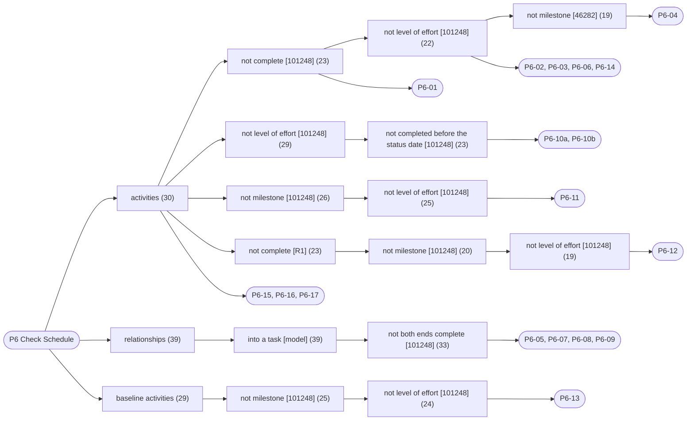

### Funnels of the P6 checks

The following lines give the same chains check by check, with the demo counts.

- P6-01: activities (30) → not complete [101248] (23) → population (23) → counted (2); demo result
  8.70, fail
- P6-02: activities (30) → not complete [101248] (23) → not level of effort [101248] (22) →
  population (22) → counted (0); demo result 0.00, pass
- P6-03: activities (30) → not complete [101248] (23) → not level of effort [101248] (22) →
  population (22) → counted (2); demo result 9.09, fail
- P6-04: activities (30) → not complete [101248] (23) → not level of effort [101248] (22) → not
  milestone [46282] (19) → population (19) → counted (1); demo result 5.26, fail
- P6-05: relationships (39) → into a task [model] (39) → not both ends complete [101248] (33) →
  population (33) → counted (0); demo result 0.00, pass
- P6-06: activities (30) → not complete [101248] (23) → not level of effort [101248] (22) →
  population (22) → counted (3); demo result 13.64, fail
- P6-07: relationships (39) → into a task [model] (39) → not both ends complete [101248] (33) →
  population (33) → counted (29); demo result 87.88, fail
- P6-08: relationships (39) → into a task [model] (39) → not both ends complete [101248] (33) →
  population (33) → counted (2); demo result 6.06, fail
- P6-09: relationships (39) → into a task [model] (39) → not both ends complete [101248] (33) →
  population (33) → counted (1); demo result 3.03, fail
- P6-10a: activities (30) → not level of effort [101248] (29) → not completed before the status date
  [101248] (23) → population (23) → counted (0); demo result 0.00, pass
- P6-10b: activities (30) → not level of effort [101248] (29) → not completed before the status date
  [101248] (23) → population (23) → counted (1); demo result 4.35, fail
- P6-11: activities (30) → not milestone [101248] (26) → not level of effort [101248] (25) →
  population (25) → counted (2); demo result 8.00, fail
- P6-12: activities (30) → not complete [R1] (23) → not milestone [101248] (20) → not level of
  effort [101248] (19) → population (19) → counted (19); demo result 100.00, fail
- P6-13: baseline activities (29) → not milestone [101248] (25) → not level of effort [101248] (24)
  → population (24) → counted (6); demo result 0.25, fail
- P6-14: activities (30) → not complete [101248] (23) → not level of effort [101248] (22) →
  population (22) → counted (13); demo result 59.09, fail
- P6-15: activities (30) → population (30) → counted (0); demo result 0.00, pass
- P6-16: activities (30) → population (30) → counted (0); demo result 0.00, pass
- P6-17: activities (30) → population (30) → counted (0); demo result 0.00, pass

P6-15, P6-16 and P6-17 divide by every activity. The activities they examine are cut in the
numerator, as their row of Table 10 says: a started activity for P6-15, an activity that is
neither complete nor a milestone for the two others.

### Open points of the P6 checks

The following readings are marked as unresolved in the code or in the related documents.

- P6-01: page 46291 says that activities with external predecessors or successors pass the check.
  The rule reads it side by side: an external predecessor does not stand for a missing successor.
  Level of effort stays in the population, the help being silent (rule docstring; Formulas 7).
- P6-02 and P6-03: a secondary constraint counts like a primary one. No Oracle text and no report
  settles it (rule docstring; Backlog, checks).
- P6-05, P6-07, P6-08 and P6-09: a relationship from another project is counted only when that
  project is in the file, so the same schedule can give two denominators depending on the export
  (Standards, section "Same check, several definitions").
- P6-10a: no report shows an in-progress activity whose remaining early start is before the data
  date (Formulas 7).
- P6-13: both reports measure a project that is its own baseline. A report on a project with a
  separate baseline would settle whether every baseline activity is counted there too (Standards,
  section "P6 Check Schedule"; Backlog, checks).
- P6-15: FF and SF relationships are not read (rule docstring).
- P6-16 and P6-17: completed activities are never counted, a predecessor or successor in another
  project is not read as P6-01 reads it, and Oracle documents no default for the dialog options
  (rule docstrings; Standards, section "P6 Check Schedule").

## DCMA DECM v8.0

The standard `DECM` (`standards/decm.toml`, name `DCMA DECM v8.0 (schedule)`) holds 16 checks of
Guideline 6, one function each in `analysis/decm/schedule_metrics.py`. The app shows them on the
**Schedule health** and **Audit** pages; the command is `xerscope check FILE --standard DECM`.

The source of each check is its specification sheet of the DCMA EVMS Compliance Metrics v8.0,
cited as "sheet" and the metric id. The status date of the sheets is the data date. The day limits
(`limit_days`, `riding_window_wd`, `remaining_tolerance_wd`) are working days of the activity's own
calendar; `status_period_days` is 28 calendar days. Formulas 2.2 holds the long form and the
pinning tests.

### Checks of DCMA DECM v8.0

Table 11 gives the compact fields of each check.

Table 11. Checks of DCMA DECM v8.0

| Id | Name | Formula | Unit | Target | Needs | Source | Code | Deeper reading |
|---|---|---|---|---|---|---|---|---|
| 06A204b | Dangling logic | open start (milestone: no predecessor; other activity: no FS or SS predecessor) or open finish (milestone: no successor; other activity: no FS or FF successor); a link to another project counts by its type; exempt: the earliest baseline start (start side) and the latest baseline finish (finish side), ties included | `%` | `<= 0%` | baseline read, not required; without one, or when the update is its own baseline: planned dates, note `no baseline: first/last by planned dates` | sheet 06A204b | `decm_06a204b_dangling_logic` | Formulas 2.2 |
| 06A205a | Lags | successor of at least one relationship with `lag_hr > 0` | `%` | `<= 10%` | none | sheet 06A205a | `decm_06a205a_lags` | Formulas 2.2 |
| 06A208a | Summary tasks with logic | WBS summary row that is the predecessor or the successor of a relationship | `count` | `<= 0` | none | sheet 06A208a | `decm_06a208a_summary_logic` | Formulas 2.2 |
| 06A209a | Hard constraints | primary or secondary constraint among Mandatory start, Mandatory finish; no exemption once started | `%` | `<= 0%` | none | sheet 06A209a | `decm_06a209a_hard_constraints` | Formulas 2.2 |
| 06A210a | LOE with discrete successors | at least one successor in the file that is not level of effort | `%` | `<= 0%` | none | sheet 06A210a | `decm_06a210a_loe_successors` | Formulas 2.2 |
| 06A211a | High total float | `total_float_d > limit_days` (44 wd of the activity's calendar) | `%` | `info` | none | sheet 06A211a | `decm_06a211a_high_float` | Formulas 2.2 |
| 06A212a | Out of sequence | with Start and Finish of both ends (actual, else forecast): FS successor start before predecessor finish; SS start before start; FF finish before finish; SF finish before start; the lag is not added | `count` | `<= 0` | none | sheet 06A212a | `decm_06a212a_out_of_sequence` | Formulas 2.2 |
| 06A401a | Critical path test | value 1 when the critical path test of DCMA-12 passes, else 0 (`slip_days` 600) | `pass/fail` | `pass` | data date; without one: `n/a`, note `no status date` | sheet 06A401a; method: xerscope | `decm_06a401a_critical_path_test` | Formulas 2.6; CPM, critical path test |
| 06A501a | Missing baseline dates | no `bl_start` or no `bl_finish` | `%` | `<= 5%` | baseline; without one: `n/a`, note `needs a baseline` | sheet 06A501a | `decm_06a501a_missing_baseline` | Formulas 2.2 |
| 06A504a | Actual starts changed | in both updates, with an actual start in the earlier one and another, or none, in this one | `%` | `<= 10%` | an update at least 28 days older; without one: `n/a`, note `needs an update 28 days older` | sheet 06A504a | `decm_06a504a_actual_starts_changed` | Formulas 2.2 |
| 06A504b | Actual finishes changed | the same on the actual finish | `%` | `<= 10%` | an update at least 28 days older; without one: `n/a`, note `needs an update 28 days older` | sheet 06A504b | `decm_06a504b_actual_finishes_changed` | Formulas 2.2 |
| 06A505a | In progress without actual start | no `act_start_date` | `%` | `<= 5%` | none | sheet 06A505a | `decm_06a505a_in_progress_without_actual_start` | Formulas 2.2 |
| 06A505b | Complete without actual finish | no `act_end_date` | `%` | `<= 5%` | none | sheet 06A505b | `decm_06a505b_complete_without_actual_finish` | Formulas 2.2 |
| 06A506a | Actual dates after the status date | `act_start_date` or `act_end_date` after the data date, read on every activity (the population is the denominator only) | `%` | `<= 5%` | data date; without one: `n/a`, note `no status date` | sheet 06A506a | `decm_06a506a_actual_dates_after_status_date` | Formulas 2.2 |
| 06A506b | Forecast dates before the status date | not started with a forecast start on or before the data date, or a forecast finish on or before it | `count` | `<= 0` | data date; without one: `n/a`, note `no status date` | sheet 06A506b | `decm_06a506b_forecast_dates_before_status_date` | Formulas 2.2 |
| 06A506c | Riding the status date | not started in both updates with a forecast start 0 wd to 3 wd after the data date in both (`riding_window_wd`, each update on its own data date and calendar); or started in both with remaining durations within 2 wd of each other (`remaining_tolerance_wd`) | `%` | `<= 1%` | an update at least 28 days older; without one: `n/a`, note `needs an update 28 days older` | sheet 06A506c | `decm_06a506c_riding_status_date` | Formulas 2.2 |

### Funnel tree of DCMA DECM v8.0

The following diagram shows the start sets of the DECM checks, the steps they share, and the checks
that use each chain of steps.

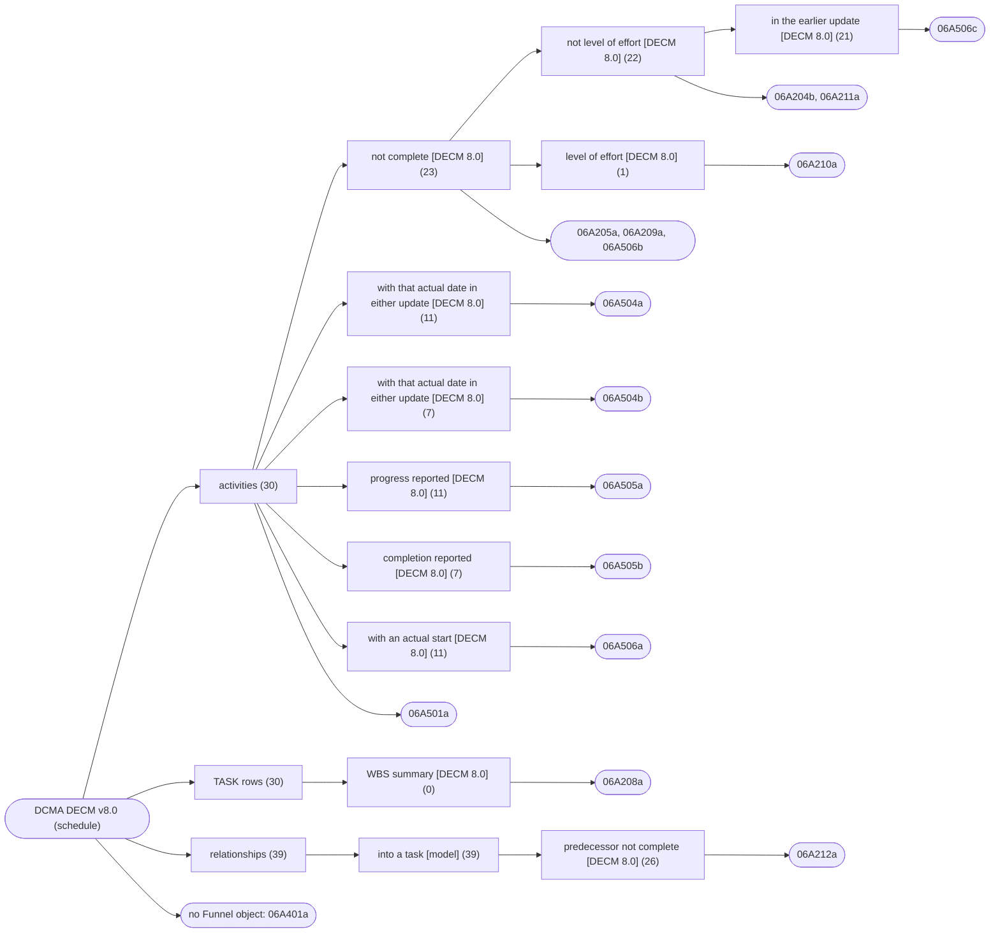

### Funnels of the DECM checks

The following lines give the same chains check by check, with the demo counts.

- 06A204b: activities (30) → not complete [DECM 8.0] (23) → not level of effort [DECM 8.0] (22) →
  population (22) → counted (2); demo result 9.09, fail
- 06A205a: activities (30) → not complete [DECM 8.0] (23) → population (23) → counted (2); demo
  result 8.70, pass
- 06A208a: TASK rows (30) → WBS summary [DECM 8.0] (0) → population (0) → counted (0); demo result
  0.00, pass
- 06A209a: activities (30) → not complete [DECM 8.0] (23) → population (23) → counted (0); demo
  result 0.00, pass
- 06A210a: activities (30) → not complete [DECM 8.0] (23) → level of effort [DECM 8.0] (1) →
  population (1) → counted (1); demo result 100.00, fail
- 06A211a: activities (30) → not complete [DECM 8.0] (23) → not level of effort [DECM 8.0] (22) →
  population (22) → counted (3); demo result 13.64, info
- 06A212a: relationships (39) → into a task [model] (39) → predecessor not complete [DECM 8.0] (26)
  → population (26) → counted (0); demo result 0.00, pass
- 06A401a: the chain of DCMA-12; no `Funnel` object; demo result 1.00, pass
- 06A501a: activities (30) → population (30) → counted (1); demo result 3.33, pass
- 06A504a: activities (30) → with that actual date in either update [DECM 8.0] (11) → population
  (11) → counted (0); demo result 0.00, pass
- 06A504b: activities (30) → with that actual date in either update [DECM 8.0] (7) → population (7)
  → counted (1); demo result 14.29, fail
- 06A505a: activities (30) → progress reported [DECM 8.0] (11) → population (11) → counted (0); demo
  result 0.00, pass
- 06A505b: activities (30) → completion reported [DECM 8.0] (7) → population (7) → counted (0); demo
  result 0.00, pass
- 06A506a: activities (30) → with an actual start [DECM 8.0] (11) → population (11) → counted (1);
  demo result 9.09, fail
- 06A506b: activities (30) → not complete [DECM 8.0] (23) → population (23) → counted (0); demo
  result 0.00, pass
- 06A506c: activities (30) → not complete [DECM 8.0] (23) → not level of effort [DECM 8.0] (22) → in
  the earlier update [DECM 8.0] (21) → population (21) → counted (0); demo result 0.00, pass

The start set `TASK rows` of 06A208a holds the WBS summary rows that every other start set leaves
out; the demo series has none. The step `with that actual date in either update` of 06A504a and
06A504b keeps the activities with the date in this update, and those of both updates with the date
in the earlier one.

### Open points of the DECM checks

The following readings are marked as unresolved in the code or in the related documents.

- 06A205a and 06A209a: level of effort stays in the population, and 06A205a counts positive lags
  only; the sheets do not say (Backlog, DECM).
- 06A210a: the sheet's exemption for a level of effort whose only successors are end-item
  deliverables or the contract completion is not modelled (Backlog, DECM).
- 06A212a: a level of effort predecessor is kept, the sheet not setting it apart (rule docstring).
- 06A401a: the sheet compares the critical path with the path a constraint method gives; the rule
  runs the slip test of DCMA-12, an approximation and not the sheet's method (Backlog, DECM).
- 06A504a and 06A504b: the denominator is the union of both updates; the sheet's is the activities
  with the date in the earlier one (Backlog, DECM).
- 06A505a: the sheet's "in progress" is an earned value percent above 0 and below 100, and its
  numerator also counts an actual finish; the rule takes started or percent complete above 0, and
  the actual start only (Backlog, DECM).
- 06A506b: block 6 of the sheet, "on or before the status date", is applied; block 10 step 3 keeps
  "before" (Standards, section "DCMA DECM v8.0, Guideline 6 (schedule)").
- 06A506c: the population leaves out level of effort and the activities absent from the earlier
  update; block 6 counts every incomplete task and milestone (rule docstring; Backlog, DECM).

## DCMA 14-Point

The standard `DCMA` (`standards/dcma.toml`, name `DCMA 14-Point`) holds 14 checks, one function each
in `analysis/dcma/fourteen_point.py`. The app shows them on the **Schedule health** and **Audit**
pages; the command is `xerscope check FILE --standard DCMA`.

The source is DCMA-EA PAM 200.1 (October 2012), cited by section. Lag limits are in hours as
stored. Float and duration limits are working days of the activity's own calendar. DCMA-09,
DCMA-11 and DCMA-14 compare calendar days (`date_grain = "day"`), where the P6 checks compare
timestamps. Formulas 2.3 and 2.6 hold the long form and the pinning tests.

### Checks of DCMA 14-Point

Table 12 gives the compact fields of each check.

Table 12. Checks of DCMA 14-Point

| Id | Name | Formula | Unit | Target | Needs | Source | Code | Deeper reading |
|---|---|---|---|---|---|---|---|---|
| DCMA-01 | Logic | no predecessor or no successor; a link to another project counts as a link | `%` | `<= 5%` | none | PAM 200.1 §4.1, §4.0 | `dcma_01_logic` | Formulas 2.3 |
| DCMA-02 | Leads | `lag_hr < 0` | `count` | `<= 0` | none | PAM 200.1 §4.2, §4.0 | `dcma_02_leads` | Formulas 2.3 |
| DCMA-03 | Lags | `lag_hr > 0` | `%` | `<= 5%` | none | PAM 200.1 §4.3, §4.0 | `dcma_03_lags` | Formulas 2.3 |
| DCMA-04 | Relationship types | relationships of type FS; value = 100 × FS / population; the list shows the others | `%` | `>= 90%` | none | PAM 200.1 §4.4, §4.0 | `dcma_04_relationship_types` | Formulas 2.3 |
| DCMA-05 | Hard constraints | primary or secondary constraint among Start on, Start on or before, Finish on, Finish on or before, Mandatory start, Mandatory finish; no exemption once started | `%` | `<= 5%` | none | PAM 200.1 §4.5, §4.0 | `dcma_05_hard_constraints` | Formulas 2.3 |
| DCMA-06 | High float | `total_float_d > limit_days` (44 wd of the activity's calendar) | `%` | `<= 5%` | none | PAM 200.1 §4.6, §4.0 | `dcma_06_high_float` | Formulas 2.3 |
| DCMA-07 | Negative float | `total_float_d < 0` | `count` | `<= 0` | none | PAM 200.1 §4.7, §4.0 | `dcma_07_negative_float` | Formulas 2.3 |
| DCMA-08 | High duration | baseline duration above `limit_days` (44): `bl_duration_hr` / the activity's current `hours_per_day`; an activity the baseline does not hold is not counted | `%` | `<= 5%` | baseline read; without one: `n/a`, note `needs a baseline` | PAM 200.1 §4.8, §4.0 | `dcma_08_high_duration` | Formulas 2.3 |
| DCMA-09 | Invalid dates | not started with a forecast start before the data date, or a forecast finish before it, or an actual start or finish after it; calendar days compared (`date_grain = "day"`) | `count` | `<= 0` | data date; without one: `n/a`, note `no status date` | PAM 200.1 §4.9, §4.0 | `dcma_09_invalid_dates` | Formulas 2.3 |
| DCMA-10 | Resources | no `TASKRSRC` row and no `PROJCOST` row; `n/a` when the project has no assignment and no activity with `labor_budget_hr > 0` | `%` | `<= 0%` | none | PAM 200.1 §4.10, §4.0 | `dcma_10_resources` | Formulas 2.3 |
| DCMA-11 | Missed tasks | Finish (actual, else forecast) on a later calendar day than `bl_finish`, or later by any working time on the activity's calendar | `%` | `<= 5%` | baseline; without one: `n/a`, note `needs a baseline`; without a data date: `n/a`, note `no status date` | PAM 200.1 §4.11, §4.0 | `dcma_11_missed_tasks` | Formulas 2.3 |
| DCMA-12 | Critical path test | value 1 when a slip of `slip_days` (600 wd) on the first open activity of the recalculated longest path reaches the project finish, else 0 | `pass/fail` | `pass` | data date; without one: `n/a`, note `no status date` | PAM 200.1 §4.12; slip length and reading: xerscope | `dcma_12_critical_path_test` | Formulas 2.6; CPM, critical path test |
| DCMA-13 | CPLI | value = (CPL + TF) / CPL, in wd of the project calendar; CPL from the data date to the measured finish, TF its float or its margin to its baseline finish | `ratio` | `>= 0.95` | data date; a Must Finish By, or a baseline (not the planned dates, which give `info`); without either: `n/a` | PAM 200.1 §3.1.2.3; margin without a Must Finish By: xerscope | `dcma_13_cpli` | Formulas 2.6 |
| DCMA-14 | BEI | complete activities, less those with an actual finish after the data date (calendar days compared); value = counted / population | `ratio` | `>= 0.95` | baseline; without one: `n/a`, note `needs a baseline`; without a data date: `n/a`, note `no status date` | PAM 200.1 §3.1.2.4 | `dcma_14_bei` | Formulas 2.3 |

### Funnel tree of DCMA 14-Point

The following diagram shows the start sets of the 14-Point checks, the steps they share, and the
checks that use each chain of steps.

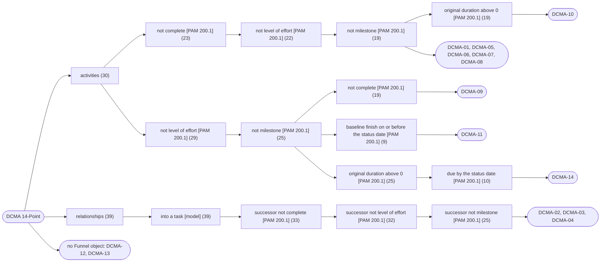

### Funnels of the 14-Point checks

The following lines give the same chains check by check, with the demo counts.

- DCMA-01: activities (30) → not complete [PAM 200.1] (23) → not level of effort [PAM 200.1] (22) →
  not milestone [PAM 200.1] (19) → population (19) → counted (1); demo result 5.26, fail
- DCMA-02: relationships (39) → into a task [model] (39) → successor not complete [PAM 200.1] (33) →
  successor not level of effort [PAM 200.1] (32) → successor not milestone [PAM 200.1] (25) →
  population (25) → counted (1); demo result 1.00, fail
- DCMA-03: relationships (39) → into a task [model] (39) → successor not complete [PAM 200.1] (33) →
  successor not level of effort [PAM 200.1] (32) → successor not milestone [PAM 200.1] (25) →
  population (25) → counted (2); demo result 8.00, fail
- DCMA-04: relationships (39) → into a task [model] (39) → successor not complete [PAM 200.1] (33) →
  successor not level of effort [PAM 200.1] (32) → successor not milestone [PAM 200.1] (25) →
  population (25) → counted (23); demo result 92.00, pass
- DCMA-05: activities (30) → not complete [PAM 200.1] (23) → not level of effort [PAM 200.1] (22) →
  not milestone [PAM 200.1] (19) → population (19) → counted (0); demo result 0.00, pass
- DCMA-06: activities (30) → not complete [PAM 200.1] (23) → not level of effort [PAM 200.1] (22) →
  not milestone [PAM 200.1] (19) → population (19) → counted (3); demo result 15.79, fail
- DCMA-07: activities (30) → not complete [PAM 200.1] (23) → not level of effort [PAM 200.1] (22) →
  not milestone [PAM 200.1] (19) → population (19) → counted (12); demo result 12.00, fail
- DCMA-08: activities (30) → not complete [PAM 200.1] (23) → not level of effort [PAM 200.1] (22) →
  not milestone [PAM 200.1] (19) → population (19) → counted (1); demo result 5.26, fail
- DCMA-09: activities (30) → not level of effort [PAM 200.1] (29) → not milestone [PAM 200.1] (25) →
  not complete [PAM 200.1] (19) → population (19) → counted (0); demo result 0.00, pass
- DCMA-10: activities (30) → not complete [PAM 200.1] (23) → not level of effort [PAM 200.1] (22) →
  not milestone [PAM 200.1] (19) → original duration above 0 [PAM 200.1] (19) → population (19) →
  counted (2); demo result 10.53, fail
- DCMA-11: activities (30) → not level of effort [PAM 200.1] (29) → not milestone [PAM 200.1] (25) →
  baseline finish on or before the status date [PAM 200.1] (9) → population (9) → counted (9); demo
  result 100.00, fail
- DCMA-12: activities (30) → not complete, not level of effort, not milestone [xerscope] (19) → on
  the recalculated longest path [xerscope] (7) → earliest remaining start, then lowest Activity ID
  [xerscope] (1: `P2030`) → delayed by 600 wd; finish read on the end points (2); no `Funnel`
  object; demo result 1.00, pass
- DCMA-13: activities (30) → not complete, not level of effort, finish milestone, with a finish
  [xerscope] (3) → latest finish, then highest Activity ID [xerscope] (1: `M9999`) → CPL 156 wd, TF
  −15 wd; no `Funnel` object; demo result 0.90, fail
- DCMA-14: activities (30) → not level of effort [PAM 200.1] (29) → not milestone [PAM 200.1] (25) →
  original duration above 0 [PAM 200.1] (25) → due by the status date [PAM 200.1] (10) → population
  (10) → counted (5); demo result 0.50, fail

In DCMA-11 the step `baseline finish on or before the status date` also removes the activities
without a baseline start: the 25 activities before it hold 1 activity without baseline dates. In
DCMA-14 an activity without a baseline finish is due and stays in the population.

### Critical path test and CPLI, step by step

DCMA-12, 06A401a and DCMA-13 carry no `Funnel` object. Their rules cut their population as follows
(`rules.critical_path_output`, `cpm.critical_path_test`, `dcma_13_cpli`).

The critical path test proceeds in this order:

1. The value is `n/a` without a data date (note `no status date`), or when no activity is at once
   not complete, not level of effort and dated (note `no remaining work`).
2. The update is recalculated. A schedule the engine refuses is a fail.
3. The delayed activity is, among the activities not complete, not level of effort and not
   milestone that are on the recalculated longest path, the one with the earliest remaining start,
   then the lowest Activity ID. Without one the test fails.
4. The delay is `slip_days` × the `hours_per_day` of that activity, 600 wd × 8 h in the demo. It is
   added to the remaining duration, the expected finish of the delayed activity is dropped, and the
   update is recalculated again.
5. The finish is the latest early finish of the end points, before and after. An end point is an
   activity of the recalculation that no activity other than a level of effort follows; a level of
   effort is never one.
6. The shift is the working hours between the two finishes on the delayed activity's calendar.
7. The test passes when the shift is at least the delay, or when the finish moved at least as far
   as the delayed activity's own finish did. It also passes when part of the delay arrived, the end
   points that finish the plain schedule moved, and no expected finish downstream gave up remaining
   duration. Otherwise it fails.

The demo note reads `+600 wd on P2030: forecast finish 2027-03-23 -> 2028-11-12, moved +600.0 wd`.

The CPLI proceeds in this order:

1. The value is `n/a` under the two conditions of step 1 of the critical path test.
2. With a Must Finish By (`PROJECT.plan_end_date`), the measured activity is the finish driver: the
   activity not complete and not level of effort with the latest Finish. Among several, a blank
   total float comes first, then the least total float, then the lowest Activity ID. TF is its
   `total_float_hr_cnt` / the hours per day of the project calendar, and the value is `n/a` when
   that float is blank.
3. Without a Must Finish By, the measured activity is the finish milestone not complete and not
   level of effort with the latest Finish, then the highest Activity ID. TF is the project working
   days from its Finish to its `bl_finish`, negative when late. The value is `n/a` without a
   baseline, without such a milestone or without its baseline finish. On the planned dates baseline
   TF is 0 and the status is `info`.
4. CPL is the project working days from the data date to the Finish of the measured activity. The
   value is (CPL + TF) / CPL, and `n/a` when CPL is not above 0.

The demo series has no Must Finish By: CPL is 156 wd to `M9999`, TF is −15 wd, and the value is
(156 − 15) / 156 = 0.90.

### Open points of the 14-Point checks

The following readings are marked as unresolved in the code or in the related documents.

- Every check on activities: a milestone is the P6 activity type, so an activity of another type
  without an original duration stays in the population, except in DCMA-10 and DCMA-14 (docstring of
  `_discrete_tasks`).
- DCMA-02, DCMA-03 and DCMA-04: a relationship counts when its successor is kept, xerscope's
  reading of section 4.0, which names tasks and not relationships (rule docstrings).
- DCMA-05: a hard secondary constraint counts, and an activity with two hard constraints is
  counted once (rule docstring).
- DCMA-08: the weekly files carry no detail planning period, so every baseline start qualifies, and
  the baseline hours are divided by the activity's current hours per day (rule docstring; Backlog,
  DECM).
- DCMA-09: the intent of "actual start/finish" in section 4.9 for completed tasks; a completed
  activity with an actual finish after the data date is left out, not counted (rule docstring).
- DCMA-12: how much of the slip must arrive when the delayed activity has float on its own finish;
  the slip length and the reading of the result are xerscope's (rule docstring; CPM, critical path
  test).
- DCMA-13: the margin to the baseline finish without a Must Finish By is xerscope's reading (rule
  docstring). Under a Must Finish By, the float of the finish driver, measured on its own calendar,
  is divided by the hours per day of the project calendar (Backlog, checks).
- DCMA-14: "tasks missing baseline finish dates" is read as the tasks with no baseline finish date
  (rule docstring).

## Integrity

The standard `INTEGRITY` (`standards/integrity.toml`, name `Integrity`) holds eight checks, one
function each in `analysis/integrity.py`. The app shows them on the **Schedule health** and
**Audit** pages; the command is `xerscope check FILE --standard INTEGRITY`.

Integrity is not a published standard. INT-01 and INT-03 compare the file with the recalculation
described in the part "Recalculation" of this sheet. INT-02 and INT-04 to INT-08 follow the
Schedule Project Log of the Oracle P6 EPPM 26 help, cited by page number. Formulas 2.4 holds the
long form and the pinning tests.

### Checks of Integrity

Table 13 gives the compact fields of each check.

Table 13. Checks of Integrity

| Id | Name | Formula | Unit | Target | Needs | Source | Code | Deeper reading |
|---|---|---|---|---|---|---|---|---|
| INT-01 | Schedule recalculated | at least one stored value among `early_start_date`, `early_end_date`, `late_start_date`, `late_end_date`, `total_float_hr_cnt` that the recalculation does not give (dates: same timestamp; float: difference of 0 at 0.01 h) | `%` | `<= 0%` | none | P6 EPPM 26 help 99351, 99352; comparison: xerscope | `int_01_recalculated` | Formulas 2.4, 6 |
| INT-02 | Out of sequence activities | FS predecessor not complete, or SS predecessor not started | `count` | `info` | none | P6 EPPM 26 help 99350; R1 | `int_02_out_of_sequence_progress` | Formulas 2.4 |
| INT-03 | Assignments recalculated | assignment with a stored `restart_date`, `reend_date`, `rem_late_start_date` or `rem_late_end_date` that is not the recalculated timestamp | `%` | `<= 0%` | none | xerscope (the standard file states no source) | `int_03_assignments_recalculated` | Formulas 2.4, 6 |
| INT-04 | Relationship loops | on a logic loop: a strongly connected group of more than one activity, or an activity linked to itself, among the activities that are not level of effort | `count` | `<= 0` | none | P6 EPPM 26 help 99374 | `int_04_relationship_loops` | Formulas 2.4 |
| INT-05 | Without predecessors or successors | no relationship into it, or none out of it; a link to another project counts | `count` | `info` | none | P6 EPPM 26 help 99350 | `int_05_without_predecessors_or_successors` | Formulas 2.4 |
| INT-06 | Actual date later than data date | `act_start_date` or `act_end_date` after the data date, timestamps compared | `count` | `<= 0` | data date; without one: `n/a`, note `no status date` | P6 EPPM 26 help 99350 | `int_06_actual_date_after_data_date` | Formulas 2.4 |
| INT-07 | Unsatisfied constraints | recalculated early start or finish not on the side of the constraint date its type requires, in working hours of the activity's calendar | `count` | `info` | none | P6 EPPM 26 help 99352; reading: xerscope | `int_07_unsatisfied_constraints` | Formulas 2.4 |
| INT-08 | Unsatisfied relationships | FS successor start before predecessor finish; SS start before start; FF finish before finish; SF finish before start; successor at its recalculated early date, predecessor at its actual date, else its recalculated early date; the lag is not added | `count` | `info` | none | P6 EPPM 26 help 99352; reading: xerscope | `int_08_unsatisfied_relationships` | Formulas 2.4 |

### Funnel tree of Integrity

The following diagram shows the start sets of the Integrity checks, the steps they share, and the
checks that use each chain of steps.

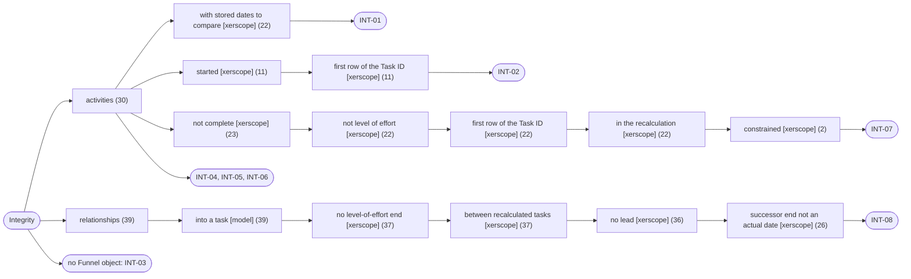

### Funnels of the Integrity checks

The following lines give the same chains check by check, with the demo counts.

- INT-01: activities (30) → with stored dates to compare [xerscope] (22) → population (22) → counted
  (0); demo result 0.00, pass
- INT-02: activities (30) → started [xerscope] (11) → first row of the Task ID [xerscope] (11) →
  population (11) → counted (0); demo result 0.00, info
- INT-03: `TASKRSRC` rows (25) → on an activity the recalculation schedules, not complete, not level
  of effort [xerscope] (19) → with a stored date to compare [xerscope] (19) → population (19) →
  counted (0); no `Funnel` object; demo result 0.00, pass
- INT-04: activities (30) → population (30) → counted (0); demo result 0.00, pass
- INT-05: activities (30) → population (30) → counted (3); demo result 3.00, info
- INT-06: activities (30) → population (30) → counted (1); demo result 1.00, fail
- INT-07: activities (30) → not complete [xerscope] (23) → not level of effort [xerscope] (22) →
  first row of the Task ID [xerscope] (22) → in the recalculation [xerscope] (22) → constrained
  [xerscope] (2) → population (2) → counted (1); demo result 1.00, info
- INT-08: relationships (39) → into a task [model] (39) → no level-of-effort end [xerscope] (37) →
  between recalculated tasks [xerscope] (37) → no lead [xerscope] (36) → successor end not an actual
  date [xerscope] (26) → population (26) → counted (0); demo result 0.00, info

The step `with stored dates to compare` of INT-01 keeps the activities the recalculation compares,
not complete and not level of effort, that hold at least one of the five stored values. Its note
counts values, `110 of 110 stored values reproduced` in the demo, where the ratio counts
activities. In INT-07 a start constraint on a started activity does not make it constrained.

### Open points of the Integrity checks

The following readings are marked as unresolved in the code or in the related documents.

- INT-02: FF and SF relationships are not listed; the reading by relationship type is calibrated
  on report R1 (source field of the standard file).
- INT-03: the standard file states no source for this check.
- INT-07: the reading is xerscope's and is not confirmed against a P6 log (rule docstring).
- INT-08: the comparison is on clock times. Across calendars, a relationship can be listed as
  broken where both dates are the same working minute (Backlog, checks).

## Rules for a custom standard

A custom standard is a TOML file that picks rules of `analysis/rules.py` by name and gives each its
parameters and its target. The 12 parameterised rules take the population from their parameters:
`exclude` lists keys of Table 5, one funnel step per key in the order given, each step citing the
token `xerscope`. A rule on relationships starts from the relationships, keeps those `into a task`,
then applies `links` (`all`, `not_both_complete` or `succ_incomplete`), one step per `exclude` key
on the successor, and `exclude_loe`; these steps cite the token `model`.

The app shows a custom standard like a built-in one, on the **Schedule health** and **Audit**
pages; the commands are `xerscope check FILE --standard my.toml` and `xerscope standards --rules`,
which prints every rule with its parameters. A custom standard can also name any rule of the
built-in standards. Formulas 2.5 and the section "Your own standard" of Standards hold the long
form.

### Parameterised rules

Table 14 gives the compact fields of each rule; a value in parentheses is the default of the
parameter.

Table 14. Parameterised rules

| Rule | List label | Formula | Unit | Target | Needs | Source | Code | Deeper reading |
|---|---|---|---|---|---|---|---|---|
| `missing_logic` | Missing a predecessor or a successor | no predecessor or no successor among the relationships of the project; `external_passes` (true) counts a link to another project; `pred_exempt` and `succ_exempt` (none) pass one side for `started`, `start_milestone`, `finish_milestone`, `project_start`, `project_finish`, `single_project_start`, `single_project_finish`; `dangling` (false) also counts a start with predecessors none of which is FS or SS, and a finish with successors none of which is FS or FF | `%` | set by the standard file | none | xerscope | `missing_logic` | Formulas 2.5 |
| `dangling` | Logic that does not drive the task | `end = "finish"` (default): a successor exists and none is FS or FF; `end = "start"`: a predecessor exists and none is FS or SS, the started activities left out of the population | `%` | set by the standard file | none | xerscope | `dangling` | Formulas 2.5 |
| `lag` | Relationships with the lag in question | `lag_hr` compared with `value` (0) by `op` (`>`); `unit = "days"` reads `lag_d`, days of the predecessor's calendar; `unit = "project_pct"` compares `lag_hr` with `value` % of the working hours from the planned start to the forecast finish on the project calendar | `%` | set by the standard file | none; `project_pct` without those two dates: `n/a` | xerscope | `lag` | Formulas 2.5 |
| `relationship_type` | Relationships of another type | relationships of `type` (FS), with a lag of 0 as well when `zero_lag`; value = 100 × counted / population; `listed` chooses the list: the others, or those of the type | `%` | set by the standard file | none | xerscope | `relationship_type` | Formulas 2.5 |
| `constraints` | Constrained tasks | primary or secondary constraint among `types` (none), P6 codes such as `CS_MANDSTART`; `ignore_start_when_started` (true) leaves out a start constraint on a started activity | `%` | set by the standard file | none | xerscope | `constraints` | Formulas 2.5 |
| `float` | Tasks outside the float limit | `total_float_d`, wd of the activity's calendar, compared with `value` (44) by `op` (`>`); `unit = "hours"` reads `total_float_hr_cnt`; `op = "between"` counts a float from `value` to `value_max`, both included | `%` | set by the standard file | none | xerscope | `total_float` | Formulas 2.5 |
| `duration` | Tasks outside the duration limit | `original_d` compared with `value` (44) by `op` (`>`); `field` reads the remaining duration, or the baseline duration (`bl_duration_hr` / the activity's current `hours_per_day`); `unit = "hours"` reads the hours as stored | `%` | set by the standard file | baseline for `field = "baseline"`; without one: `n/a`, note `needs a baseline` | xerscope | `duration` | Formulas 2.5 |
| `invalid_dates` | Progress dates on the wrong side of the status date | `kind` (both): a forecast before the data date (not started: forecast start; any open activity: forecast finish; `in_progress = "start"`: forecast start of every open activity), or an actual date after it; `include_data_date` (false) also counts a forecast on the data date; `denominator = "started"` divides by the activities with an actual start | `%` | set by the standard file | data date; without one: `n/a`, note `no status date` | xerscope | `invalid_dates` | Formulas 2.5 |
| `on_data_date` | Starting or finishing on the data date | Start or Finish on the data date; `date_grain` (day) compares calendar days, or timestamps | `%` | set by the standard file | data date; without one: `n/a`, note `no status date` | xerscope | `on_data_date` | Formulas 2.5 |
| `no_resource` | Tasks with no resource assignment | no `TASKRSRC` row, and no `PROJCOST` row when `expenses_count` (true); `kind = "labour_units"` counts `labor_budget_hr` not above 0 instead | `%` | set by the standard file | none | xerscope | `no_resource` | Formulas 2.5 |
| `late_vs_baseline` | Forecast to finish after their baseline finish | working hours from `bl_finish` to Finish above `tolerance_hours` (0), on the activity's calendar; `no_baseline = "planned"` takes the update's `target_end_date` where the baseline has no finish | `%` | set by the standard file | baseline; without one: `n/a`, note `needs a baseline` | xerscope | `late_vs_baseline` | Formulas 2.5 |
| `bei` | Due by the status date but not completed | complete activities; value = counted / population, the activities due: `bl_finish` on or before the data date, or no baseline finish (`missing_baseline = "due"`); `due_from = "baseline"` counts the due activities in the baseline itself | `ratio` | set by the standard file | baseline; without one: `n/a`, note `needs a baseline`; without a data date: `n/a`, note `no status date` | xerscope | `bei` | Formulas 2.5 |

### Funnels of the parameterised rules

The following lines give the chain of each rule with its default parameters on the demo series,
and the value the rule returns.

- `missing_logic`: activities (30) → not complete [xerscope] (23) → population (23) → counted (2);
  demo value 8.70
- `dangling`: activities (30) → not complete [xerscope] (23) → population (23) → counted (0); demo
  value 0.00
- `lag`: relationships (39) → into a task [model] (39) → successor not complete [model] (33) →
  population (33) → counted (2); demo value 6.06
- `relationship_type`: relationships (39) → into a task [model] (39) → successor not complete
  [model] (33) → population (33) → counted (29); demo value 87.88
- `constraints`: activities (30) → not complete [xerscope] (23) → population (23) → counted (0);
  demo value 0.00
- `float`: activities (30) → not complete [xerscope] (23) → population (23) → counted (3); demo
  value 13.04
- `duration`: activities (30) → not complete [xerscope] (23) → population (23) → counted (1); demo
  value 4.35
- `invalid_dates`: activities (30) → not level of effort [xerscope] (29) → not completed before the
  status date [xerscope] (23) → population (23) → counted (1); demo value 4.35
- `on_data_date`: activities (30) → not complete [xerscope] (23) → population (23) → counted (0);
  demo value 0.00
- `no_resource`: activities (30) → not complete [xerscope] (23) → not level of effort [xerscope]
  (22) → not milestone [xerscope] (19) → population (19) → counted (2); demo value 10.53
- `late_vs_baseline`: activities (30) → not complete [xerscope] (23) → not milestone [xerscope] (20)
  → not level of effort [xerscope] (19) → population (19) → counted (18); demo value 94.74
- `bei`: activities (30) → not level of effort [xerscope] (29) → not milestone [xerscope] (25) → due
  by the status date [xerscope] (9) → population (9) → counted (6); demo value 0.67

## Standard score

The score reads the statuses of the checks of one standard and recomputes no check. The following
diagram shows how the 18 checks of P6 Check Schedule become the score of the demo series.

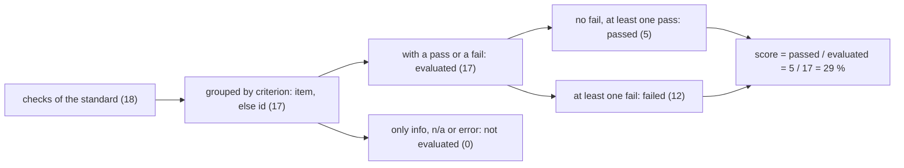

### Score of a standard

- **Identifier**: `StandardScore` (`passed`, `evaluated`, `failed_ids`); the card prints a value
  such as `29 %` and a detail such as `17 evaluated · 12 fail: P6-01, …`.
- **Shown**: **Overview** page, section **Score by standard**, one card per listed standard on the
  latest update; **Schedule health** page, the card of the standard picked. No command prints it.
- **Formula**: criteria in `pass` / (criteria in `pass` + criteria in `fail`), printed as a
  percentage without decimal. A criterion is one check, or the checks that share an `item`. It
  fails when one of its checks fails, passes when none fails and at least one passes, and is not
  evaluated otherwise.
- **Funnel**: checks of P6 (18) → grouped by criterion (17) → with a `pass` or a `fail` (17) →
  population (17) → counted: passed (5); demo result 29%. P6-10a and P6-10b are one criterion,
  named `P6-10 (P6-10b)` when it fails. The other standards give 11 / 15 for DECM, 4 / 14 for
  DCMA and 3 / 4 for INTEGRITY.
- **Target and status**: none. A standard without an evaluated criterion prints `–` and
  `0 evaluated`.
- **Needs**: the results of the checks. A check that is `n/a` without a baseline leaves both
  terms, so two scores computed with and without a baseline do not compare.
- **Source**: xerscope. No published standard defines a score for a schedule.
- **Code**: `analysis/checks.py`, `standard_score`.
- **Deeper reading**: Formulas 1.6.

### Counts of checks by status

- **Identifier**: `status_counts` (`pass`, `fail`, `info`, `n/a`, `error`, `scored`).
- **Shown**: **Schedule health** page, cards **Checks passed**, **Checks failed**, **For review**,
  **Not applicable**, and **Errors** when there is one.
- **Formula**: number of checks in each status; **Checks passed** prints `pass` / `scored`, where
  `scored` = `pass` + `fail`. The unit is a check, not a criterion.
- **Funnel**: checks of P6 (18) → with a `pass` or a `fail`: scored (18) → population (18) →
  counted: `pass` (6); demo result 6 / 18.
- **Target and status**: none.
- **Needs**: the results of the checks.
- **Source**: xerscope.
- **Code**: `analysis/checks.py`, `status_counts`.
- **Deeper reading**: Formulas 1.5.

## Recalculation

The engine recalculates the early and late dates and the floats of an update as P6 schedules it,
then compares them with the values the file stores. The following diagram shows the comparison on
the latest update of the demo series.

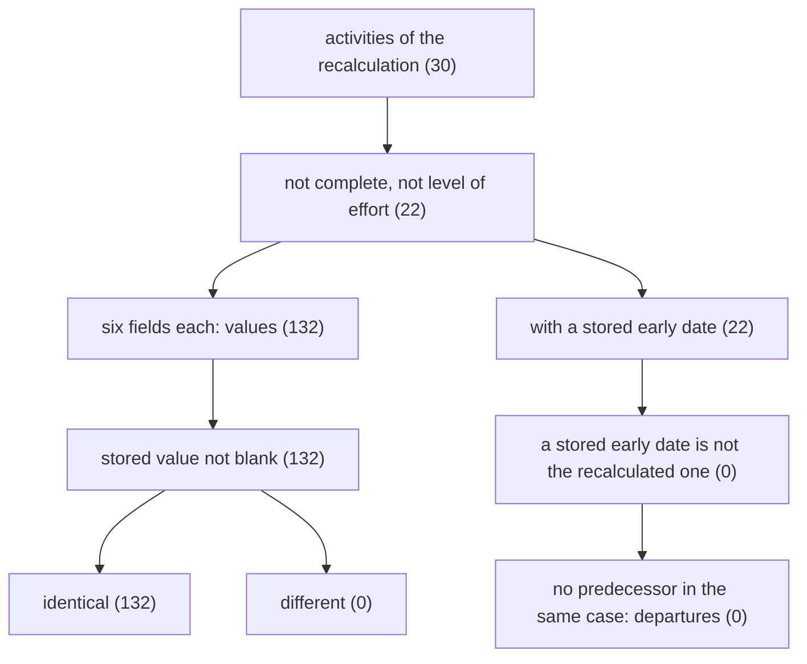

### Recalculated dates and floats

- **Identifier**: `es`, `ef`, `remaining_start`, `ls`, `lf`, `tf_hr`, `ff_hr`, `longest_path`
  (`Schedule.frame`); `Schedule.finish`.
- **Shown**: `xerscope recalc FILE` prints the recalculated finish, and `--out` writes the dates
  and floats. INT-01, INT-03, INT-07, INT-08, DCMA-12, 06A401a and the **Delay analysis** page read
  them.
- **Formula**: a forward and a backward pass, to the minute, each date on the activity's own
  calendar and each lag on the calendar the scheduling options designate. The total float `tf_hr`
  is the working hours of the activity's calendar from early finish to late finish, or the start
  float, or the smaller of the two, as the option **Compute Total Float as** says. The project
  finish is the latest early finish.
- **Funnel**: activities (30) → population: in the recalculation (30). A level of effort takes
  its dates from the activities it is linked to and drives nothing.
- **Target and status**: none. A logic loop, or a duration or a lag that is not finite or is above
  1,000,000 h, stops the recalculation; the checks then print `cannot schedule:` and the reason.
- **Needs**: one update.
- **Source**: Oracle P6 scheduling rules, validated against P6 output; xerscope for the conventions
  no reference settles.
- **Code**: `analysis/cpm.py`, `schedule`.
- **Deeper reading**: CPM.
- **Open point**: resource leveling, multiple float paths and relationships to projects that are
  not in the file are not modelled (CPM, section "Not modelled"; CPM, conventions).

### Stored values compared with the recalculation

- **Identifier**: `compare_with_stored`: one row per activity and field, with `stored`, `computed`,
  `gap_hr` and `agree`.
- **Shown**: `xerscope recalc FILE`, one line per field with identical / stored; **Debug** page,
  block 3; INT-01.
- **Formula**: `es` against `early_start_date` (`remaining_start` for an activity in progress),
  `ef` against `early_end_date`, `ls` against `late_start_date`, `lf` against `late_end_date`,
  `tf_hr` against `total_float_hr_cnt`, `ff_hr` against `free_float_hr_cnt`. A date agrees when the
  two timestamps are equal. A float agrees when computed − stored, rounded to 0.01 h, is 0. `gap_hr`
  of a date is the working hours from stored to computed on the activity's calendar: 0 with
  `agree` false means the same working minute written at another clock time.
- **Funnel**: activities of the recalculation (30) → not complete, not level of effort (22) →
  six fields each (132 values) → population: stored value not blank (132) → counted: identical
  (132).
- **Target and status**: none here; INT-01 sets the target on five of the six fields, the free
  float left out.
- **Needs**: one update that P6 has scheduled; a file without stored dates prints
  `no stored dates to compare (never scheduled in P6?)`.
- **Source**: xerscope.
- **Code**: `analysis/cpm.py`, `compare_with_stored`.
- **Deeper reading**: Formulas 6.

### Assignment dates compared with the recalculation

- **Identifier**: `compare_assignments`: one row per assignment and date.
- **Shown**: `xerscope recalc FILE`, line `assignments`; **Debug** page, block 3; INT-03.
- **Formula**: the recalculated remaining early start and finish and late start and finish of each
  assignment against `TASKRSRC.restart_date`, `reend_date`, `rem_late_start_date` and
  `rem_late_end_date`. A date agrees when the two timestamps are equal; `gap_hr` is in working
  hours of the activity's calendar.
- **Funnel**: `TASKRSRC` rows (25) → on an activity of the recalculation, not complete, not level
  of effort (19) → four dates each (76 values) → population: stored value not blank (76) →
  counted: identical (76).
- **Target and status**: none here; INT-03 sets it.
- **Needs**: one update with resource assignments.
- **Source**: xerscope.
- **Code**: `analysis/cpm.py`, `compare_assignments`.
- **Deeper reading**: Formulas 6.

### Recalculation departures

- **Identifier**: `departures`, `departure_forms`, `departure_funnel`.
- **Shown**: **Debug** page, block 3, with the funnel steps; the anonymous diagnostic holds the
  counts by form.
- **Formula**: the activities where the recalculated early dates first differ from the stored
  ones. Per activity: the stored and the recalculated early finish, and `gap_hr`, recalculated
  minus stored in working hours of its calendar. `departure_forms` counts the same rows by status,
  type, constraint, expected finish, resource dependence and longest path.
- **Funnel**: activities (30) → not complete [xerscope] (23) → not level of effort [xerscope]
  (22) → with a stored early date [xerscope] (22) → a stored early date is not the recalculated
  one [xerscope] (0) → no predecessor in the same case [xerscope] (0) → population (0).
- **Target and status**: none.
- **Needs**: one update that P6 has scheduled.
- **Source**: xerscope.
- **Code**: `app/recalculation_departures.py`, `departure_funnel`, `departures`.
- **Deeper reading**: Formulas 5.3.

## Changelog

The changelog compares two updates of one project. Activities are matched by Activity ID, the first
row of each ID. It lists one row per change, and its counts feed the **Changelog** page and the
delay analysis.

### Change rows

- **Identifier**: `changelog(old, new)`: columns `category`, `change`, `task_code`, `field`,
  `before`, `after`, `delta`, `unit`.
- **Shown**: **Changelog** page, section **All changes**; `xerscope changelog OLD NEW` prints the
  counts.
- **Formula**: one row per condition of Table 15 that holds. The sign of `delta` for a start, a
  finish or the forecast finish is working days gained (+) or lost (−). Every other `delta` is
  after minus before.
- **Funnel**: activities of the earlier update (30) and of the later update (30) → in both (30),
  added (0), deleted (0) → rows (60), of which 4 Project rows.
- **Target and status**: none.
- **Needs**: two updates.
- **Source**: xerscope.
- **Code**: `analysis/changelog.py`, `changelog`.
- **Deeper reading**: Formulas 5.

Table 15 gives the condition of each row and the unit and calendar of its `delta`.

Table 15. Rows of the changelog

| Category | Change | Condition | Delta |
|---|---|---|---|
| Project | status date | always | working days from the old to the new data date, project calendar of the later update (wd) |
| Project | forecast finish | always | −(working days from the old to the new forecast finish), same calendar (wd) |
| Project | activities, relationships | always | new count − old count |
| Scope | added, deleted | Activity ID only in the later update, only in the earlier one | none |
| Tasks | renamed, moved to another WBS, type changed, calendar changed | `task_name`, `wbs_code`, `type` or `clndr_id` differs | none |
| Durations | original duration changed | `target_drtn_hr_cnt` differs, hours compared | `original_d` after − old hours / `hours_per_day` after (wd of the activity's calendar in the later update) |
| Durations | remaining duration increased | `remain_drtn_hr_cnt` higher, and not complete in the later update | the same on the remaining duration (wd) |
| Durations | remaining duration cut | `remain_drtn_hr_cnt` lower, and not started in the later update | the same on the remaining duration (wd) |
| Progress | started, finished, status reverted | `status` differs; reverted when it goes back in the order not started, in progress, complete | none |
| Progress | actual start or finish changed (retroactive), removed | both dates present and different; present before and blank after | none |
| Progress | % complete | `pct_complete` after − before, rounded to 0.01, is not 0 | that difference (points) |
| Dates | start moved, finish moved | not complete in the later update, and the move, rounded to 0.01 wd, is above 0.005 wd in size | −(working days from the old to the new date), activity's calendar in the later update (wd) |
| Float | total float changed | not complete in the later update, both floats present, change above 0.005 wd in size | (`total_float_hr_cnt` after − before) / `hours_per_day` after (wd) |
| Float | became critical, no longer critical | critical after and not before; critical before, not after, and not complete | none |
| Constraints | primary or secondary constraint added, removed, changed | the type differs, or the type is present and its date differs | none |
| Resources | budgeted labour hours changed | `labor_budget_hr` after − before, rounded to 0.01, is not 0 | that difference (h) |
| Resources | resource assigned, resource removed, budgeted units changed | per activity of both updates and resource: `TASKRSRC.target_qty` summed appears, disappears, or differs by 0.01 or more | the difference of units, for the last one |
| Relationships | added, deleted | the pair of predecessor and successor is only in the later update, only in the earlier one | none |
| Relationships | type changed, lag changed | the pair is in both with another set of types; with the same types and another lag in hours | none |
| Calendars | working time changed | a calendar of both updates whose hours per day, week or dated exceptions differ | none |
| Options | scheduling option changed | a scheduling option or the Must Finish By differs; blank and absent are equal | none |

### Counts of changes

- **Identifier**: `summary`, `category_totals`, `headline_counts` (`added`, `deleted`, `logic`,
  `durations`, `retroactive_actuals`, `became_critical`).
- **Shown**: **Changelog** page, cards **Forecast finish**, **Added / deleted**, **Logic changes**,
  **Durations changed**, **Retroactive actuals**, **Became critical**, and section **Changes by
  category**; `xerscope changelog OLD NEW`.
- **Formula**: number of rows per category and change. **Logic changes** counts the rows of the
  category Relationships, **Durations changed** those of Durations, **Retroactive actuals** the
  actual dates changed or removed. **Forecast finish** prints the forecast finish of the later
  update and the `delta` of its Project row, in wd of the project calendar.
- **Funnel**: rows (60) → not of the category Project (56) → population (56) → counted per
  category: Progress (6), Dates (36), Float (14). The cards read 0 / 0, 0, 0, 1 and 0 in the demo,
  and the forecast finish 2027-03-23 with −2.0 wd.
- **Target and status**: none.
- **Needs**: two updates.
- **Source**: xerscope.
- **Code**: `analysis/changelog.py`, `summary`, `category_totals`, `headline_counts`,
  `forecast_finish`.
- **Deeper reading**: Formulas 5.

### Changes by week

- **Identifier**: `weekly_change_counts`, `weekly_change_matrix`.
- **Shown**: **Changelog** page, expander **Every week, side by side**.
- **Formula**: the counts of the preceding entry for every pair of consecutive updates, one column
  per week, named by the later data date.
- **Funnel**: updates of the series (8) → consecutive pairs (7) → rows of each pair, not of the
  category Project → counted per category and change.
- **Target and status**: none.
- **Needs**: at least two updates.
- **Source**: xerscope.
- **Code**: `analysis/changelog.py`, `weekly_change_counts`, `weekly_change_matrix`.
- **Deeper reading**: Formulas 5.

## Delay analysis

The delay analysis reads one week by half steps: the earlier update takes the changes of the later
update one kind at a time, and each derived schedule is recalculated. The following diagram shows
the week from 2026-10-12 to 2026-10-19 of the demo series, with the recalculated finish after each
step and its shift.

```mermaid
flowchart LR
  earlier["earlier update, recalculated: 2027-03-21"]
  progress["progress: 2027-03-23, shift -2.0 wd"]
  scope["scope: shift 0.0 wd"]
  durations["durations: shift 0.0 wd"]
  logic["logic: shift 0.0 wd"]
  constraints["constraints: shift 0.0 wd"]
  options["calendars and options: shift 0.0 wd"]
  later["later update, recalculated: 2027-03-23, residual 0.0 wd"]
  earlier --> progress
  progress --> scope
  scope --> durations
  durations --> logic
  logic --> constraints
  constraints --> options
  options --> later
```

Table 16 gives what each step carries from the later update onto the schedule before it, and the
changelog rows counted at the step.

Table 16. Steps of the half-step reading

| Step | Carried from the later update | Changelog rows counted |
|---|---|---|
| progress | the data date; status, actual dates, suspend and resume dates, `phys_complete_pct`, the external date bounds; the remaining duration of the activities started in the later update whose remaining duration decreased | Progress |
| scope | the activities added, with the relationships and assignments that reach them; the activities deleted, taken out with theirs; the activity types | Scope; Tasks, type changed |
| durations | `target_drtn_hr_cnt`, `expect_end_date`, every other remaining duration that changed, the resource assignments | Durations, Resources |
| logic | every relationship of the later update | Relationships |
| constraints | the constraint types and dates, and the Must Finish By of the project | Constraints |
| calendars and options | `clndr_id`, the calendar definitions, the scheduling options, the planned start | Calendars, Options; Tasks, calendar changed |

### Shift of each step, slip and replanning

- **Identifier**: `shift_wd` of a step; `slip_wd`; `replanning_wd`; `finish_before_replanning`.
- **Shown**: **Delay analysis** page, cards **Finish before replanning** and **Finish shown**,
  section **Step by step**, section **Every update**; download **Download steps (CSV)**.
- **Formula**: `shift_wd` = −(working days from the finish before the step to the finish after it),
  on the project calendar of the later update, rounded to 0.01 wd. `slip_wd` is the shift of the
  progress step. `replanning_wd` is the sum of the shifts of the five other steps. The finish
  before replanning is the recalculated finish after the progress step.
- **Funnel**: activities of the earlier update (30) and of the later update (30) → matched by
  Activity ID (30), added (0), deleted (0); changelog rows (60) → carried by a step: progress
  (6), every other step (0). The demo reads a slip of −2.0 wd and a replanning of 0.0 wd.
- **Target and status**: none.
- **Needs**: two updates the engine can schedule; a week it cannot keeps its row in the series
  with `not read:` and the reason.
- **Source**: AACE RP 29R-03, MIP 3.4, 3.4.K.4; xerscope for the order of the steps and for the
  fields the recommended practice does not name.
- **Code**: `analysis/forensics.py`, `half_step`, `half_step_series`.
- **Deeper reading**: Formulas 5.1.
- **Open point**: the order in which the kinds of revision are applied, and the step that takes
  the scheduling options, are conventions no source settles (Formulas 5.1).

### Residual and period

- **Identifier**: `residual_wd`; `period_wd`; `is_slip_beyond_period`.
- **Shown**: **Delay analysis** page, warnings under **Step by step**, and the table of
  **Every update**.
- **Formula**: `residual_wd` = −(working days from the finish after the last step to the
  recalculated finish of the later update). `period_wd` = working days from the earlier to the
  later data date. Both are on the project calendar of the later update. The slip is beyond the
  period when `slip_wd` is below −`period_wd` − 0.005.
- **Funnel**: the two updates of the week; no population is cut. The demo reads a residual of
  0.0 wd and a period of 7.0 wd.
- **Target and status**: none; the page warns when the residual is above 0.005 wd in size and when
  the slip is beyond the period.
- **Needs**: two updates.
- **Source**: AACE RP 29R-03, 3.4.K.4.f and 3.4.K.4.g.
- **Code**: `analysis/forensics.py`, `half_step`, `HalfStep.is_slip_beyond_period`.
- **Deeper reading**: Formulas 5.1.

### Engine gap

- **Identifier**: `engine_gap_wd`; `is_finish_reproduced`.
- **Shown**: **Delay analysis** page, warning above the cards when it is not 0, and the table of
  **Every update**.
- **Formula**: −(working days from the forecast finish of the file to the recalculated finish), on
  the project calendar of the update, rounded to 0.01 wd. The finish is reproduced when the gap is
  0 for both updates of the week.
- **Funnel**: one update; no population is cut. The demo reads 0.0 wd on every update.
- **Target and status**: none; the page warns that the shifts can come from the recalculation when
  the gap is not 0.
- **Needs**: one update.
- **Source**: xerscope.
- **Code**: `analysis/forensics.py`, `engine_gap_wd`.
- **Deeper reading**: Formulas 5.1.

### Finish case

- **Identifier**: `finish_case`; `held_by`.
- **Shown**: **Delay analysis** page, caption **Finish held by**, and the table of
  **Every update**.
- **Formula**: `mandatory finish` when an end point carries a Mandatory Finish as its primary
  constraint and its recalculated early finish is the project's; else `must finish by` when the
  project has one; else `last task`. `held_by` is the constraint date, the Must Finish By, or the
  recalculated finish.
- **Funnel**: activities (30) → not level of effort, not complete (22) → without a successor in
  the project → with a Mandatory Finish → early finish equal to the project finish (0). The demo
  reads `last task`.
- **Target and status**: none.
- **Needs**: one update.
- **Source**: Oracle P6 help for the three cases; xerscope for the order in which they are read.
- **Code**: `analysis/forensics.py`, `finish_case`.
- **Deeper reading**: Formulas 5.1.

### Longest path float

- **Identifier**: `longest_path_float_d`.
- **Shown**: **Delay analysis** page, card **Longest path float**, and the table of
  **Every update**.
- **Formula**: lowest `tf_hr` of the activities on the recalculated longest path / hours per day
  of the project calendar. The float is in working hours of each activity's calendar; the division
  is by the project calendar's day.
- **Funnel**: activities of the recalculation (30) → on the recalculated longest path → lowest
  total float. The demo reads −12.0 wd.
- **Target and status**: none.
- **Needs**: one update.
- **Source**: xerscope.
- **Code**: `analysis/forensics.py`, `longest_path_float_d`.
- **Deeper reading**: Formulas 5.1.

### Revisions by horizon

- **Identifier**: `revisions_by_horizon`: `within the lookahead`, `beyond the lookahead`,
  `beyond_pct`.
- **Shown**: **Delay analysis** page, table under the caption **Where the revisions fall**.
- **Formula**: per step after progress, and for all of them: the changelog rows the step carries
  that name an activity, counted within the lookahead when the Start of the activity is on or
  before the later data date plus 6 weeks (`Settings.lookahead_weeks`), beyond it otherwise.
  `beyond_pct` = 100 × beyond / (within + beyond). The Start is the later update's, and the earlier
  update's for an activity deleted since.
- **Funnel**: changelog rows (60) → carried by a step after progress (0) → naming an activity
  with a Start (0) → counted: beyond the lookahead (0). The demo week has no revision.
- **Target and status**: none; `beyond_pct` is blank when nothing was revised.
- **Needs**: two updates.
- **Source**: xerscope; the lookahead as the place where work is made ready follows the Last
  Planner System, and no source sets a threshold on the share.
- **Code**: `analysis/forensics.py`, `revisions_by_horizon`.
- **Deeper reading**: Formulas 5.1.

### Longest path of an update

- **Identifier**: `longest_path`, `longest_path_funnel`; source `P6 longest path`, `recalculated`
  or `none`.
- **Shown**: **Delay analysis** page, section **Longest path**, with the funnel steps.
- **Formula**: the activities not complete that P6 flagged (`TASK.driving_path_flag`). When the
  file flags none, the activities not complete on the recalculated longest path.
- **Funnel**: activities (30) → not complete [AACE 29R-03] (23) → on the longest path (P6
  longest path) [AACE 29R-03] (10) → population (10).
- **Target and status**: none.
- **Needs**: one update.
- **Source**: AACE RP 29R-03, 3.4.E.9.
- **Code**: `analysis/longest_path.py`, `longest_path_funnel`.
- **Deeper reading**: Formulas 5.2.

### Changes of the longest path and stability

- **Identifier**: `path_changes` (`change`, `float_before_d`); `path_churn` (`on_path`, `stayed`,
  `entered`, `left_finished`, `left_open`, `left_deleted`, `stability`).
- **Shown**: **Delay analysis** page, section **Longest path**, table of changes and table of every
  update; download **Download longest path (CSV)**.
- **Formula**: each activity on the path of either update is `stayed`, `entered`,
  `left: finished`, `left: still open` or `left: deleted`. `on_path` = stayed + entered.
  `stability` = stayed / (stayed + left still open). `float_before_d` is the stored total float of
  the earlier update, in wd of the activity's calendar.
- **Funnel**: activities on the longest path of the earlier update (10) or of the later update
  (10) → on either (10) → counted: stayed (10), entered (0), left (0); demo stability 1.00.
- **Target and status**: none; `stability` is blank when no activity of the earlier path is still
  open.
- **Needs**: two updates.
- **Source**: AACE RP 29R-03, SVP 2.3.B.6; xerscope for the stability ratio.
- **Code**: `analysis/longest_path.py`, `path_changes`, `path_churn`.
- **Deeper reading**: Formulas 5.2.

### PPC on the longest path

- **Identifier**: `path_commitments`; `path_committed`, `path_kept`, `ppc_path`, `ppc_week`.
- **Shown**: **Delay analysis** page, caption and table of the commitments on the previous
  update's longest path, and the table of every update.
- **Formula**: `ppc_path` = 100 × kept / committed over the commitments of the week whose activity
  is on the longest path of the earlier update. `ppc_week` is the same over every commitment, as
  on the **PPC & progress** page.
- **Funnel**: commitments of the week (4) → still in the later update (4) → activity on the
  longest path of the earlier update (0) → population (0) → counted: kept (0). The demo prints
  `ppc_week` 50.0 and a blank `ppc_path`.
- **Target and status**: none; blank when nothing was committed on the path.
- **Needs**: two updates.
- **Source**: xerscope; PPC itself follows the Last Planner System.
- **Code**: `analysis/longest_path.py`, `path_commitments`, `path_churn`.
- **Deeper reading**: Formulas 5.2.

## Earned value and Earned Schedule

Earned value is computed in labour hours against a baseline, with cost figures beside it when the
sidebar checkbox **Costs** is selected. The **Earned value** page reads the baseline of the first
update of the series, and the baseline of each update when **P6 view: the file's baseline** is on.
The following diagram shows the chain from the baseline and the update to the indices, with the
figures of the demo series.

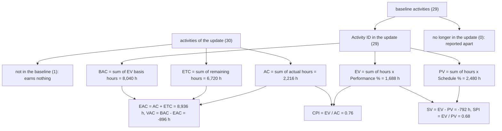

### Budget at completion

- **Identifier**: `bac_hr`; `unbaselined`; `deleted_since_bl`, `pv_deleted_hr`;
  `Baseline.bac_hours`.
- **Shown**: **Earned value** page, expander **How it is calculated**, table of **Performance
  indices by update**, and the captions under **Earned hours by task**.
- **Formula**: BAC = Σ `ev_labor_hr` over the baseline activities whose Activity ID is in the
  update, in hours. `Baseline.bac_hours` sums every baseline activity: the size of the plan. With
  the option **Link renumbered tasks by GUID**, an activity renumbered since the baseline is matched
  by `TASK.guid`.
- **Funnel**: baseline activities (29) → Activity ID in the update (29) → population (29); no
  longer in the update (0); activities of the update that are not in the baseline (1, `C3045`).
  The demo BAC is 8,040 h.
- **Target and status**: none.
- **Needs**: a baseline with labour hours; without a baseline the page asks for one, and a
  baseline without hours has nothing to earn.
- **Source**: P6 totals its earned value fields over the activities of the current project (P6
  Professional 25, How data is summarized); the earned value basis follows the Earned Value tab of
  the P6 admin preferences.
- **Code**: `analysis/evm.py`, `earned`, `ev_point`; `analysis/baseline.py`, `Baseline`.
- **Deeper reading**: Formulas 3.

### Schedule percent and planned value

- **Identifier**: `schedule_pct`; `pv_hr`; `pv_pct`, card **Percent scheduled**.
- **Shown**: **Earned value** page, card, expander **How it is calculated**, **Earned hours by
  task**.
- **Formula**: Schedule % at the data date = 100 × working minutes from `ev_start` to the data
  date / working minutes from `ev_start` to `ev_finish`, kept in the range 0 to 100, on the
  baseline activity's calendar read in the baseline file. A span without working time is 100 once
  `ev_finish` is reached, else 0; a missing date gives a blank, read as 0. PV = Σ `ev_labor_hr` ×
  Schedule % / 100, in hours, not rounded. `pv_pct` = 100 × PV / BAC.
- **Funnel**: baseline activities in the update (29) → with EV basis hours (22) → with both EV
  dates (22) → population (22) → counted: Schedule % above 0 (11). The demo PV is 2,480 h,
  30.8% of BAC.
- **Target and status**: none.
- **Needs**: a baseline and a data date.
- **Source**: P6, Planned Value Labor Units = baseline labour units × Schedule % Complete.
- **Code**: `analysis/evm.py`, `schedule_pct`, `earned`.
- **Deeper reading**: Formulas 3.
- **Open point**: Schedule % runs to the baseline finish, where the P6 Professional 26 help names
  the current planned finish for the planned value cost (`UNRESOLVED` in `schedule_pct`; Backlog,
  checks).

### Performance percent and earned value

- **Identifier**: `perf_pct`, `ev_technique`; `ev_hr`; `ev_pct`, card **Percent complete**.
- **Shown**: **Earned value** page, card, expander **How it is calculated**, **Earned hours by
  task**.
- **Formula**: EV = Σ `ev_labor_hr` × Performance % / 100, in hours. Performance % follows the
  earned value technique of the activity's WBS element, as Table 17 gives it. `ev_pct` = 100 × EV
  / BAC.
- **Funnel**: baseline activities in the update (29) → population (29) → counted: earning hours
  (8). The demo EV is 1,688 h, 21.0% of BAC.
- **Target and status**: none.
- **Needs**: a baseline.
- **Source**: P6, Earned Value Labor Units = baseline labour units × Performance % Complete;
  `PROJWBS.ev_compute_type`.
- **Code**: `analysis/evm.py`, `performance_pct`, `earned`.
- **Deeper reading**: Formulas 3.
- **Open point**: the technique WBS milestones and any unknown code fall back on the activity
  percent complete and are listed; only `EC_Cmp_pct` has been read in P6 exports (Formulas 7;
  Backlog, checks).

Table 17 gives the Performance % of each earned value technique.

Table 17. Performance percent by earned value technique

| `PROJWBS.ev_compute_type` | Technique | Performance % |
|---|---|---|
| blank, `EC_Cmp_pct` | `activity` | `pct_complete` |
| `EC_0_100` | `0/100` | 100 when complete, else 0 |
| `EC_50_50` | `50/50` | 100 when complete, 50 when started, else 0 |
| `EC_User_pct` | `custom` | 100 when complete, `PROJWBS.ev_user_pct` when started (blank: 0), else 0 |
| `EC_WBS_pct` | `wbs_milestones` | `pct_complete`; the activity is listed as not modelled |
| any other code | `unknown` | `pct_complete`; the activity is listed as not modelled |

### Actual hours and estimate at completion

- **Identifier**: `ac_hr`, `ac_unbaselined_hr`; `etc_hr`; `eac_hr`; `vac_hr`, card **EAC**.
- **Shown**: **Earned value** page, card **EAC** with VAC as its delta, expander **How it is
  calculated**.
- **Formula**: AC = Σ `labor_actual_hr` and ETC = Σ `labor_remaining_hr` over every activity of
  the update, in the baseline or not. EAC = AC + ETC. VAC = BAC − EAC, negative for an overrun.
  All in hours.
- **Funnel**: activities of the update (30) → population (30) → counted: with actual hours (9),
  with remaining hours (17). The demo reads AC 2,216 h, ETC 6,720 h, EAC 8,936 h, VAC −896 h.
- **Target and status**: none.
- **Needs**: a baseline for VAC.
- **Source**: P6, Actual Labor Units and Remaining Labor Units; EAC = ACWP + ETC in EVMS wording.
- **Code**: `analysis/evm.py`, `ev_point`, `EvPoint`.
- **Deeper reading**: Formulas 3.
- **Open point**: the ETC technique of each WBS element (`PROJWBS.ev_etc_compute_type`) is
  reported, not applied: ETC stays the remaining hours (Formulas 7; Backlog, checks).

### Schedule variance and schedule performance index

- **Identifier**: `sv_hr`, card **SV**; `spi`, card **SPI (labor units)**.
- **Shown**: **Earned value** page, cards, and **Performance indices by update**.
- **Formula**: SV = EV − PV, in hours. SPI = EV / PV, without unit; none when PV is 0.
- **Funnel**: the populations of PV and EV. The demo reads −792 h and 0.68.
- **Target and status**: none; the chart draws a dotted line at the alert threshold of the page.
- **Needs**: a baseline and a data date.
- **Source**: P6 column Schedule Performance Index - Labor Units; SPI = BCWP / BCWS in EVMS
  wording.
- **Code**: `analysis/evm.py`, `EvPoint.spi`, `EvPoint.as_row`.
- **Deeper reading**: Formulas 3.

### Cost performance index and productivity

- **Identifier**: `cpi`; `productivity`, label **EV / AC (baselined work)**; `ac_baselined_hr`.
- **Shown**: **Earned value** page, **Performance indices by update** and expander **How it is
  calculated**.
- **Formula**: CPI = EV / AC over all actual hours; none when AC is 0. Productivity = EV / (AC −
  `ac_unbaselined_hr`), the actual hours of the activities the baseline holds; none when that is
  0. Both without unit.
- **Funnel**: AC: activities of the update (30) → in the baseline (29) for the productivity. The
  demo reads 0.76 for both, the activity outside the baseline having no actual hours.
- **Target and status**: none.
- **Needs**: a baseline.
- **Source**: P6 column Cost Performance Index - Labor Units (Oracle P6 EPPM help, page 47224);
  xerscope for the productivity.
- **Code**: `analysis/evm.py`, `EvPoint.cpi`, `EvPoint.productivity`.
- **Deeper reading**: Formulas 3.

### Cost figures

- **Identifier**: `bac_cost`, `pv_cost`, `ev_cost`; `spi_cost`, card **SPI**.
- **Shown**: **Earned value** page, when the sidebar checkbox **Costs** is selected.
- **Formula**: BAC cost = Σ `bl_cost` over the baseline activities the update holds. PV cost: per
  assignment, `target_cost` × the share of its own start-to-finish span elapsed at the data date,
  kept in the range 0 to 1, in working time of the resource's calendar, else the activity's; the
  expenses and the part of the budget no assignment carries take the share of the activity's
  `ev_start` to `ev_finish`. EV cost = Σ `bl_cost` × Performance % / 100. SPI = EV cost / PV cost;
  none when PV cost is 0.
- **Funnel**: baseline activities in the update (29) → with a budgeted cost (0). The demo files
  carry no cost, and the card prints `n/a — no cost in the baseline`.
- **Target and status**: none.
- **Needs**: a baseline whose assignments or expenses carry `target_cost`.
- **Source**: P6 Professional 26 help, glossary: Budget At Completion, Planned Value Cost, Earned
  Value Cost, Schedule Performance Index.
- **Code**: `analysis/evm.py`, `planned_value_cost`, `earned`, `EvPoint.spi_cost`;
  `analysis/baseline.py`, `_with_costs`.
- **Deeper reading**: Formulas 3.
- **Open point**: the date difference of the planned value cost is taken in working time, which
  is assumed and not verified (`evm.PV_COST_WORKING_TIME`); resource curves are not modelled and
  the activities that carry one are listed (Backlog, checks).

### Planned value curve and forecast curve

- **Identifier**: `pv_curve` (`pv_cum_hr`, `pv_hr`, `pv_pct`); `forecast_curve` (`fc_cum_hr`).
- **Shown**: **Earned value** page, section **S-curve**.
- **Formula**: the PV curve is the PV at every midnight from the day of the first `ev_start` to
  the day after the last `ev_finish`, and at the data date. The forecast curve starts at AC on the
  data date and adds the remaining hours of the activities not complete, spread in a straight
  line in working time of each activity's calendar from the later of its Start and the data date
  to its Finish. A row holds the value at its instant.
- **Funnel**: PV curve: baseline activities in the update (29) → with EV basis hours and both EV
  dates (22). Forecast curve: activities (30) → not complete (23) → with remaining hours above 0
  and a Finish (17). In the demo the PV curve ends at 8,040 h and the forecast curve at 8,936 h.
- **Target and status**: none.
- **Needs**: a baseline for the PV curve; a data date for both.
- **Source**: xerscope; the spread is that of Schedule %.
- **Code**: `analysis/evm.py`, `pv_curve`, `forecast_curve`.
- **Deeper reading**: Formulas 3.

### Baseline execution index by update

- **Identifier**: `bei_series` (`bei_p6`, `bei_dcma`), card **BEI (P6 / DCMA)**.
- **Shown**: **Earned value** page, card and **Performance indices by update**.
- **Formula**: the values of P6-13 and DCMA-14 on each update, each against the baseline of that
  update.
- **Funnel**: the funnels of P6-13 and DCMA-14. The demo reads 0.25 and 0.50.
- **Target and status**: none on this page; the two checks hold the targets.
- **Needs**: a baseline; without one both are blank.
- **Source**: the sources of P6-13 and DCMA-14.
- **Code**: `analysis/evm.py`, `bei_series`.
- **Deeper reading**: Formulas 3.

### Earned Schedule

The following diagram shows how the Earned Schedule is read from the measured activities, with
the figures of the demo series.

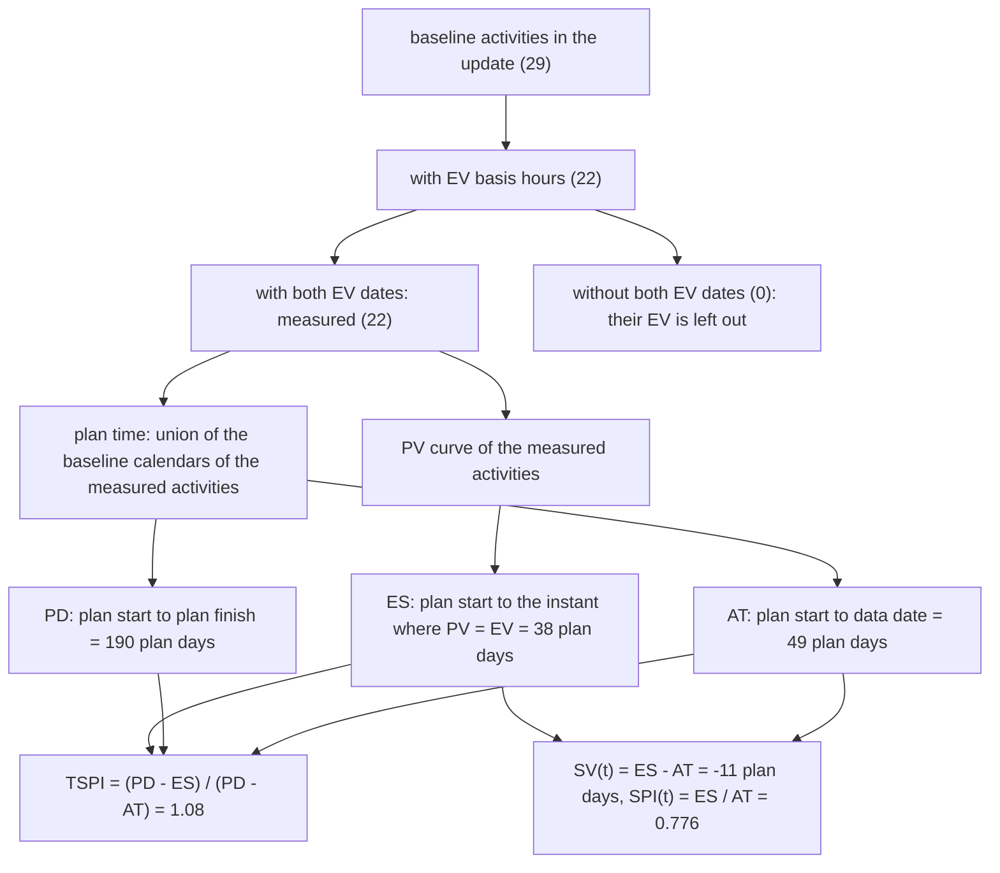

- **Identifier**: `earned_schedule`: `plan_start`, `plan_finish`, `pd_min`, `at_min`, `es_min`,
  `es_date`, `ev_left_out_hr`; cards **Plan reached** and **Planned finish**.
- **Shown**: **Earned value** page, section **Earned Schedule**.
- **Formula**: the measured activities are the baseline activities of the update with EV basis
  hours and both EV dates. The plan start and the plan finish are their first and last EV dates.
  PD is the plan time from the plan start to the plan finish, AT to the data date, and ES to the
  instant at which the PV curve of the measured activities reaches the EV, read to the minute.
  Where the plan asks for no hours over a stretch that holds the EV, ES takes the data date when
  it lies in the stretch, else the nearer end. Once every hour is earned, ES = PD. A duration in
  plan days is its minutes / 60 / the hours per day of the update's project calendar.
- **Funnel**: baseline activities in the update (29) → with EV basis hours (22) → with both EV
  dates (22) → population: measured (22). The demo reads PD 190 plan days, AT 49, ES 38, plan
  reached 2026-10-08 and planned finish 2027-03-08.
- **Target and status**: none. The section prints `Not computed:` and a note without a data
  date, on the planned dates baseline, without a measured activity, or with a data date before
  the plan start.
- **Needs**: a baseline file and a data date.
- **Source**: Lipke, "Schedule is Different" (2003); xerscope for the reading inside a stretch
  without planned hours.
- **Code**: `analysis/evm.py`, `earned_schedule`, `EarnedSchedule`.
- **Deeper reading**: Formulas 3.

### Time variance, time index and to-complete index

- **Identifier**: `sv_min`; `spi_t`, card **SPI(t)**; `gap_calendar_d`, card **Time gap**; `tspi`,
  card **TSPI (planned finish)**.
- **Shown**: **Earned value** page, section **Earned Schedule**.
- **Formula**: SV(t) = ES − AT, in plan time, negative when behind. SPI(t) = ES / AT. Time gap =
  `es_date` − data date, in calendar days; none once ES = PD. TSPI = (PD − ES) / (PD − AT); none
  once ES is at least PD or AT is at least PD.
- **Funnel**: the measured activities of the Earned Schedule (22). The demo reads SV(t) −11 plan
  days, SPI(t) 0.776, time gap −11 cal. d and TSPI 1.08.
- **Target and status**: none.
- **Needs**: a baseline file and a data date.
- **Source**: Lipke: SV(t), SPI(t), and TSPI with the total duration wanted taken as PD.
- **Code**: `analysis/evm.py`, `EarnedSchedule.sv_min`, `spi_t`, `gap_calendar_d`, `tspi`.
- **Deeper reading**: Formulas 3.

### Weekly gains, four-week index and pace

- **Identifier**: `weekly_gains` (`ev_gain_hr`, `pv_gain_hr`, `es_gain_min`, `at_gain_min`,
  `baseline_changed`); `moving_window`; `gain_ratio`; `spi_4w`; cards **SPI (4 weeks)**,
  **Pace (4 weeks)** and **Pace (all updates)**.
- **Shown**: **Earned value** page, section **Earned Schedule**, expander **The weeks of the 4
  weeks' figures**, and **Performance indices by update**.
- **Formula**: a week is a pair of consecutive updates. Its gains are EV, PV, ES and AT of the
  closing update minus those of the opening update, both read on the baseline of the opening
  update. The window holds the weeks from the latest update dated at least 28 days before the data
  date. SPI (4 weeks) = Σ EV gained / Σ PV gained over the window. Pace (4 weeks) = Σ ES gained /
  Σ AT gained over the window. Pace (all updates) is the same ratio over every week that holds the
  four gains.
- **Funnel**: updates (8) → consecutive pairs: weeks (7) → from the update of 2026-09-21: window
  (4). The demo reads 872.8 h / 1,584 h = 0.55, a pace of 0.66 over the window and of 0.78 over
  all updates.
- **Target and status**: none; blank without an update dated 28 days before, with a week without
  a baseline, or when nothing was planned over the window.
- **Needs**: the series, and the baseline of each opening update.
- **Source**: xerscope for the window and the ratio of sums; the pace is Lipke's performance
  factor, ES gained over time elapsed.
- **Code**: `analysis/evm.py`, `weekly_gains`, `moving_window`, `gain_ratio`, `gains_since_first`,
  `spi_by_window`.
- **Deeper reading**: Formulas 3.

### Forecast finishes of the Earned Schedule

- **Identifier**: `finish_at(pace)`; cards **Forecast finish (4 weeks)** and **Forecast finish
  (all updates)**.
- **Shown**: **Earned value** page, section **Earned Schedule**.
- **Formula**: data date + (PD − ES) / pace, in minutes of plan time, with the pace of the
  window or the pace of all updates.
- **Funnel**: the measured activities of the Earned Schedule (22) and the weeks of each pace. The
  demo reads 2027-06-06 and 2027-05-02.
- **Target and status**: none; `n/a` without an ES, once ES = PD, or without a pace above 0.
- **Needs**: a baseline file, a data date and the series.
- **Source**: Lipke, IEAC(t) = AT + (PD − ES) / PF(t).
- **Code**: `analysis/evm.py`, `EarnedSchedule.finish_at`.
- **Deeper reading**: Formulas 3.

### Baseline changes, copied lag and gap by status

- **Identifier**: `baseline_changes` (`gap_old_d`, `gap_new_d`, `absorbed_d`, `bac_old_hr`,
  `bac_new_hr`, `added`, `removed`); `copied_lag`; `schedule_gap_by_status`.
- **Shown**: **Earned value** page, warning under the Earned Schedule figures for the copied lag;
  **Debug** page, block 9, for the two tables.
- **Formula**: `baseline_changes` holds one row per update whose baseline is not the previous
  update's: the time gap on the old and on the new baseline, `absorbed_d` = new − old in calendar
  days, the BAC on each, and the activities added and removed. `copied_lag` counts the measured
  activities in progress that the baseline's own project had started, with an EV finish before the
  baseline's data date, and sums their PV − EV in hours. `schedule_gap_by_status` sums EV − PV
  of the measured activities by status, with the hours ahead and behind.
- **Funnel**: measured activities of the Earned Schedule (22) → in progress (3) → started in the
  baseline's own project (0) → population (0). By status: complete (6), in progress (3), not
  started (13); the demo reads 472 h behind in progress and 320 h behind not started.
- **Target and status**: none.
- **Needs**: a baseline file; the series for the baseline changes.
- **Source**: xerscope; P6 stops moving the planned dates of an activity once it has started
  (Oracle P6 EPPM user guide, Planned Dates).
- **Code**: `analysis/evm.py`, `baseline_changes`, `copied_lag`, `schedule_gap_by_status`.
- **Deeper reading**: Formulas 3.

## Milestone trend

The milestone trend follows the forecast date of each milestone, and of any activity picked, from
one update to the next.

### Forecast of a milestone by update

- **Identifier**: `milestone_trend` (`forecast`); `plotted_trend`.
- **Shown**: **Milestone trend** page, chart, and expander **Data**.
- **Formula**: per milestone and update, the forecast is the Start of a start milestone and the
  Finish of any other activity. The chart blanks the forecast of an update in which the milestone
  is complete with a forecast before that update's data date.
- **Funnel**: activities of every update (30 Activity IDs) → milestone in at least one update
  (4) → population (4); not complete in the latest update (3).
- **Target and status**: none.
- **Needs**: at least two updates for the chart.
- **Source**: xerscope; the chart is a milestone trend analysis.
- **Code**: `analysis/progress.py`, `milestone_codes`, `milestone_trend`, `plotted_trend`.
- **Deeper reading**: Formulas 4.

### Slip of a milestone

- **Identifier**: `slip_wd`, column **Slip since first (wd)**; `last_week_wd`; `deleted`.
- **Shown**: **Milestone trend** page, section **Slippage**, and the last point of each line of
  the chart.
- **Formula**: `slip_wd` = −(working days from the first forecast to the latest forecast),
  rounded to 0.1 wd. `last_week_wd` is the same between the last two updates: 0 with one update,
  blank for a milestone that is not in the latest update. Both are on the milestone's own
  calendar, as the latest update defines it.
- **Funnel**: the milestones of the trend (4). The demo reads −15.0 wd and −2.0 wd for `M9999`,
  and 0.0 wd for `M1000`.
- **Target and status**: none.
- **Needs**: the series.
- **Source**: xerscope.
- **Code**: `analysis/progress.py`, `milestone_slips`.
- **Deeper reading**: Formulas 4.

## PPC and progress

PPC, the percent plan complete, reads the commitments the update W−1 made for the week and their
outcome in the update W. The following diagram shows the commitments of the week from 2026-10-12
to 2026-10-19 of the demo series.

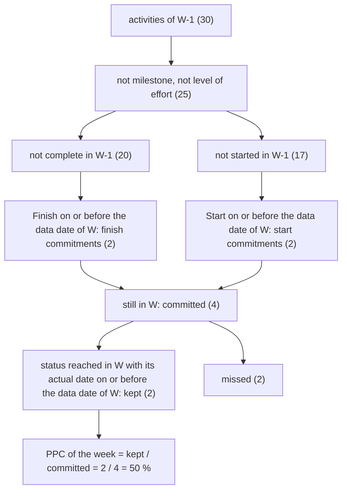

### Commitments and their outcome

- **Identifier**: `committed`: columns `commitment`, `planned_date`, `in_update`, `kept`,
  `actual_date`, `forecast_now`, `status_now`.
- **Shown**: **PPC & progress** page, section **Commitments**, and cards **Starts kept** and
  **Finishes kept**.
- **Formula**: a finish commitment is an activity not complete in W−1 whose Finish in W−1 is on
  or before the data date of W. It is kept when the activity is complete in W with an actual
  finish on or before that data date. A start commitment is the same on not started, Start, and
  actual start. An activity due to start and to finish in the week is two commitments. With
  **Include commitments late at W−1** cleared, only the dates after the data date of W−1 commit.
- **Funnel**: activities of W−1 (30) → not milestone, not level of effort (25) → finish
  commitments (2) and start commitments (2) → still in W (4) → population (4) → counted: kept
  (2). The cards read 1 / 2 and 1 / 2.
- **Target and status**: none.
- **Needs**: two consecutive updates; without a data date in W nothing commits.
- **Source**: Last Planner System for the finish commitments; xerscope for the start commitments.
- **Code**: `analysis/progress.py`, `committed`.
- **Deeper reading**: Formulas 4.

### Percent plan complete

- **Identifier**: `ppc_series`: `ppc_start`, `ppc_finish`, `ppc_week`, with `starts_committed`,
  `starts_kept`, `finishes_committed`, `finishes_kept`, `committed`, `kept`, `note`; cards
  **PPC Start**, **PPC Finish** and **PPC W/W−1**.
- **Shown**: **PPC & progress** page, cards, chart **Percent plan complete by week**, and expander
  **Every week: counts behind the three PPC**.
- **Formula**: PPC Start = 100 × starts kept / starts committed. PPC Finish = 100 × finishes kept
  / finishes committed. PPC W/W−1 = 100 × kept / committed over both kinds. Each is none, not 0,
  when its denominator is 0. An activity deleted in W leaves both terms.
- **Funnel**: commitments of the week (4) → still in W (4) → population (4) → counted: kept (2);
  demo result 50.0% for the three.
- **Target and status**: none; **PPC target (%)**, 80 by default, draws a line on the chart and
  judges nothing.
- **Needs**: two consecutive updates. The note says when the two are more than 7 calendar days
  apart, when W has no data date, when W−1 holds no date on its open work, and when Activity IDs
  changed.
- **Source**: Last Planner System, PPC = completed / planned, for PPC Finish; xerscope for PPC
  Start and PPC W/W−1.
- **Code**: `analysis/progress.py`, `ppc_series`, `percent_kept`.
- **Deeper reading**: Formulas 4.

### Milestones committed and unplanned work

- **Identifier**: `committed_milestones`; `unplanned_work`.
- **Shown**: **PPC & progress** page, sections **Milestones committed** and **Unplanned work**.
- **Formula**: a start milestone commits its Start and a finish milestone its Finish, read as the
  commitments of the other activities; they are listed and stay out of the PPC counts. Unplanned
  work is the activities of W that are not in W−1, not milestone and not level of effort, with an
  actual start on or before the data date of W.
- **Funnel**: activities of W−1 (30) → milestone (4) → due by the data date of W (0);
  activities of W (30) → not in W−1 (0). Both lists are empty in the demo week.
- **Target and status**: none.
- **Needs**: two consecutive updates.
- **Source**: xerscope.
- **Code**: `analysis/progress.py`, `committed_milestones`, `unplanned_work`.
- **Deeper reading**: Formulas 4.

### Lookahead reliability

- **Identifier**: `lookahead_series`: `ta_pct`, `tmr_pct`, with `wwp`, `anticipated`,
  `lookahead`, `lookahead_kept`, `horizon`; cards **TA (n ahead)** and **TMR (n ahead)**.
- **Shown**: **PPC & progress** page, section **Lookahead reliability**, and expander **Every
  week: counts behind TA and TMR**.
- **Formula**: for the week W−1 to W and a horizon of n updates, the earlier plan is the
  commitments the update W−1−n held for dates on or before the data date of W, with their outcome
  in W. TA = 100 × commitments of the week that the earlier plan held / commitments of the week.
  TMR = 100 × commitments of the earlier plan kept in W / commitments of the earlier plan. The
  horizons are 1, 2, 4 and 8 updates.
- **Funnel**: horizon 1 in the demo: commitments of the week (4) → held by the plan of
  2026-10-05 (4), TA 100%; commitments of that plan (7) → kept in W (4), TMR 57.1%.
- **Target and status**: none; a horizon the series does not reach has no row.
- **Needs**: n + 2 updates for the horizon n.
- **Source**: Hamzeh, Ballard and Tommelein (2012), Tasks Anticipated and Tasks Made Ready;
  xerscope for the horizons of 4 and 8 updates and for the commitment as the unit.
- **Code**: `analysis/progress.py`, `planned_for_week`, `lookahead_series`.
- **Deeper reading**: Formulas 4.

### Progress by activity

- **Identifier**: `progress_delta`: `pct_prev`, `pct_now`, `pct_delta`, `labor_budget_hr`,
  `earned_hr_week`, `actual_hr_week`, `new`, `deleted`.
- **Shown**: **PPC & progress** page, section **Progress by task**.
- **Formula**: `pct_delta` = percent complete in W − in W−1, in points, rounded to 0.01; an
  absent activity counts 0. With a baseline, `earned_hr_week` = `ev_labor_hr` × (Performance % in
  W − in W−1) / 100, so the column sums to EV in W − EV in W−1. Without a baseline, or with one
  without hours, `earned_hr_week` = `labor_budget_hr` × `pct_delta` / 100. `actual_hr_week` =
  actual hours in W − in W−1.
- **Funnel**: Activity IDs of W−1 or of W (30) → population (30) → counted: percent complete,
  earned hours or actual hours changed (4).
- **Target and status**: none.
- **Needs**: two consecutive updates; the baseline changes the weights.
- **Source**: xerscope.
- **Code**: `analysis/progress.py`, `progress_delta`, `progressed_tasks`.
- **Deeper reading**: Formulas 4.

### Progress by WBS and project progress

- **Identifier**: `rollup_delta`: `budget_hr`, `earned_hr_week`, `actual_hr_week`,
  `activities_progressed`, `progress_pts`; card **Project progress**.
- **Shown**: **PPC & progress** page, card and section **Progress by WBS**.
- **Formula**: per level-1 WBS element and for the project, the sums of the columns of the
  preceding entry; `activities_progressed` counts `pct_delta` above 0; `progress_pts` = 100 ×
  `earned_hr_week` / `budget_hr`, in points, blank when the budget is 0.
- **Funnel**: Activity IDs of W−1 or of W (30) → grouped by level-1 WBS element (6) → project
  row. The demo reads 230.4 h earned over 8,040 h, +2.87 points, with the baseline.
- **Target and status**: none.
- **Needs**: two consecutive updates.
- **Source**: xerscope.
- **Code**: `analysis/progress.py`, `rollup_delta`, `project_progress`.
- **Deeper reading**: Formulas 4.

### Start and finish variance

- **Identifier**: `date_variances`: `start_var_w1`, `finish_var_w1`, `start_var_w2`,
  `finish_var_w2`; `moved_variances`.
- **Shown**: **PPC & progress** page, section **Start and finish variance**; download **Download
  variances (CSV)**.
- **Formula**: working days from the date in W to the date in W−1, or in W−2, on the activity's
  calendar in W: negative when the date in W is later. The dates are Start and Finish. A missing
  date gives a blank. A start milestone has the start columns only, a finish milestone the finish
  columns only.
- **Funnel**: activities of W (30) → not level of effort (29) → population (29) → counted: one
  of the four variances is not 0 (24).
- **Target and status**: none.
- **Needs**: one earlier update for the W−1 columns, two for the W−2 columns.
- **Source**: xerscope; Oracle's help names no calendar for a variance.
- **Code**: `analysis/progress.py`, `date_variances`, `moved_variances`.
- **Deeper reading**: Formulas 1.1 to 1.4; Formulas 4.

## Overview and Gantt figures

The **Overview** page reads the series; the **Gantt & WBS** page reads one update, its baseline and
a comparison update.

### Forecast finish and its shift

- **Identifier**: `finish_date`, card **Forecast finish**; `finish_shift_wd`;
  `finish_shift_since_first`, card **Shift since first update**.
- **Shown**: **Overview** page, cards, chart **Forecast finish by update** and table **Updates
  loaded**; `xerscope info FOLDER`.
- **Formula**: the forecast finish is the latest Finish of the activities. `finish_shift_wd` =
  −(working days from the forecast finish of the previous update to this one), on the project
  calendar of this update, not rounded. The shift since the first update is the same from the
  first to the latest update, on the project calendar of the latest.
- **Funnel**: activities (30) → population (30) → latest Finish. The demo reads 2027-03-23,
  −2.0 wd against the previous update and −15.0 wd since the first.
- **Target and status**: none.
- **Needs**: an earlier update for the shifts; blank for the first update.
- **Source**: P6, the latest Finish of the activities; xerscope for the shifts and their calendar.
- **Code**: `xer/model.py`, `_project_finish`; `store.py`, `SnapshotStore.summary`;
  `analysis/progress.py`, `finish_shift_since_first`.
- **Deeper reading**: Formulas 4.

### Counts of an update

- **Identifier**: `summary`: `activities`, `complete`, `in_progress`, `not_started`,
  `relationships`, `pct_complete_count`; card **Tasks complete**.
- **Shown**: **Overview** page, card and table **Updates loaded**; `xerscope info FOLDER`.
- **Formula**: counts of activities by status, and of relationships. `pct_complete_count` = 100 ×
  complete / activities, rounded to 0.1.
- **Funnel**: activities (30) → population (30) → counted: complete (7), in progress (4), not
  started (19); relationships (39). The card reads 7 / 30.
- **Target and status**: none.
- **Needs**: one update; the card's delta needs the previous one.
- **Source**: P6 statuses.
- **Code**: `store.py`, `SnapshotStore.summary`.
- **Deeper reading**: Formulas 4.

### Critical activities

- **Identifier**: `critical`, card **Critical tasks**; `is_critical`.
- **Shown**: **Overview** page, card and table **Updates loaded**; `xerscope info FOLDER`.
- **Formula**: number of critical activities, as Table 5 defines critical for the project.
- **Funnel**: activities (30) → not complete (23) → population (23) → counted: total float at
  or below 0 wd (18). The demo project defines critical by total float, without a threshold in
  the file.
- **Target and status**: none.
- **Needs**: one update.
- **Source**: P6, the project's definition of critical activities (`PROJECT.critical_path_type`,
  `critical_drtn_hr_cnt`).
- **Code**: `xer/model.py`, `_task_frame`; `analysis/explain.py`, `critical_definition`.
- **Deeper reading**: Formulas 1.1 to 1.4.

### WBS roll-up

- **Identifier**: `rollup`: `pct_complete`, `weight`, `activities`, `complete`, `critical`,
  `min_float_d`, `start`, `finish`, `bl_finish`, `finish_variance_wd`, `outside_bl`, `budget_hr`,
  `actual_hr`, `remaining_hr`; cards **% complete**, **Forecast finish**, **Labor hours** and
  **Open critical**.
- **Shown**: **Gantt & WBS** page, cards of the node in focus and WBS rows of the chart.
- **Formula**: per WBS node, over every activity under it, and for the project. `pct_complete` =
  Σ `labor_budget_hr` × `pct_complete` / Σ `labor_budget_hr` when the node has budgeted hours,
  else Σ `original_d` × `pct_complete` / Σ `original_d`; `weight` says which. `critical` counts
  the activities critical and not complete. `finish_variance_wd` = −(working days from the latest
  `bl_finish` to the latest Finish of the activities the baseline holds), on the project calendar,
  rounded to 0.1 wd.
- **Funnel**: activities (30) → under the node; project row: population (30) → in the baseline
  for the variance (29). The demo project row reads 20.2% by hours, 2,216 / 8,360 labour hours,
  18 open critical and −15.0 wd.
- **Target and status**: none.
- **Needs**: a baseline for the variance; without one it is blank.
- **Source**: xerscope; the percent complete of a node is not a P6 field.
- **Code**: `analysis/wbs.py`, `rollup`.
- **Deeper reading**: Formulas 4; Formulas 7.

### Float category of the Gantt

- **Identifier**: `category`: `Complete`, `Critical`, `Near critical`, `Normal`.
- **Shown**: **Gantt & WBS** page, bar colour and legend, and the float filter.
- **Formula**: complete first; else critical; else near critical when `total_float_d` is at or
  below 10 wd of the activity's calendar (`Settings.near_critical_float_days`); else normal.
- **Funnel**: activities (30) → population (30) → counted: complete (7), critical (18), near
  critical (0), normal (5).
- **Target and status**: none.
- **Needs**: one update.
- **Source**: xerscope for the near-critical limit.
- **Code**: `viz/gantt.py`, `categorise`.
- **Deeper reading**: Formulas 1.1 to 1.4.

### Finish shift of an activity

- **Identifier**: `shift_wd` of a Gantt row; `activity_finish_shift`, delta **since first** of the
  activity card.
- **Shown**: **Gantt & WBS** page, column of the chart and of **Table view**, and the card of the
  activity picked.
- **Formula**: `shift_wd` = −(working days from the Finish in the comparison update to the Finish
  in the update shown), on the activity's calendar in the update shown. That card gives the
  same from the first to the last forecast finish of the activity, on its calendar in the last
  update that holds it. A WBS row carries the `finish_variance_wd` of its node.
- **Funnel**: activities of the update shown (30) → in the comparison update (30) → counted:
  shift not 0 (21) against the previous update.
- **Target and status**: none.
- **Needs**: a comparison update; blank without one.
- **Source**: xerscope.
- **Code**: `viz/gantt.py`, `_compare_columns`; `analysis/progress.py`, `activity_finish_shift`.
- **Deeper reading**: Formulas 1.1 to 1.4.

## Ask

The Ask field of the **Gantt & WBS** page turns a sentence into filters of the page. It computes no
number of its own: every count it prints is the size of a set the page's filters can build.

### Funnel of a sentence

- **Identifier**: `query.apply`; `funnel_line`.
- **Shown**: **Gantt & WBS** page, field **Ask the schedule**: the caption under the answer, and
  expander **Population, step by step**.
- **Formula**: the rows of the page after its own filters, cut by one step per filter the
  sentence holds: WBS branch, status, float category, activity code, resource, milestones, level
  of effort, words of the name, and the clauses with `not` and `or`. The count is the number of
  rows left. A comparison in days is made in hours, the number of days × the activity's
  `hours_per_day`.
- **Funnel**: for `critical not started` on the demo: rows of the page (30) → status Not started
  [ask] (19) → float Critical [ask] (14) → population (14). The page prints
  `30 → status Not started 19 → float Critical 14`.
- **Target and status**: none. A sentence of which nothing is understood keeps no row.
- **Needs**: one update; the word `late` reads the baseline of the page, and the planned finish
  where the baseline has none.
- **Source**: xerscope; `late` follows P6-12 and the constraint words follow P6-02 and P6-03.
- **Code**: `analysis/ask/funnel.py`, `apply`, `mask`; `analysis/query.py`.
- **Deeper reading**: Architecture, Ask.

### Answer sentence

- **Identifier**: `query.answer`.
- **Shown**: **Gantt & WBS** page, banner under **Ask the schedule**.
- **Formula**: the count of rows of the funnel, the worst total float among them and the latest
  Finish. The worst float is that of the row with the lowest `total_float_hr_cnt`, printed in wd
  of that activity's calendar.
- **Funnel**: the population of the funnel of the sentence.
- **Target and status**: none.
- **Needs**: one update.
- **Source**: xerscope.
- **Code**: `analysis/ask/answer.py`, `answer`.
- **Deeper reading**: Architecture, Ask.

## Other numbers on the pages

The following numbers are shown by the app and have their formula elsewhere.

- **Audit** page, cards **Standard**, **Standard status**, **Audit** and **Audit status**: the
  result of one check as its standard sets it, and with the parameters changed on the page. The
  formula is that of the check.
- **Schedule health** page, section **Trend across updates**: the value of one check on every
  update (`checks.health_history`). The formula is that of the check.
- **Schedule health** page, expander **Compare with a P6 Check Schedule report**: the counts typed
  from a report against `found` and `total` of each check (`checks.compare_counts`).
- **Export for Power BI** page: the table `dim_snapshot` holds the counts of each update, and the
  tables `fact_activity`, `fact_relationship` and `fact_assignment` hold the columns of the
  activities, relationships and assignments as the model reads them, without any other calculation
  (`export.export_tables`).
- **Debug** page: the scheduling options, the costs in the file, the earned value settings of the
  WBS, the planned value labour units by assignment (`evm.pv_labor_check`) and the comparison with
  a P6 Activities export (`evm.pv_p6_comparison`, also `xerscope pv-compare`). These two
  comparisons are diagnostics that no figure of the other pages reads; Formulas 3 and the
  docstrings of `analysis/evm.py` hold their definitions.
